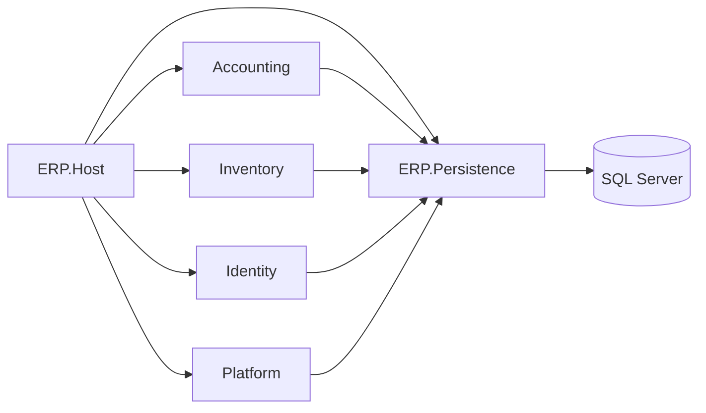

# AAA.ERP — Modular monolith backend

**.NET 8** ERP backend for **accounting** and **inventory**, deployed as a **single API process** against **one SQL Server database**. The codebase is a **modular monolith**: module boundaries are enforced at compile time via architecture tests.

🔗 **Frontend demo:** [ERP Frontend System](https://erp-frontend-system.netlify.app)  
🔗 **Frontend repo:** [Accounting Management System](https://github.com/AhmedYounis20/aaa-dashboard)

## Solution overview

| Area | Location |
|------|----------|
| **Host** (HTTP, Swagger, migrations) | [`ERP.Host/`](ERP.Host/) |
| **Shared persistence kernel** | [`ERP.Persistence/`](ERP.Persistence/) |
| **Modules** | [`Modules/Accounting`](Modules/Accounting/), [`Inventory`](Modules/Inventory/), [`Identity`](Modules/Identity/), [`Platform`](Modules/Platform/) |
| **Building blocks** | [`BuildingBlocks/`](BuildingBlocks/) |
| **Architecture docs** | [`docs/architecture/MODULAR_MONOLITH.md`](docs/architecture/MODULAR_MONOLITH.md) |
| **Solution diagram** | [`docs/architecture/SOLUTION_DIAGRAM.md`](docs/architecture/SOLUTION_DIAGRAM.md) |



## Tech stack

- **.NET 8**, **Entity Framework Core**, **SQL Server**
- **MediatR** (single write path), **FluentValidation**
- **Serilog** structured logging, **Swagger** (grouped by module)
- **JWT** authentication (Identity module + host wiring)

## Prerequisites

- [.NET 8 SDK](https://dotnet.microsoft.com/download)
- SQL Server (connection string in `ERP.Host/appsettings.json`)

## Build and test

```bash
dotnet restore AAA.ERP.sln
dotnet build AAA.ERP.sln -c Release
dotnet test AAA.ERP.sln -c Release
```

Architecture and integration tests:

```bash
dotnet test Tests/ERP.Architecture.Tests/ERP.Architecture.Tests.csproj -c Release
dotnet test Tests/ERP.IntegrationTests/ERP.IntegrationTests.csproj -c Release
```

## Run locally

```bash
dotnet run --project ERP.Host/ERP.Host.csproj
```

Swagger UI is available at `/swagger` when running in Development.

## EF migrations

Migrations are owned by the host project:

```bash
dotnet ef migrations add <MigrationName> \
  --project ERP.Host/ERP.Host.csproj \
  --startup-project ERP.Host/ERP.Host.csproj

dotnet ef database update \
  --project ERP.Host/ERP.Host.csproj \
  --startup-project ERP.Host/ERP.Host.csproj
```

## Module READMEs

- [Accounting](Modules/Accounting/README.md)
- [Inventory](Modules/Inventory/README.md)
- [Identity](Modules/Identity/README.md)
- [Platform](Modules/Platform/README.md)
- [ERP.Persistence](ERP.Persistence/README.md)

New features: follow [MODULE_TEMPLATE.md](docs/architecture/MODULE_TEMPLATE.md).

## Contributing

See [docs/architecture/CONTRIBUTING.md](docs/architecture/CONTRIBUTING.md) for layer rules, PR checklist, and CI expectations.
