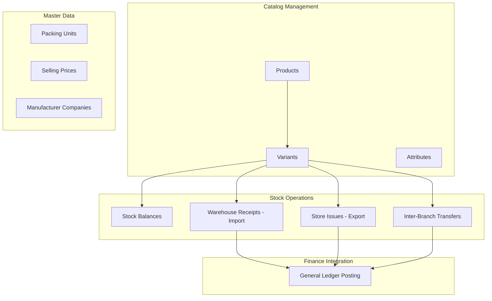
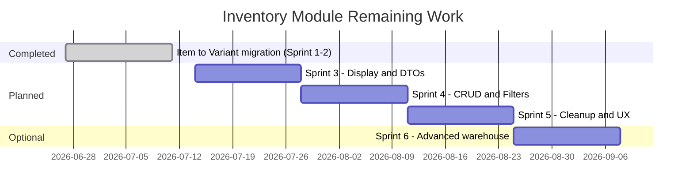

# Inventory Module — Progress Report & Remaining Work Plan

| Document | |
|----------|---|
| **Prepared by** | Business Analysis |
| **Date** | 11 July 2026 |
| **Version** | 1.0 |
| **Audience** | Product owners, development team, QA |
| **Scope** | Inventory module — backend (`AAA.ERP/Modules/Inventory`) and frontend (`aaa-dashboard`) |

---

## 1. Executive Summary

The Inventory module is undergoing a **catalog migration** from the legacy **Item** model to **Product + Variant**. The backend migration is **functionally complete** for all stock-moving operations. The frontend has **recently been updated** for warehouse receipts, store issues, and inter-branch transfers.

**Overall module maturity: ~75% complete** for production-ready daily operations.

| Area | Status |
|------|--------|
| Catalog (Products, Variants, Attributes) | ✅ Operational |
| Master data (Packing Units, Selling Prices, Manufacturers) | ✅ Operational |
| Warehouse receipts & store issues | ✅ Migrated (minor polish remaining) |
| Inter-branch transfers | ✅ Migrated (minor polish remaining) |
| Stock balance visibility | ⚠️ Partial — works but relies on client-side joins |
| Legacy pages (Items, Colors, Sizes) | ❌ Orphaned — must be removed |
| Reporting, filters, pagination | ⚠️ Not fully implemented |
| Transaction edit/delete (UI) | ❌ Not wired |

**Key business outcome:** Users can manage products/variants and record inventory movements on variants. Remaining work is mostly **UX polish**, **API enrichment**, **cleanup of dead code**, and **operational features** (filters, edit/delete, pagination).

---

## 2. Business Context

### 2.1 Why the migration happened

| Legacy model | New model |
|--------------|-----------|
| Flat **Item** tree (parent/child SKUs) | **Product** (catalog template) + **Variant** (sellable/stockable SKU) |
| Colors & Sizes as separate lookup tables | **Attribute definitions & values** (flexible dimensions) |
| All operations keyed by `ItemId` | All stock operations keyed by `VariantId` |

The backend dropped legacy tables in July 2026 (`RemoveLegacyItemTables`, `RemoveColorsAndSizesTables`). Any UI still calling the old `items` API will fail.

### 2.2 What the module must support (business capabilities)

---

## 3. Module Page Inventory

### 3.1 Active pages (in sidebar)

| # | Page | Route | Menu | Business purpose |
|---|------|-------|------|------------------|
| 1 | **Products** | `/products` | Inventory | Define product templates, attributes, default packing/pricing |
| 2 | **Variants** | `/variants` | Inventory | Manage sellable SKUs generated from products |
| 3 | **Inventory Transactions** | `/inventory-transactions` | Inventory | Stock balances, warehouse receipts, store issues |
| 4 | **Inventory Transfers** | `/inventory/transfers` | Inventory | Move stock between branches (conditional/direct) |
| 5 | **Attributes** | `/Attributes` | Inventory | Define product dimensions (e.g. color, size, material) |
| 6 | **Packing Units** | `/packingUnits` | Settings | Units of measure (box, piece, carton) |
| 7 | **Selling Prices** | `/sellingPrices` | Settings | Price list definitions |
| 8 | **Manufacturer Companies** | `/manufacturerCompanies` | Settings | Supplier/manufacturer master data |

### 3.2 Orphaned / legacy pages (not in sidebar)

| Page | Folder | Status | Business impact |
|------|--------|--------|-----------------|
| **Items** | `Items/` | ❌ Broken | Backend removed; causes confusion if discovered |
| **Colors** | `Colors/` | ❌ Broken | Replaced by Attributes; tables dropped |
| **Sizes** | `Sizes/` | ❌ Broken | Replaced by Attributes; tables dropped |
| **Stock Balance** (standalone) | `StockBalance/` | 🗄️ Commented out | Functionality moved into Inventory Transactions tab |

---

## 4. Page-by-Page Status

### Legend

| Symbol | Meaning |
|--------|---------|
| ✅ | Complete — fit for production use |
| ⚠️ | Partial — works with known gaps |
| ❌ | Broken or not started |
| 🗄️ | Deprecated / superseded |

---

### 4.1 Catalog

#### Products — ✅ Complete (minor gaps)

| Aspect | Status | Notes |
|--------|--------|-------|
| List & CRUD | ✅ | Tree catalog with rich form |
| Variant generation | ✅ | Combination builder on product create |
| Backend API | ✅ | `api/Products` |
| Pagination (UI) | ⚠️ | Loads full list; backend has paginated endpoint unused |
| API drift | ⚠️ | Some client methods reference removed backend routes |

**Remaining:** Wire paginated product list for large catalogs; remove stale API methods.

---

#### Variants — ⚠️ Mostly complete

| Aspect | Status | Notes |
|--------|--------|-------|
| Paginated list | ✅ | Server-side pagination in grid |
| View / Edit / Delete | ✅ | Full variant form with packing units, prices, attachments |
| Standalone create (UI) | ⚠️ | Variants are normally created via Product workflow; standalone POST may be limited on API |
| Search API | ⚠️ | Frontend search URL may not match backend (`/search` vs `/search-variants`) |

**Remaining:** Align search endpoint; confirm standalone variant creation path for edge cases.

---

#### Attributes — ✅ Complete

| Aspect | Status | Notes |
|--------|--------|-------|
| Definitions CRUD | ✅ | Replaces legacy Colors/Sizes concept |
| Values per attribute | ✅ | Used by product variant combination builder |
| Backend API | ✅ | `api/AttributeDefinitions`, `api/AttributeValues` |

**Remaining:** Remove legacy Colors/Sizes pages from codebase.

---

### 4.2 Master data (Settings menu)

| Page | Status | Notes |
|------|--------|-------|
| **Packing Units** | ✅ | Used by variants and all transaction lines |
| **Selling Prices** | ✅ | Referenced by variant/product pricing |
| **Manufacturer Companies** | ✅ | Linked to variants/products |

No significant remaining work on these pages.

---

### 4.3 Stock operations

#### Inventory Transactions — ⚠️ Mostly complete (recently migrated)

**Tabs:**

| Tab | Business name | Status | Notes |
|-----|---------------|--------|-------|
| Tab 0 | Stock Balance | ⚠️ | Displays balances; variant names joined client-side when API omits them |
| Tab 1 | Warehouse Receipts | ✅ | Create & view import transactions on variants |
| Tab 2 | Store Issues | ✅ | Create & view export transactions on variants |

| Capability | Status | Notes |
|------------|--------|-------|
| Create receipt/issue | ✅ | Sends `variantId` to backend |
| View transaction detail | ⚠️ | Line items show variant ID; names missing until DTO enrichment |
| Edit transaction | ❌ | UI stub (TODO) — backend supports PUT |
| Delete transaction | ❌ | UI stub (TODO) — backend supports DELETE |
| List pagination / filters | ❌ | Loads all records |
| Status chips on cards | ⚠️ | Backend has no status field; UI shows defaults |

**Remaining:** Edit/delete flows, server pagination, enriched line-item DTOs, optional status workflow.

---

#### Inventory Transfers — ⚠️ Mostly complete (recently migrated)

| Capability | Status | Notes |
|------------|--------|-------|
| Create transfer | ✅ | Variant lines with packing unit & quantity |
| Variant picker modal | ✅ | Shows branch stock from `StockBalances` API |
| Approve / Reject (conditional) | ✅ | Fixed status detection; reject passes approver ID |
| Transfer list | ⚠️ | Shows branch names when API returns them; raw IDs as fallback |
| View transfer detail | ❌ | No detail view — list only |
| Edit transfer | ❌ | Not implemented |
| Server-side filters | ❌ | Status filter works; branch/date filters not wired |

**Remaining:** Detail view, edit before approval, enriched list DTOs, pagination.

---

#### Stock Balance (embedded) — ⚠️ Partial

The standalone `StockBalancePage` is commented out. Stock visibility lives in **Inventory Transactions → Stock Balance tab**.

| Capability | Status | Notes |
|------------|--------|-------|
| View all balances | ✅ | |
| Search by variant | ✅ | Client-side |
| Filter by branch | ✅ | Client-side |
| Low/zero stock alerts | ⚠️ | UI chips exist; backend `LowStock`/`ZeroStock` filters not wired |
| Adjust stock manually | ❌ | No dedicated UI (API exists) |
| Link to variant detail | ❌ | Not implemented |

**Remaining:** Backend filter support, optional manual adjustment screen, variant drill-down links.

---

### 4.4 Legacy pages — ❌ Must be removed

| Page | Risk | Recommendation |
|------|------|----------------|
| Items | High — misleads users & developers | Delete folder + `ItemsApi.ts` |
| Colors | Medium — dead code | Delete folder + `ColorsApi.ts` |
| Sizes | Medium — dead code | Delete folder + `SizesApi.ts` |
| StockBalance (standalone) | Low — already commented | Delete or archive |

---

## 5. Backend Progress Summary

### 5.1 Completed (production-ready)

| Domain | API base | Capabilities |
|--------|----------|--------------|
| Products | `api/Products` | Tree CRUD, next code, children |
| Variants | `api/Variants` | List, paginated, search, by product, update, delete |
| Attributes | `api/AttributeDefinitions`, `api/AttributeValues` | Full CRUD + lookups |
| Packing Units | `api/PackingUnits` | Full CRUD |
| Selling Prices | `api/SellingPrices` | Full CRUD |
| Manufacturers | `api/ManufacturerCompanies` | Full CRUD |
| Stock Balances | `api/StockBalances` | CRUD, by variant/branch, current balance, quantity update |
| Import Transactions | `api/ImportTransactions` | CRUD, transaction number, GL posting |
| Export Transactions | `api/ExportTransactions` | CRUD, transaction number, GL posting |
| Transfers | `api/InventoryTransfer` | CRUD, approve, reject, by status, GL posting |

All stock-moving entities use **`VariantId`** — no `ItemId` remains in the database.

### 5.2 Partial / gaps

| Gap | Business impact | Priority |
|-----|-----------------|----------|
| Read DTOs lack variant/product names on line items | Users see GUIDs or blank names in detail views | **High** |
| Paginated endpoints return raw entities (not read DTOs) | Inconsistent data shape for list screens | Medium |
| Filter DTOs defined but not applied in queries | Search/filter features cannot be built on frontend | Medium |
| Validation messages still say "Item" for VariantId | Confusing error messages for users | Low |
| No FluentValidation on transfer create/update | Errors may be less clear | Low |
| Transfer item `Notes` field in command but not in entity | Silent data loss if UI adds notes | Low |

---

## 6. Recent Delivery (Sprint 1–2 — July 2026)

The following was completed in the Item → Variant migration sprint:

### Frontend

- [x] All transaction/transfer interfaces: `itemId` → `variantId`
- [x] `StockBalanceApi` aligned to `byVariant*` endpoints
- [x] Import & Export forms use `VariantsApi`
- [x] Stock balance tab uses variants (with Product column)
- [x] Transfer form & variant picker modal with live branch stock
- [x] Transfer approve/reject fixes (status enum, approver ID)
- [x] Transfer create payload sanitized for backend contract

### Not in scope of that sprint (still open)

- [ ] Backend read DTO enrichment
- [ ] Transaction edit/delete UI
- [ ] Paginated list views
- [ ] Legacy code removal
- [ ] i18n key updates (`Item` → `Variant`)

---

## 7. Remaining Work — Prioritized Backlog

### 7.1 Priority matrix

| Priority | Theme | Business value |
|----------|-------|----------------|
| **P0** | Legacy cleanup | Prevents broken pages and developer confusion |
| **P1** | Read DTO enrichment | Users see meaningful names in all transaction views |
| **P1** | Transaction edit/delete | Daily operations require correcting mistakes |
| **P2** | Pagination & filters | Required as data volume grows |
| **P2** | Transfer detail view | Approvers need to see lines before approve/reject |
| **P3** | UX polish | Better autocomplete, i18n, variant drill-down |
| **P3** | Manual stock adjustment UI | Warehouse managers adjusting counts outside receipts/issues |

---

### 7.2 Detailed remaining items by page

| Page / Area | Remaining work | Effort | Depends on |
|-------------|----------------|--------|------------|
| **All legacy pages** | Delete Items, Colors, Sizes folders & APIs | S | — |
| **Inventory Transactions** | Edit/delete receipt & issue | M | — |
| **Inventory Transactions** | Enriched line items in detail view | M | Backend DTOs |
| **Inventory Transactions** | Paginated transaction lists | M | Backend filters |
| **Inventory Transactions** | Stock tab: low-stock filter from API | S | Backend filters |
| **Inventory Transfers** | Transfer detail modal/page | M | Backend DTOs |
| **Inventory Transfers** | Edit pending transfer | M | — |
| **Inventory Transfers** | Branch/date filters | S | Backend filters |
| **Products** | Paginated product list | S | — |
| **Variants** | Fix search endpoint alignment | S | — |
| **Stock Balance** | Manual adjustment screen (optional) | M | — |
| **Backend** | `*ItemReadDto` with variant/product/packing names | M | — |
| **Backend** | Wire filter DTOs in paginated queries | M | — |
| **Backend** | Validation message cleanup | S | — |
| **i18n** | Replace Item terminology in locales | S | — |

*Effort: S = small (1–3 days), M = medium (3–8 days), L = large (8+ days)*

---

## 8. Recommended Delivery Plan

### Sprint 3 — Display & Data Quality (2 weeks)

**Goal:** Users see complete, readable information in transaction and transfer screens.

| # | Deliverable | Pages affected |
|---|-------------|----------------|
| 3.1 | Backend: enriched line-item read DTOs for transactions, transfers, stock balances | All stock ops |
| 3.2 | Frontend: consume enriched DTOs; remove client-side name joins | Inventory Transactions, Transfers |
| 3.3 | Transfer list: branch names, line count, status labels | Inventory Transfers |

**Exit criteria:** Detail and list views show variant code, name, and product name without extra API calls.

---

### Sprint 4 — Operations Completeness (2 weeks)

**Goal:** Full CRUD and findability for daily warehouse work.

| # | Deliverable | Pages affected |
|---|-------------|----------------|
| 4.1 | Wire import/export edit and delete in forms | Inventory Transactions |
| 4.2 | Backend: implement filter DTOs in paginated queries | Backend |
| 4.3 | Frontend: paginated lists with variant/branch/date filters | Inventory Transactions, Transfers |
| 4.4 | Paginated endpoints return read DTOs consistently | Backend |
| 4.5 | Backend validation message cleanup (Item → Variant) | Backend |

**Exit criteria:** Users can correct or void transactions; lists scale beyond hundreds of records.

---

### Sprint 5 — Cleanup & UX (2 weeks)

**Goal:** Production polish and technical debt removal.

| # | Deliverable | Pages affected |
|---|-------------|----------------|
| 5.1 | Delete legacy Items, Colors, Sizes pages and APIs | Codebase cleanup |
| 5.2 | Delete commented StockBalance standalone page | Codebase cleanup |
| 5.3 | i18n: Variant terminology across inventory locales | All inventory pages |
| 5.4 | Products paginated list | Products |
| 5.5 | Transfer detail view before approve/reject | Inventory Transfers |
| 5.6 | Optional: Product → Variant two-step picker | Transfers, Transactions |
| 5.7 | Regression test pass + update module README | Documentation |

**Exit criteria:** No dead inventory code; consistent terminology; module ready for UAT sign-off.

---

### Sprint 6 (optional) — Advanced warehouse features

| # | Deliverable | Business case |
|---|-------------|-----------------|
| 6.1 | Manual stock adjustment screen | Cycle counts, corrections without fake receipts |
| 6.2 | Low/zero stock dashboard or alerts | Procurement planning |
| 6.3 | Stock balance export (Excel/CSV) | Reporting |
| 6.4 | Transaction approval workflow (if required by policy) | Internal control |

---

## 9. Timeline Overview

**Estimated time to UAT-ready:** 6 weeks (Sprints 3–5)  
**Estimated time to full feature parity + polish:** 10 weeks (including Sprint 6)

---

## 10. Risks & Dependencies

| Risk | Likelihood | Impact | Mitigation |
|------|------------|--------|------------|
| Users discover legacy Items page via bookmarks | Low | High — 404 errors | Delete code in Sprint 5; communicate migration |
| Large variant catalog slows transaction forms | Medium | Medium — slow autocomplete | Sprint 4 pagination; search-as-you-type |
| Missing variant names in API blocks training | Medium | High — user confusion | Prioritize Sprint 3 DTO enrichment |
| Transfer approved without seeing line detail | Medium | Medium — operational errors | Sprint 5 detail view |
| GL posting failures on transaction create | Low | High | Existing integration tests; QA on create flows |

**Cross-module dependencies:**

- **Accounting:** Branches, chart of accounts (parties), financial periods — required for all transactions
- **Identity:** User ID needed for transfer rejection (`approverId`)

---

## 11. Success Criteria for Module Sign-Off

The Inventory module can be considered **UAT-complete** when:

1. ✅ All sidebar pages function without calling removed APIs
2. ✅ Warehouse receipt, store issue, and transfer create flows work end-to-end on variants
3. ⬜ Users can edit and delete draft/posted transactions (per business rules)
4. ⬜ All list and detail screens show variant and product names
5. ⬜ Legacy Items/Colors/Sizes code removed from repository
6. ⬜ Paginated lists perform acceptably with 1,000+ variants and 500+ transactions
7. ⬜ QA regression pass on inventory integration tests (backend) and manual UAT scripts (frontend)

---

## 12. Appendix

### A. API file inventory (`aaa-dashboard/src/Apis/Inventory/`)

| File | Status |
|------|--------|
| `ProductsApi.ts` | Active |
| `VariantsApi.ts` | Active |
| `ImportTransactionsApi.ts` | ✅ Migrated |
| `ExportTransactionsApi.ts` | ✅ Migrated |
| `InventoryTransferApi.ts` | ✅ Migrated |
| `StockBalanceApi.ts` | ✅ Migrated |
| `AttributeDefinitionsApi.ts` | Active |
| `AttributeValuesApi.ts` | Active |
| `PackingUnitsApi.ts` | Active |
| `SellingPricesApi.ts` | Active |
| `ManufacturerCompaniesApi.ts` | Active |
| `ItemsApi.ts` | ❌ Remove |
| `ColorsApi.ts` | ❌ Remove |
| `SizesApi.ts` | ❌ Remove |

### B. Backend controllers (`Modules/Inventory/Inventory.Api/Controllers/`)

| Controller | Route |
|------------|-------|
| ProductsController | `api/Products` |
| VariantsController | `api/Variants` |
| AttributeDefinitionsController | `api/AttributeDefinitions` |
| AttributeValuesController | `api/AttributeValues` |
| PackingUnitsController | `api/PackingUnits` |
| SellingPricesController | `api/SellingPrices` |
| ManufacturerCompaniesController | `api/ManufacturerCompanies` |
| StockBalancesController | `api/StockBalances` |
| ImportTransactionsController | `api/ImportTransactions` |
| ExportTransactionsController | `api/ExportTransactions` |
| InventoryTransferController | `api/InventoryTransfer` |

### C. Related documentation

- [Inventory Module README](../Modules/Inventory/README.md)
- [CQRS migration reports](./cqrs/) — historical backend migration phases

---

*End of report*
