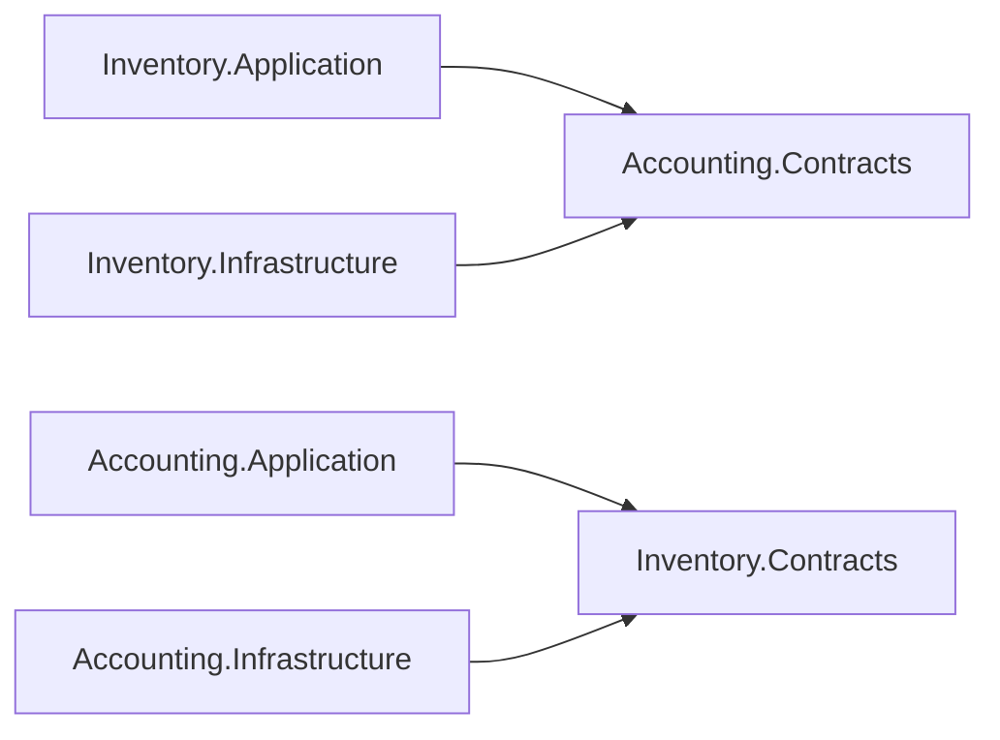
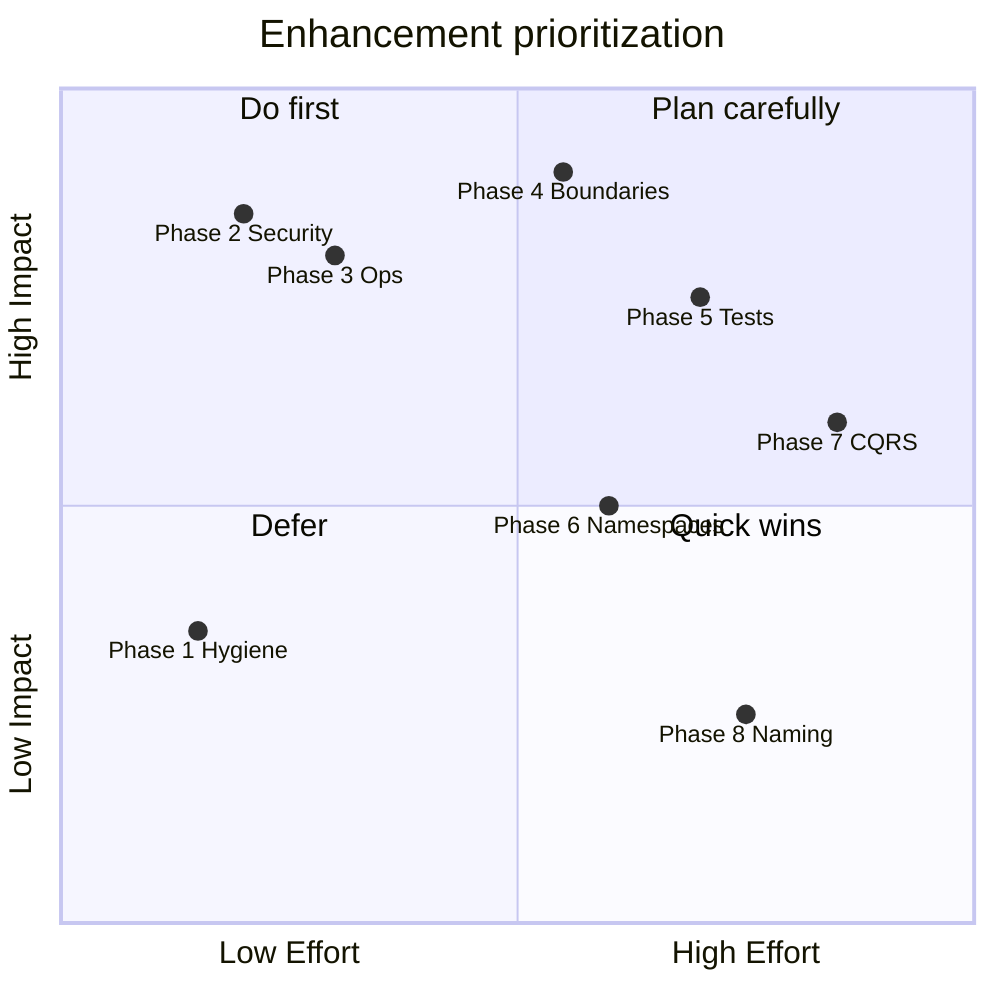

# Architecture Enhancement Plan — AAA.ERP

> **Status:** **Active** — baseline July 2026 (post M4 / Phase 7 / [FINAL_SIGNOFF](./FINAL_SIGNOFF.md))  
> **Audience:** Solution architects, tech leads, senior developers  
> **Canonical migration history:** [MODULAR_MONOLITH.md](./MODULAR_MONOLITH.md) §16 (Phases 0–7 complete)

This plan starts **from the current codebase state**. Prior work (modular monolith migration, M4 hardening, post-M4 quality, Phases 5–7) is **complete** and recorded in sign-off documents. All phases below are **new forward work**.

---

## Table of contents

1. [Baseline assessment](#1-baseline-assessment)
2. [Executive summary](#2-executive-summary)
3. [Phase 1 — Repository hygiene](#phase-1--repository-hygiene)
4. [Phase 2 — Host & security hardening](#phase-2--host--security-hardening)
5. [Phase 3 — Operational readiness](#phase-3--operational-readiness)
6. [Phase 4 — Cross-module boundary hardening](#phase-4--cross-module-boundary-hardening)
7. [Phase 5 — Testing expansion](#phase-5--testing-expansion)
8. [Phase 6 — Namespace normalization](#phase-6--namespace-normalization)
9. [Phase 7 — Application layer standardization](#phase-7--application-layer-standardization)
10. [Phase 8 — Naming debt cleanup](#phase-8--naming-debt-cleanup)
11. [Phase 9 — Optional structural polish](#phase-9--optional-structural-polish)
12. [Priority matrix](#priority-matrix)
13. [Governance](#governance)
14. [Success metrics](#success-metrics)
15. [Related documents](#related-documents)

---

## 1. Baseline assessment

**As of July 2026:**

| Dimension | Score | Notes |
|-----------|-------|-------|
| Module boundaries | B+ | 56 arch tests passing; some cross-module Domain/Application refs remain |
| Folder / project structure | B | Modular layout achieved; legacy empty folders on disk |
| Namespaces | C+ | Dual `Shared.*` vs `ERP.BuildingBlocks.*` / module namespaces |
| Application patterns | B | MediatR for writes, services for reads — pragmatic hybrid |
| Test strategy | B− | Strong arch + integration; thin per-module unit coverage |
| Documentation | A | MODULAR_MONOLITH, sign-offs, module READMEs, CI |
| Security / ops | B− | Dev endpoints exposed; schema migration runbook pending execution |

**Solution topology (actual):**

```
AAA.ERP/
├── ERP.Host/                         # Composition root (~42 controllers, migrations)
├── ERP.Persistence/                  # EF kernel (ApplicationDbContext, base services)
├── BuildingBlocks/
│   ├── ERP.BuildingBlocks.Domain/
│   ├── ERP.BuildingBlocks.Application/
│   └── ERP.BuildingBlocks.Persistence/
├── Modules/
│   ├── Accounting/  (Domain · Application · Infrastructure · Contracts)
│   ├── Inventory/   (Domain · Application · Infrastructure)
│   ├── Identity/    (Domain · Application · Infrastructure)
│   └── Platform/    (Audit · Caching · Localization · Infrastructure)
├── Shared/                           # Thin cross-cutting (6 files)
└── Tests/ (Architecture · Unit · Integration · Smoke)
```

**Build / test baseline:**

| Metric | Value |
|--------|-------|
| Source files (`.cs`, excl. obj/bin) | ~874 |
| Solution projects | 26 |
| Architecture tests | 56 passed, 0 skipped |
| Full test suite | 120 passed (Release) |
| `dotnet build AAA.ERP.sln -c Release` | Green |

**What already works well (do not regress):**

- Compile-time module boundaries via `ERP.Architecture.Tests`
- `Accounting.Contracts` + `IAccountingIntegrationService` for inventory → GL
- `ITransactionCoordinator` for cross-module ACID
- Single MediatR registration in `ERP.Host/Utilities/WebBuilderExtensions.cs`
- Module-scoped repositories (God `IUnitOfWork` retired)
- SQL schema separation migration (`SeparateModuleSchemas`) + ADR-006/007
- CI pipeline (`.github/workflows/ci.yml`)

---

## 2. Executive summary

AAA.ERP is **production-viable** as a modular monolith. Remaining work is **consistency, boundary tightening, hygiene, and operational hardening** — not a re-architecture.

**Recommended execution order:**

1. **Phase 1** — Repository hygiene (immediate, low risk)
2. **Phase 2** — Host & security (`DbworkController`)
3. **Phase 3** — Operational readiness (schema migration on staging)
4. **Phase 4** — Cross-module boundaries (`Inventory.Contracts` + arch tests)
5. **Phase 5** — Testing expansion (parallel with Phase 4)
6. **Phase 6** — Namespace normalization
7. **Phase 7** — Application layer standardization (incremental)
8. **Phase 8 / 9** — Backlog (naming debt, optional structural polish)

---

## Phase 1 — Repository hygiene

**Duration:** 1–2 days · **Risk:** Low · **Status:** **Complete** — [PHASE1_SIGNOFF.md](./PHASE1_SIGNOFF.md)

**Goal:** Remove confusion from retired structure; align docs with disk layout.

| ID | Task | Acceptance criteria |
|----|------|---------------------|
| 1.1 | Delete empty legacy folders | No 0-file scaffolds: `ERP.Application/`, `ERP.Domain/`, `ERP.Infrastracture/`, `ERP.API/`, `Stack.API/`, `Modules/Account/`, `Modules/MainAPI/`, `Modules/Shared/`, `Modules/Inventory/Inventory.API/`, `Modules/Identity/Identity.API/` |
| 1.2 | Clean `obj/` / `bin/` artifacts under retired paths if present | Clean `git status` after removal |
| 1.3 | Align [SOLUTION_DIAGRAM.md](./SOLUTION_DIAGRAM.md) with actual layout | No `src/` folder unless physically introduced |
| 1.4 | Nest `ERP.Shared` under `BuildingBlocks` solution folder in `AAA.ERP.sln` | Solution Explorer matches physical grouping |
| 1.5 | Update [CONTRIBUTING.md](./CONTRIBUTING.md) “current structure” section | Reflects modular layout (not horizontal layers) |

**Exit criteria:** New developers see only active projects; contributing guide matches reality.

---

## Phase 2 — Host & security hardening

**Duration:** 3–5 days · **Risk:** Low–medium · **Status:** **Complete** — [PHASE2_SIGNOFF.md](./PHASE2_SIGNOFF.md)

**Goal:** Close production security gaps in the composition root.

| ID | Task | Acceptance criteria |
|----|------|---------------------|
| 2.1 | Guard `DbworkController` | `#if DEBUG`, environment check, or `[Authorize(Roles = "Admin")]` — not publicly callable in Production |
| 2.2 | Remove `ERP.Host` → `Identity.Domain` direct project reference | Host depends on `Identity.Application` / `Identity.Infrastructure` only |
| 2.3 | Add arch test: `Host_should_not_reference_module_Domain` | Fails if Host imports `*.Domain` types (exceptions documented in ADR if any) |
| 2.4 | Audit other controllers for missing `[Authorize]` on sensitive endpoints | Documented in PR / security checklist |

**Exit criteria:** No unauthenticated data import/export in Production; Host dependency graph thinned.

---

## Phase 3 — Operational readiness

**Duration:** 1 week (operator-dependent) · **Risk:** Medium · **Status:** **Engineering complete** — [PHASE3_SIGNOFF.md](./PHASE3_SIGNOFF.md) (staging/prod execution **operator pending**)

**Goal:** Staging/production parity with dev schema and quality gates.

| ID | Task | Acceptance criteria |
|----|------|---------------------|
| 3.1 | Execute `SeparateModuleSchemas` on **staging** | Per schema runbook in [PHASE5_SIGNOFF.md](./PHASE5_SIGNOFF.md) |
| 3.2 | Execute on **production** after staging sign-off | Operator checklist complete |
| 3.3 | Run [SMOKE_TEST_CHECKLIST.md](./SMOKE_TEST_CHECKLIST.md) on staging | All critical paths green |
| 3.4 | Enable nullable warnings as errors for **new/touched** files in CI | Incremental `WarningsAsErrors` or analyzer rule in PR template |
| 3.5 | Verify Serilog production config | Per [PRODUCTION_LOGGING.md](../ops/PRODUCTION_LOGGING.md) |

**Exit criteria:** Staging DB on module schemas; smoke tests pass; logging verified.

---

## Phase 4 — Cross-module boundary hardening

**Duration:** 2–3 weeks · **Risk:** Medium · **Status:** **Complete** — [PHASE4_SIGNOFF.md](./PHASE4_SIGNOFF.md)

**Goal:** Enforce Contracts-only integration; eliminate bidirectional Application-layer coupling.

**Current gaps (baseline):**

| From | References | Concern |
|------|------------|---------|
| `Inventory.Infrastructure` | `Accounting.Domain`, `Accounting.Application` | EF cross-nav (ADR-007) + Domain DTOs |
| `Inventory.Application` | `Accounting.Domain` | `TransactionNumberDto`, `EntryNumberDto` in service interfaces |
| `Accounting.Application` | `Inventory.Application` | Bidirectional Application coupling |
| `Accounting.Infrastructure` | `Inventory.Domain`, `Inventory.Application` | `FinancialPeriodUsageQueries`, `FinancialPeriodService` |

**Missing:** `Inventory.Contracts` (planned in MODULAR_MONOLITH §4.2, not yet created).

| ID | Task | Acceptance criteria |
|----|------|---------------------|
| 4.1 | Create `Modules/Inventory/Inventory.Contracts/` | Project in solution; references BuildingBlocks only |
| 4.2 | Define `IInventoryQueryService` / financial-period usage ports on Contracts | Accounting consumes via Contracts, not `Inventory.Application` |
| 4.3 | Move `TransactionNumberDto`, `EntryNumberDto` to `Accounting.Contracts` (or BuildingBlocks) | `Inventory.Application` has no `Accounting.Domain` reference |
| 4.4 | Remove `Accounting.Application` → `Inventory.Application` reference | Replaced by Contracts query port |
| 4.5 | Document ADR-008: EF `*DbConfig` may reference foreign Domain types | Scoped arch-test exception for `*.Infrastructure.Persistence.*` only |
| 4.6 | Add arch tests | `*_Application_should_not_reference_other_module_Domain`; cross-module only via `*.Contracts` |

**Target dependency:**



**Exit criteria:** No Application→foreign-Domain references; `Inventory.Contracts` in solution; ≥6 new arch tests.

---

## Phase 5 — Testing expansion

**Duration:** Ongoing (parallel with Phase 4) · **Risk:** Low · **Status:** **Complete** — [PHASE5_SIGNOFF.md](./PHASE5_SIGNOFF.md)

**Goal:** Module-owned tests around critical ERP workflows.

| ID | Task | Acceptance criteria |
|----|------|---------------------|
| 5.1 | Split `ERP.UnitTests` → `Accounting.UnitTests`, `Inventory.UnitTests` | Per-module test projects in `Tests/` |
| 5.2 | Handler unit tests: inventory receipt/issue → GL posting | Cover idempotency (`SourceDocumentId`) |
| 5.3 | Handler unit tests: inventory transfer approve/reject → GL | Uses `ITransactionCoordinator` mocks |
| 5.4 | Expand `ERP.IntegrationTests` cross-module flows | Target ≥20 integration tests |
| 5.5 | Contract tests for `IAccountingIntegrationService` | Boundary verification without full DB |
| 5.6 | CI: Coverlet coverage report on PR | Published artifact or comment |

**Exit criteria:** ≥200 total tests; critical GL/inventory paths covered; per-module unit projects exist.

---

## Phase 6 — Namespace normalization

**Duration:** 1–2 weeks · **Risk:** Medium · **Status:** **Complete** — [PHASE6_SIGNOFF.md](./PHASE6_SIGNOFF.md)

**Goal:** One namespace per physical project; retire `Shared.*` drift.

**Baseline:** Physical projects use `ERP.BuildingBlocks.*`, but many types still use `Shared.*` namespaces (`Shared.BaseEntities`, `Shared.DTOs`, `Shared.Behaviors`, etc.). `ERP.Persistence/` folder uses `ERP.Infrastructure.*` namespaces.

| ID | Task | Acceptance criteria |
|----|------|---------------------|
| 6.1 | ADR-009: namespace mapping policy | `ERP.BuildingBlocks.*` for kernel; `{Module}.*` for modules; `Shared.*` deprecated |
| 6.2 | Migrate `Shared.BaseEntities` → `ERP.BuildingBlocks.Domain.Entities` | Arch test: no new `Shared.*` types |
| 6.3 | Migrate `Shared.DTOs`, `Shared.Responses`, `Shared.Behaviors` | Extend `NamespaceDebtTests` |
| 6.4 | Rename `Controllers/Account/` → `Controllers/Accounting/` | API routes unchanged (`[Route]` attributes) |
| 6.5 | (Optional) Align `ERP.Infrastructure.*` → `ERP.Persistence.*` namespaces | Cosmetic; last in phase |

**Out of scope for Phase 6 (see Phase 8):** `SubLeadger`, `ComandValidators` — API-stable renames.

**Exit criteria:** No new `Shared.*` namespaces; arch tests guard regression.

---

## Phase 7 — Application layer standardization

**Duration:** 3–4 weeks (incremental) · **Risk:** Medium–high · **Status:** **Complete** (core) — [PHASE7_SIGNOFF.md](./PHASE7_SIGNOFF.md)

**Goal:** Reduce dual-path confusion; clarify CQRS conventions.

**Baseline pattern:**

| Operation | Current path |
|-----------|--------------|
| Create / Update | `ISender.Send(command)` → MediatR handler |
| Read / Delete / Paginate | `IService.Read*()` / `Delete()` |

| ID | Task | Options / notes |
|----|------|-----------------|
| 7.1 | Document hybrid CQRS in [MODULE_TEMPLATE.md](./MODULE_TEMPLATE.md) | Official: “Commands → MediatR; Queries → Service” **or** migrate reads to queries |
| 7.2 | Move `Accounting.Domain.Commands.*` → `Accounting.Application.Commands.*` | One aggregate cluster per sprint |
| 7.3 | Move `*.Domain.OutputDtos` → `*.Application.Dtos` | Reduces cross-module Domain DTO imports |
| 7.4 | (Optional) MediatR queries for high-traffic reads | `IQuery<T>` / `*QueryHandler` for Products, Variants, ChartOfAccounts |
| 7.5 | Thin services to persistence + mapping | Handlers own business rules for new features |

**Exit criteria:** MODULE_TEMPLATE documents the chosen pattern; new features follow it; Domain commands/DTOs migrated for ≥1 module cluster.

---

## Phase 8 — Naming debt cleanup

**Duration:** Backlog · **Risk:** High if breaking · **Status:** **Complete** (shims) — [PHASE8_SIGNOFF.md](./PHASE8_SIGNOFF.md)

**Goal:** Fix longstanding typos with compatibility shims where needed.

| Item | Scope | Approach |
|------|-------|----------|
| `SubLeadger` → `SubLedger` | Types, folders, validators, DB | New types + `[Obsolete]` aliases; DB migration only if columns renamed |
| `ComandValidators` → `CommandValidators` | Folders/namespaces | File move; no wire impact |
| `DbworkController` → `DbWorkController` | Class name | Fix casing (may overlap Phase 2.1) |

**Exit criteria:** No `Compined` type names (already done); `SubLeadger` tracked with deprecation timeline.

---

## Phase 9 — Optional structural polish

**Duration:** Backlog · **Risk:** Low–medium · **Status:** **Complete** (selected items) — [PHASE9_SIGNOFF.md](./PHASE9_SIGNOFF.md)

| ID | Task | Notes |
|----|------|-------|
| 9.1 | Move solution under `src/` + `tests/` | Large diff; team preference |
| 9.2 | Retire `ERP.Shared` project | Merge 6 files into BuildingBlocks or Platform |
| 9.3 | Extract `ERP.BuildingBlocks.Infrastructure` | `CustomExceptionHandler`, filters |
| 9.4 | Feature folders in Host | `ERP.Host/Features/Accounting/...` vs flat `Controllers/` |
| 9.5 | Move EF migrations from Host to `ERP.Persistence` | Ownership clarity |

---

## Priority matrix



---

## Governance

| Practice | Current | Target |
|----------|---------|--------|
| Arch test review per PR | Documented (MODULAR_MONOLITH §4.3.x) | Mandatory in PR template |
| Module owner review | [MODULE_OWNERS.md](./MODULE_OWNERS.md) | Enforce via CODEOWNERS |
| New feature placement | [MODULE_TEMPLATE.md](./MODULE_TEMPLATE.md) | No new business logic in `Shared/` or horizontal `ERP.Persistence` |
| ADRs for boundary exceptions | ADR-006, ADR-007 | ADR per cross-module EF navigation (ADR-008 in Phase 4) |
| API stability | Legacy routes preserved | Document deprecation policy before Phase 8 renames |

---

## Success metrics

**6-month targets (from July 2026 baseline):**

| Metric | Baseline | Target |
|--------|----------|--------|
| Architecture tests | 56 | ≥70 → **72** |
| Cross-module Domain refs (excl. scoped DbConfig) | Several | 0 Application-layer; DbConfig per ADR-008 |
| `Shared.*` namespaces (new code) | ~25 legacy types | 0 new; migrated to `ERP.BuildingBlocks.*` |
| Total tests | 120 | ≥200 → **163** (critical paths covered) |
| Nullable warnings in CI | ~20+ per build | 0 in touched files; gate for new code |
| Legacy empty folders | ~10 | 0 |
| Production security: open dev endpoints | `DbworkController` | Guarded or removed |

---

## Related documents

| Document | Purpose |
|----------|---------|
| [MODULAR_MONOLITH.md](./MODULAR_MONOLITH.md) | Historical migration plan (Phases 0–7 complete) |
| [FINAL_SIGNOFF.md](./FINAL_SIGNOFF.md) | Pre-production closure sign-off |
| [TECHNICAL_DEBT.md](../../TECHNICAL_DEBT.md) | Resolved debt tracker |
| [MODULE_TEMPLATE.md](./MODULE_TEMPLATE.md) | How to add features inside a module |
| [CONTRIBUTING.md](./CONTRIBUTING.md) | PR checklist and layer rules |
| [SOLUTION_DIAGRAM.md](./SOLUTION_DIAGRAM.md) | Dependency diagram |

---

## Phase status tracker

| Phase | Name | Status | Sign-off |
|-------|------|--------|----------|
| 1 | Repository hygiene | **Complete** | [PHASE1_SIGNOFF.md](./PHASE1_SIGNOFF.md) |
| 2 | Host & security hardening | **Complete** | [PHASE2_SIGNOFF.md](./PHASE2_SIGNOFF.md) |
| 3 | Operational readiness | **Engineering complete** (ops pending) | [PHASE3_SIGNOFF.md](./PHASE3_SIGNOFF.md) |
| 4 | Cross-module boundary hardening | **Complete** (deferred closed) | [PHASE4_SIGNOFF.md](./PHASE4_SIGNOFF.md) |
| 5 | Testing expansion | **Complete** | [PHASE5_SIGNOFF.md](./PHASE5_SIGNOFF.md) |
| 6 | Namespace normalization | **Complete** | [PHASE6_SIGNOFF.md](./PHASE6_SIGNOFF.md) |
| 7 | Application layer standardization | **Complete** (core) | [PHASE7_SIGNOFF.md](./PHASE7_SIGNOFF.md) |
| 8 | Naming debt cleanup | **Complete** (SubLedger v2.0) | [PHASE8_SIGNOFF.md](./PHASE8_SIGNOFF.md) |
| 9 | Optional structural polish | **Complete** (selected) | [PHASE9_SIGNOFF.md](./PHASE9_SIGNOFF.md) |

_Update this table as phases complete; add `PHASE1_SIGNOFF.md`, etc., when exiting each phase._
