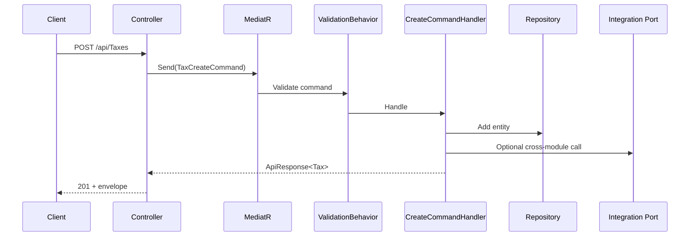
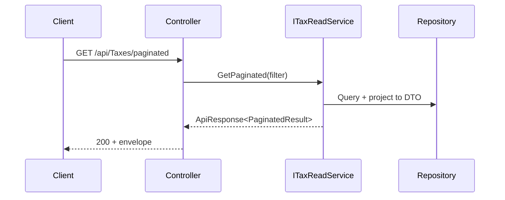
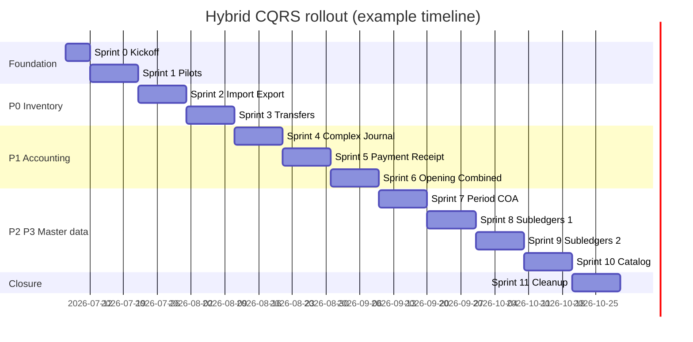

# Hybrid CQRS Plan — MediatR for Actions, Read Services for GET

> **Status:** **Implemented** — July 2026 (Sprints 0–12 complete)  
> **Audience:** All backend developers, solution architects, tech leads  
> **Supersedes:** Informal split in [MODULE_TEMPLATE.md](./MODULE_TEMPLATE.md) § hybrid CQRS (this plan is the authoritative reference)  
> **Related:** [ADR-004](./adr/004-mediatr-single-write-path.md) · [MEDIATR_REGISTRATION.md](./MEDIATR_REGISTRATION.md) · [MODULE_TEMPLATE.md](./MODULE_TEMPLATE.md)

---

## Table of contents

1. [One-page summary](#1-one-page-summary)
2. [Why hybrid CQRS for this ERP](#2-why-hybrid-cqrs-for-this-erp)
3. [The golden rule — HTTP verb to application path](#3-the-golden-rule--http-verb-to-application-path)
4. [Architecture overview](#4-architecture-overview)
5. [Project layout & naming conventions](#5-project-layout--naming-conventions)
6. [Write side — MediatR commands (actions)](#6-write-side--mediatr-commands-actions)
7. [Read side — query services (GET endpoints)](#7-read-side--query-services-get-endpoints)
8. [Controller design](#8-controller-design)
9. [Special endpoint patterns](#9-special-endpoint-patterns)
10. [Cross-module & transactional flows](#10-cross-module--transactional-flows)
11. [MediatR & DI registration](#11-mediatr--di-registration)
12. [Testing strategy](#12-testing-strategy)
13. [Migration from current codebase](#13-migration-from-current-codebase)
14. [Complete aggregate inventory](#14-complete-aggregate-inventory)
15. [Architecture enforcement](#15-architecture-enforcement)
16. [Anti-patterns & FAQ](#16-anti-patterns--faq)
17. [Phased rollout — sprints & tasks](#17-phased-rollout--sprints--tasks)
    - [17.0 Planning assumptions](#170-planning-assumptions)
    - [17.1 Master timeline](#171-master-timeline)
    - [17.2 Standard aggregate migration recipe](#172-standard-aggregate-migration-recipe)
    - [17.3 Sprint 0 — Kickoff](#173-sprint-0--kickoff-1-week)
    - [17.4 Sprint 1 — Pilots & tooling](#174-sprint-1--pilots--tooling-2-weeks)
    - [17.5 Sprint 2 — Import & export transactions](#175-sprint-2--import--export-transactions-2-weeks)
    - [17.6 Sprint 3 — Inventory transfers](#176-sprint-3--inventory-transfers-2-weeks)
    - [17.7 Sprints 4–6 — GL entries](#177-sprints-46--gl-entries-6-weeks)
    - [17.8 Sprints 7–10 — Master data waves](#178-sprints-710--master-data-waves-8-weeks)
    - [17.9 Sprint 11 — Cleanup & closure](#179-sprint-11--cleanup--closure-2-weeks)
    - [17.11 Sprint 12 — Base query services](#1711-sprint-12--base-query-services)
    - [17.10 Milestones & checkpoints](#1710-milestones--checkpoints)
18. [Success metrics & sign-off](#18-success-metrics--sign-off)
19. [Related documents](#19-related-documents)

---

## 1. One-page summary

AAA.ERP uses **hybrid CQRS**:

| HTTP / intent | Application path | Inject in controller |
|---------------|------------------|----------------------|
| **POST, PUT, PATCH** — create / update state | `ISender.Send(command)` → **Command handler** | `ISender` only |
| **DELETE** — remove state (with business rules) | `ISender.Send(deleteCommand)` → **Command handler** | `ISender` only |
| **GET** — list, detail, paginate, search, lookup | **`I{Aggregate}Queries`** (extends `ISettingQueries` / `ITreeSettingQueries` when applicable) | Query service only |
| **GET** — dropdown lookups (shared pattern) | **`IBaseQueryService<TEntity, TLookupDto>`** | Read service only |

**Controller dependencies (target):**

```csharp
public class TaxesController(ISender sender, ITaxQueries queries) : ControllerBase
```

**Never in controller:**

```csharp
// ❌ Do not inject write services
public TaxesController(ITaxService service, ISender sender)  // ITaxService has Create/Update

// ❌ Do not call service writes from controller
await _service.Create(command);
await _service.Update(command);
await _service.Delete(id);   // use DeleteTaxCommand via ISender instead
```

**Mental model:**

```
         ┌──────────────────────────────────────────┐
         │              API Controller               │
         │   POST/PUT/DELETE → ISender               │
         │   GET             → I*Queries               │
         └──────────────────────────────────────────┘
                    │                    │
         ┌──────────▼─────────┐   ┌──────▼──────────────┐
         │  Command Handlers   │   │   Read Services      │
         │  (writes, rules,    │   │   (DTOs, pagination, │
         │   orchestration)    │   │    lookups, search)  │
         └──────────┬─────────┘   └──────┬──────────────┘
                    │                    │
         ┌──────────▼────────────────────▼──────────────┐
         │           Repositories + Integration Ports    │
         └──────────────────────────────────────────────┘
```

---

## 2. Why hybrid CQRS for this ERP

### 2.1 Business context

AAA.ERP combines **accounting (GL)** and **inventory (stock)** in one ACID database. Writes often:

- Validate financial period is open
- Assign document numbers
- Update stock balances
- Post GL entries via `IAccountingIntegrationService`

Reads are often **heavier than writes**: paginated lists with filters, DTO graphs for edit screens, tree hierarchies (chart of accounts), lookup dropdowns.

### 2.2 Why not full MediatR (queries for everything)?

| Factor | Full MediatR queries | Hybrid (this plan) |
|--------|---------------------|-------------------|
| Simple GET lists | Extra handler + query type per endpoint | Direct read service — less boilerplate |
| ERP read complexity | Many specialized read methods | Read service interface documents capabilities |
| Team velocity | High ceremony for CRUD screens | Fast for master data |
| Write consistency | Same | Same — MediatR + ValidationBehavior |

**Decision:** MediatR for **all state-changing actions**. Read/query services for **all GET endpoints**. MediatR queries are **optional later** for hot paths only (Products, Variants).

### 2.3 Why not services-only (no MediatR)?

- Loses centralized **FluentValidation pipeline** (`ValidationBehavior`)
- No single write entry point for cross-cutting concerns (logging, future outbox)
- ADR-004 already commits to MediatR for writes

---

## 3. The golden rule — HTTP verb to application path

| HTTP | Controller action | Application call | Handler / service |
|------|-------------------|------------------|-------------------|
| `POST` | Create | `await sender.Send(createCommand)` | `{Entity}CreateCommandHandler` |
| `PUT` | Update | `await sender.Send(updateCommand)` | `{Entity}UpdateCommandHandler` |
| `PATCH` | Partial update | `await sender.Send(patchCommand)` | `{Entity}PatchCommandHandler` |
| `DELETE` | Delete | `await sender.Send(deleteCommand)` | `{Entity}DeleteCommandHandler` |
| `GET` | List all | `await reads.GetAll()` | `I{Entity}ReadService` |
| `GET` | Paginated list | `await reads.GetPaginated(filter, ct)` | `I{Entity}ReadService` |
| `GET {id}` | Detail | `await reads.GetById(id)` | `I{Entity}ReadService` |
| `GET lookups` | Dropdown | `await lookups.GetLookUps()` | `IBaseQueryService<,>` |
| `GET search` | Name search | `await reads.Search(query)` | `I{Entity}ReadService` |
| `GET {custom}` | Next number, tree code, etc. | `await reads.{Method}(...)` | `I{Entity}ReadService` |

**Bulk operations:**

| HTTP | Path |
|------|------|
| `POST bulk` | `sender.Send(new BulkCreate{Entity}Command(...))` |
| `PUT bulk` | `sender.Send(new BulkUpdate{Entity}Command(...))` |
| `DELETE bulk` | `sender.Send(new BulkDelete{Entity}Command(...))` |

---

## 4. Architecture overview

### 4.1 Layer responsibilities

| Layer | Project | Responsibility |
|-------|---------|----------------|
| **API** | `{Module}.Api` | HTTP, routing, auth, map body/query → command or read call |
| **Application — commands** | `{Module}.Application` | Commands, validators, handler interfaces, read service interfaces |
| **Application — reads** | `{Module}.Application` | Read DTOs, filters, `I*ReadService`, `I*Queries` |
| **Domain** | `{Module}.Domain` | Entities, domain rules (no MediatR, no EF) |
| **Infrastructure — handlers** | `{Module}.Infrastructure` | Command handlers (write orchestration) |
| **Infrastructure — reads** | `{Module}.Infrastructure` | Read service implementations, repositories |
| **Contracts** | `{Module}.Contracts` | Cross-module DTOs + integration ports |
| **Host** | `ERP.Host` | Composition root, MediatR registration |

### 4.2 Dependency flow

```
{Module}.Api
  → {Module}.Application  (commands + read interfaces + DTOs)
  → ERP.BuildingBlocks.Api / Application
  → NEVER {Module}.Infrastructure
  → NEVER {Module}.Domain (ideally only via Application DTOs/commands)

{Module}.Infrastructure
  → {Module}.Application
  → {Module}.Domain
  → OtherModule.Contracts (not other Domain)
```

### 4.3 Request lifecycle diagrams

**Write (POST):**



**Read (GET paginated):**



---

## 5. Project layout & naming conventions

### 5.1 Folder structure (per aggregate)

```
Modules/{Module}/
├── {Module}.Application/
│   ├── Commands/{Aggregate}/
│   │   ├── TaxCreateCommand.cs
│   │   ├── TaxUpdateCommand.cs
│   │   └── TaxDeleteCommand.cs
│   ├── Validators/{Aggregate}/
│   │   ├── TaxCreateValidator.cs
│   │   └── TaxUpdateValidator.cs
│   ├── Services/
│   │   ├── ITaxReadService.cs          ← GET endpoints
│   │   └── Queries/                    ← shared lookup abstractions
│   │       └── IBaseQueryService.cs
│   ├── Dtos/
│   │   ├── TaxReadDto.cs
│   │   ├── Filters/TaxFilterDto.cs
│   │   └── Lookups/SubLeadgerLookupDto.cs
│   └── Repositories/
│       └── ITaxRepository.cs
│
├── {Module}.Infrastructure/
│   ├── Handlers/{Aggregate}/
│   │   ├── TaxCreateCommandHandler.cs
│   │   ├── TaxUpdateCommandHandler.cs
│   │   └── TaxDeleteCommandHandler.cs
│   ├── Services/
│   │   ├── TaxReadService.cs           ← implements ITaxReadService
│   │   └── Queries/BaseQueryService.cs
│   └── Repositories/
│       └── TaxRepository.cs
│
└── {Module}.Api/
    └── Controllers/
        └── TaxesController.cs
```

### 5.2 Naming conventions

| Artifact | Pattern | Example |
|----------|---------|---------|
| Create command | `{Entity}CreateCommand` | `TaxCreateCommand` |
| Update command | `{Entity}UpdateCommand` | `TaxUpdateCommand` |
| Delete command | `{Entity}DeleteCommand` | `TaxDeleteCommand` |
| Create handler | `{Entity}CreateCommandHandler` | `TaxCreateCommandHandler` |
| Read service interface | `I{Entity}ReadService` | `ITaxReadService` |
| Read service impl | `{Entity}ReadService` | `TaxReadService` |
| Complex reads interface | `I{Entity}Queries` | `IImportTransactionQueries` |
| Read DTO | `{Entity}ReadDto` | `TaxReadDto` |
| Filter DTO | `{Entity}FilterDto` | `TaxFilterDto` |
| Lookup DTO | `{Entity}LookupDto` or shared `LookupDto` | `SubLeadgerLookupDto` |

### 5.3 Legacy naming (transitional)

During migration, existing `I{Entity}Service` interfaces may still contain `Create`/`Update`/`ReadAll`. **Target end state:**

- Split into `I{Entity}ReadService` (reads only) — registered in DI
- Remove write methods from service; logic lives in handlers
- `[Obsolete]` alias on old interface until all callers migrated

---

## 6. Write side — MediatR commands (actions)

### 6.1 Command definition

Commands live in `{Module}.Application/Commands/{Aggregate}/`:

```csharp
// TaxCreateCommand.cs
namespace Accounting.Application.Commands.Taxes;

public class TaxCreateCommand : BaseSubLeadgerCreateCommand<Tax>
{
    public decimal Rate { get; set; }
}
```

Commands implement `ICommand<ApiResponse<TEntity>>` via base classes in `ERP.BuildingBlocks.Application.Commands`.

### 6.2 Validator

```csharp
// TaxCreateValidator.cs
namespace Accounting.Application.Validators.Taxes;

public class TaxCreateValidator : AbstractValidator<TaxCreateCommand>
{
    public TaxCreateValidator()
    {
        RuleFor(x => x.Name).NotEmpty().MaximumLength(200);
        RuleFor(x => x.Rate).GreaterThanOrEqualTo(0);
    }
}
```

Validators are discovered by `AddValidatorsFromAssembly` in Host. `ValidationBehavior` runs **before** the handler.

### 6.3 Command handler (target — owns business logic)

```csharp
// TaxCreateCommandHandler.cs
namespace Accounting.Infrastructure.Handlers.Taxes;

public class TaxCreateCommandHandler(
    ITaxRepository repository,
    ILogger<TaxCreateCommandHandler> logger)
    : ICommandHandler<TaxCreateCommand, ApiResponse<Tax>>
{
    public async Task<ApiResponse<Tax>> Handle(
        TaxCreateCommand request,
        CancellationToken cancellationToken)
    {
        // Business rules here (not in controller, not in read service)
        var entity = request.Adapt<Tax>();
        await repository.Add(entity);

        return new ApiResponse<Tax>
        {
            IsSuccess = true,
            StatusCode = HttpStatusCode.Created,
            Result = entity
        };
    }
}
```

**Handler responsibilities:**

- Map command → entity / domain operations
- Enforce business rules not expressible in FluentValidation
- Call repositories
- Call `*.Contracts` integration ports
- Wrap result in `ApiResponse<T>`
- Use `ITransactionCoordinator` when multiple aggregates or modules must commit atomically

**Handler must NOT:**

- Be a one-line `return service.Create(request)` pass-through (transitional only)
- Contain HTTP concerns
- Return raw entities without `ApiResponse`

### 6.4 Delete command (required for governed aggregates)

```csharp
// TaxDeleteCommand.cs — simple master data
public record TaxDeleteCommand(Guid Id) : ICommand<ApiResponse<Tax>>;

// TaxDeleteCommandHandler.cs
public class TaxDeleteCommandHandler(ITaxRepository repository)
    : ICommandHandler<TaxDeleteCommand, ApiResponse<Tax>>
{
    public async Task<ApiResponse<Tax>> Handle(TaxDeleteCommand request, CancellationToken ct)
    {
        var entity = await repository.Get(request.Id);
        if (entity is null)
            return ApiResponse.NotFound<Tax>();

        // Business rule: cannot delete if referenced
        await repository.Delete(entity);
        return ApiResponse.Ok(entity);
    }
}
```

### 6.5 Handler registration

Handlers are **not** registered manually. MediatR discovers them from Infrastructure assemblies in Host (`WebBuilderExtensions.AddProjectUtilities`). See [MEDIATR_REGISTRATION.md](./MEDIATR_REGISTRATION.md).

---

## 7. Read side — query services (GET endpoints)

### 7.0 Base query service hierarchy (post–Sprint 12)

**Standard naming:** `I{Aggregate}Queries` / `{Aggregate}Queries` — `I*ReadService` is retired.

| Contract | Location | Implementation | Use for |
|----------|----------|----------------|---------|
| `ISettingQueries<TEntity>` | `ERP.BuildingBlocks.Application` | `BaseSettingQueries<,,>` in `ERP.Persistence` | Flat settings: Currency, Role, Color, PackingUnit, … |
| `ITreeSettingQueries<TEntity>` | `ERP.BuildingBlocks.Application` | `BaseTreeSettingQueries<,,>` in `ERP.Persistence` | Tree settings: CostCenter, Tax, Customer, Product, … |
| `IBaseQueryService<TEntity, TDto>` | `Accounting.Application` (today) | `BaseQueryService` | Dropdown `GET .../lookups` only |
| `I{Aggregate}Queries` (custom) | Module Application | Dedicated `{Aggregate}Queries` | ChartOfAccount, FinancialPeriod, Variant, StockBalance, entries |

**Setting queries contract:**

```csharp
// ERP.BuildingBlocks.Application/Services/Queries/ISettingQueries.cs
public interface ISettingQueries<TEntity> where TEntity : BaseSettingEntity
{
    Task<ApiResponse<IEnumerable<TEntity>>> GetAll();
    Task<ApiResponse<PaginatedResult<TEntity>>> GetPaginated(SettingFilterDto filter, CancellationToken ct = default);
    Task<ApiResponse<TEntity>> GetById(Guid id);
    Task<ApiResponse<IEnumerable<TEntity>>> SearchByName(string query);
}
```

**Per-aggregate interface** extends base + custom reads:

```csharp
public interface IColorQueries : ISettingQueries<Color>
{
    Task<ApiResponse<string>> GetNextCode();
}

// Infrastructure — transitional delegation to IColorService
public class ColorQueries(IColorService service)
    : BaseSettingQueries<Color, ColorCreateCommand, ColorUpdateCommand>(service),
      IColorQueries
{
    public Task<ApiResponse<string>> GetNextCode() => service.GetNextCodeAsync();
}
```

**Tree sub-ledger example:**

```csharp
public interface ICustomerQueries : ITreeSettingQueries<Customer>
{
    Task<ApiResponse<CustomerCreateCommand>> GetNextSubLedgers(Guid? parentId);
}
```

**Rules:**

- Base implementations **delegate to `I*Service` read methods** until handlers own all business logic (post-M4 backlog).
- Controllers inject `I{Aggregate}Queries` only — never `I{Aggregate}Service`.
- Custom-filter paginated endpoints accept derived `*FilterDto` types (`SubLeadgerFilterDto`, `CostCenterFilterDto`) — they inherit `SettingFilterDto`.

### 7.1 Read service interface

Define **one interface per aggregate** with all GET capabilities:

```csharp
// ITaxReadService.cs
namespace Accounting.Application.Services;

public interface ITaxReadService
{
    Task<ApiResponse<IEnumerable<TaxReadDto>>> GetAll();
    Task<ApiResponse<PaginatedResult<TaxReadDto>>> GetPaginated(
        TaxFilterDto filter,
        CancellationToken cancellationToken = default);
    Task<ApiResponse<TaxReadDto>> GetById(Guid id);
    Task<ApiResponse<IEnumerable<TaxReadDto>>> SearchByName(string query);
}
```

**Rules:**

- Interface in **Application**; implementation in **Infrastructure**
- Methods return `ApiResponse<T>` — same envelope as commands
- Return **DTOs**, not domain entities, for list/detail endpoints exposed to API
- No `Create`, `Update`, or `Delete` on read service

### 7.2 Read service implementation

```csharp
// TaxReadService.cs
namespace Accounting.Infrastructure.Services;

public class TaxReadService(ITaxRepository repository) : ITaxReadService
{
    public async Task<ApiResponse<IEnumerable<TaxReadDto>>> GetAll()
    {
        var entities = await repository.Get();
        return ApiResponse.Ok(entities.Adapt<IEnumerable<TaxReadDto>>());
    }

    public async Task<ApiResponse<PaginatedResult<TaxReadDto>>> GetPaginated(
        TaxFilterDto filter,
        CancellationToken cancellationToken = default)
    {
        var result = await repository.GetPaginated(
            filter.PageNumber,
            filter.PageSize,
            BuildFilter(filter),
            orderBy: e => e.CreatedAt,
            filter.SortDescending,
            cancellationToken);

        return ApiResponse.Ok(result.Adapt<PaginatedResult<TaxReadDto>>());
    }

    public async Task<ApiResponse<TaxReadDto>> GetById(Guid id)
    {
        var entity = await repository.Get(id);
        if (entity is null)
            return ApiResponse.NotFound<TaxReadDto>();
        return ApiResponse.Ok(entity.Adapt<TaxReadDto>());
    }

    // ...
}
```

### 7.3 Lookup reads — `IBaseQueryService`

For dropdown `GET .../lookups` endpoints, use the shared lookup abstraction:

```csharp
// Accounting.Application/Services/Queries/IBaseQueryService.cs
public interface IBaseQueryService<TEntity, TDto>
    where TEntity : BaseEntity
    where TDto : class
{
    Task<IEnumerable<TDto>> GetLookUps();
    Task<IEnumerable<TDto>> GetLookUps(Expression<Func<TEntity, bool>> expression);
}
```

Controller:

```csharp
[HttpGet("lookups")]
public async Task<IActionResult> GetLookUps()
{
    var items = await _lookups.GetLookUps();
    return Ok(new ApiResponse<IEnumerable<SubLeadgerLookupDto>>
    {
        IsSuccess = true,
        Result = items
    });
}
```

**Future:** Move `IBaseQueryService` to `ERP.BuildingBlocks.Application` or `Accounting.Contracts` so Inventory.Api does not reference Accounting.Application.

### 7.4 Complex read interface (`I*Queries`)

For aggregates with many specialized GET endpoints, use a dedicated queries interface:

```csharp
// IImportTransactionQueries.cs
public interface IImportTransactionQueries
{
    Task<ApiResponse<InventoryTransactionReadDto>> GetById(Guid id);
    Task<ApiResponse<IEnumerable<InventoryTransactionReadDto>>> GetAll();
    Task<ApiResponse<PaginatedResult<InventoryTransactionReadDto>>> GetPaginated(
        InventoryTransactionFilterDto filter,
        CancellationToken cancellationToken = default);
    Task<ApiResponse<TransactionNumberDto>> GetNextTransactionNumber(DateTime date);
}
```

Naming: **`I{Aggregate}Queries`** — consistent across Accounting and Inventory (`I*ReadService` retired in Sprint 12).

### 7.5 Read patterns by endpoint type

| Endpoint type | Read service method | Returns |
|---------------|---------------------|---------|
| Full list (small tables) | `GetAll()` | `IEnumerable<{Dto}>` |
| Paginated + filters | `GetPaginated({Entity}FilterDto)` | `PaginatedResult<{Dto}>` |
| Detail / edit screen | `GetById(id)` or `GetDetail(id)` | `{DetailDto}` with includes |
| Lookup / dropdown | `IBaseQueryService.GetLookUps()` | `{LookupDto}` |
| Tree list | `GetTree()` or inherit base tree read | hierarchical DTO |
| Search by name | `SearchByName(query)` | filtered list |
| Computed read (next number) | `GetNextTransactionNumber(date)` | scalar DTO |
| Current/active record | `GetCurrentFinancialPeriod()` | single DTO |

### 7.6 Caching (optional)

Hot read paths may wrap read service with `CachedQueryService` (Platform.Caching). Cache invalidation happens in **command handlers** after successful writes — not in controllers.

---

## 8. Controller design

### 8.1 Target controller template

```csharp
namespace Accounting.Api.Controllers.SubLedger;

[Route("api/[controller]")]
[ApiController]
[Authorize]
public class TaxesController(ISender sender, ITaxQueries queries) : ControllerBase
{
    // ─── WRITES: MediatR only ───

    [HttpPost]
    public async Task<IActionResult> Create([FromBody] TaxCreateCommand command)
        => ToResult(await sender.Send(command), successStatus: HttpStatusCode.Created);

    [HttpPut("{id}")]
    public async Task<IActionResult> Update(Guid id, [FromBody] TaxUpdateCommand command)
    {
        command.Id = id;
        return ToResult(await sender.Send(command));
    }

    [HttpDelete("{id}")]
    public async Task<IActionResult> Delete(Guid id)
        => ToResult(await sender.Send(new TaxDeleteCommand(id)));

    // ─── READS: Read service only ───

    [HttpGet]
    public async Task<IActionResult> Get()
        => ToResult(await reads.GetAll());

    [HttpGet("paginated")]
    public async Task<IActionResult> GetPaginated(
        [FromQuery] TaxFilterDto filter,
        CancellationToken cancellationToken)
        => ToResult(await reads.GetPaginated(filter, cancellationToken));

    [HttpGet("{id}")]
    public async Task<IActionResult> Get(Guid id)
        => ToResult(await reads.GetById(id));

    [HttpGet("search")]
    public async Task<IActionResult> Search([FromQuery] string query)
        => ToResult(await reads.SearchByName(query));
}
```

### 8.2 Controller dependency rules

| Allowed | Forbidden |
|---------|-----------|
| `ISender` | `I{Entity}Service` with Create/Update/Delete |
| `I{Entity}Queries` | `I{Entity}Repository` |
| `I{Entity}Queries` | `IApplicationDbContext` |
| `IBaseQueryService<TEntity, TLookupDto>` | Other module's Domain types |
| `ILogger<T>` | Direct EF / DbContext |

### 8.3 Shared controller helpers (BuildingBlocks)

Add to `ERP.BuildingBlocks.Api`:

```csharp
public static class ControllerResponseExtensions
{
    public static IActionResult ToResult<T>(
        this ControllerBase controller,
        ApiResponse<T> response,
        HttpStatusCode? successStatus = null)
    {
        if (response.IsSuccess && string.IsNullOrEmpty(response.SuccessMessage))
            response.Success = new MessageTemplate { MessageKey = SuccessMessages.OperationSuccessful };

        var status = successStatus.HasValue && response.IsSuccess
            ? successStatus.Value
            : response.StatusCode;

        return controller.StatusCode((int)status, response);
    }
}
```

### 8.4 Hybrid controller bases (ADR-012 safe)

**Obsolete (dual DI):** `BaseController`, `BaseSettingController`, `BaseTreeSettingController` — inject write `I*Service`.

**Approved (hybrid CQRS):** optional bases in `ERP.BuildingBlocks.Api` that inject **`ISender` + `I*Queries` only**:

| Base class | Purpose |
|------------|---------|
| `HybridSettingController<TEntity,TCreate,TUpdate>` | Standard setting CRUD GET + MediatR writes + `GET search` |
| `HybridTreeSettingController<TEntity,TCreate,TUpdate>` | Above + `GetLevel` / `GetChildren` |
| `HybridSubLedgerController<TEntity,TCreate,TUpdate>` | Tree base + `NextAccountDefaultData` (via `ISubLedgerQueries`) |

Use `ControllerLookupExtensions.ToLookupsResult()` for standard `GET lookups` endpoints.

```csharp
[Route("api/[controller]")]
[ApiController]
[Authorize]
public class RolesController(ISender sender, IRoleQueries queries)
    : HybridSettingController<Role, RoleCreateCommand, RoleUpdateCommand>(sender, queries)
{
    protected override IRequest<ApiResponse<Role>> BuildDeleteCommand(Guid id)
        => new RoleDeleteCommand(id);
}
```

Use hybrid bases when the controller has **only** standard endpoints. Keep explicit controllers when the aggregate adds lookups, `nextCode`, sub-ledger defaults, or custom DTO reads.

**Replacing legacy `BaseController<TEntity, TCreate, TUpdate>`**

Long term: **retire generic `BaseController`** in favor of `HybridSettingController` / `HybridTreeSettingController` or explicit per-controller wiring.

### 8.5 Auth exception — Identity module

`AuthController` uses `IAuthenticationService` for login/register/refresh. This is acceptable — authentication is not CRUD-base territory. If migrated later, use commands: `LoginCommand`, `RegisterCommand`.

---

## 9. Special endpoint patterns

### 9.1 Tree entities (Chart of Accounts, Cost Centers)

| Verb | Path |
|------|------|
| POST / PUT / DELETE | MediatR commands |
| GET (flat list) | `reads.GetAll()` |
| GET paginated | `reads.GetPaginated(filter)` |
| GET `{id}` | `reads.GetById(id)` |
| GET `generateNewChildCode` | `reads.GenerateNewCodeForChild(parentId)` |
| GET `NextAccountDefaultData` | `reads.NextAccountDefaultData(parentId)` |
| GET `lookups` | `IBaseQueryService.GetLookUps()` |

### 9.2 Sub-ledgers (Customer, Supplier, Bank, Branch, …)

Same as master data + shared lookup DTO (`SubLeadgerLookupDto`). Writes via sub-ledger base commands; reads via `I{SubLeadger}ReadService`.

### 9.3 GL entry controllers (Journal, Payment, Receipt, Combined, Complex)

| Verb | Path |
|------|------|
| POST / PUT | Entry-specific `*CreateCommand` / `*UpdateCommand` → handler with line composition |
| DELETE | `*DeleteCommand` with period/posting guards |
| GET list / paginated | `I{Entry}ReadService` |
| GET `{id}` | `reads.GetDetail(id)` — may include lines, attachments |
| GET `GetEntryNumber` | `reads.GetNextEntryNumber(date)` |

### 9.4 Inventory transactions & transfers

| Verb | Path |
|------|------|
| POST / PUT | Handler + `ITransactionCoordinator` + `IAccountingIntegrationService` |
| DELETE | Handler with stock reversal rules |
| GET | `IImportTransactionQueries` / `IExportTransactionQueries` |
| GET `GetTransactionNumber` | `queries.GetNextTransactionNumber(date)` |
| POST `approve` / `reject` (transfers) | Dedicated commands: `ApproveInventoryTransferCommand` |

### 9.5 Bulk endpoints

If retained, bulk writes are commands — not read service methods:

```csharp
[HttpPost("bulk")]
public async Task<IActionResult> CreateBulk([FromBody] List<TaxCreateCommand> items)
    => ToResult(await sender.Send(new BulkCreateTaxesCommand(items)));
```

Bulk reads (export) may be read service: `reads.ExportToExcel(filter)` returning file stream — still GET-side.

### 9.6 Attachments & file download

| Intent | Path |
|--------|------|
| Upload | `UploadAttachmentCommand` via MediatR |
| Download GET | Read service or dedicated `IAttachmentQueries` returning stream/url |

---

## 10. Cross-module & transactional flows

### 10.1 Integration ports (not direct module references)

Handlers call contracts — never other module's domain commands:

```csharp
// ✅ In Inventory command handler
await _accountingIntegration.PostInventoryTransactionEntryAsync(request, ct);

// ❌ Never in Inventory
await _sender.Send(new CombinedEntryCreateCommand(...));  // Accounting domain
```

### 10.2 Transaction coordinator

Any handler that touches **Inventory + Accounting** must use:

```csharp
return await _transactionCoordinator.ExecuteAsync(async ct =>
{
    // 1. Persist inventory
    // 2. Post GL via integration port
    // 3. Return response
}, cancellationToken);
```

See [Modules/Inventory/README.md](../../Modules/Inventory/README.md).

### 10.3 Read across modules

- **Prefer** denormalized DTOs or dedicated query ports in `*.Contracts` (e.g. `IInventoryQueryService`)
- **Avoid** Inventory read service querying Accounting tables directly — use contract read port

---

## 11. MediatR & DI registration

### 11.1 MediatR (Host only — single point)

```csharp
// ERP.Host/Utilities/WebBuilderExtensions.cs — AddProjectUtilities
services.AddMediatR(config =>
{
    config.RegisterServicesFromAssembly(typeof(AccountingModuleExtensions).Assembly);
    config.RegisterServicesFromAssembly(typeof(InventoryModuleExtensions).Assembly);
    config.RegisterServicesFromAssembly(typeof(IdentityModuleExtensions).Assembly);
    config.AddOpenBehavior(typeof(ValidationBehavior<,>));
});

services.AddValidatorsFromAssembly(typeof(TaxCreateValidator).Assembly);
// ... other module validator assemblies
```

**Do not** call `AddMediatR` inside `{Module}ModuleExtensions`.

### 11.2 Read service registration (module composition root)

```csharp
// AccountingModuleExtensions.cs
public static IServiceCollection AddAccountingModule(this IServiceCollection services)
{
    services.AddScoped<ITaxRepository, TaxRepository>();
    services.AddScoped<ITaxReadService, TaxReadService>();
    services.AddScoped(typeof(IBaseQueryService<,>), typeof(BaseQueryService<,>));
    return services;
}
```

### 11.3 What gets registered where

| Type | Registered in |
|------|---------------|
| Command handlers | MediatR auto-discovery (Infrastructure assembly) |
| FluentValidation validators | `AddValidatorsFromAssembly` in Host |
| Read services | `Add{Module}Module()` |
| Repositories | `Add{Module}Module()` |
| Integration services | Provider module's `Add{Module}Module()` |
| `ITransactionCoordinator` | `ERP.Persistence` / `InfrastructureExtensions` |

---

## 12. Testing strategy

### 12.1 Command handler unit tests

```csharp
[Fact]
public async Task Create_ValidCommand_PersistsTax()
{
    var repository = Substitute.For<ITaxRepository>();
    var handler = new TaxCreateCommandHandler(repository, NullLogger.Instance);

    var result = await handler.Handle(new TaxCreateCommand { Name = "VAT", Rate = 15 }, default);

    result.IsSuccess.Should().BeTrue();
    await repository.Received(1).Add(Arg.Any<Tax>());
}
```

### 12.2 Read service unit tests

Mock repository; assert DTO mapping and filter logic.

### 12.3 Controller tests (thin)

Verify controller calls `ISender.Send` or read service — not business rules.

### 12.4 Integration tests

Keep existing `ERP.IntegrationTests` for inventory + GL flows. Run after each handler migration:

```bash
dotnet test Tests/ERP.IntegrationTests --filter "FullyQualifiedName~Inventory"
dotnet test Tests/ERP.IntegrationTests --filter "FullyQualifiedName~Accounting"
```

### 12.5 Architecture tests

See [§15 Architecture enforcement](#15-architecture-enforcement).

---

## 13. Migration from current codebase

### 13.1 Current vs target

| Aspect | Current (Jul 2026) | Target |
|--------|-------------------|--------|
| Controller DI | `ISender` + `I*Service` | `ISender` + `I*ReadService` |
| Create/Update | MediatR → pass-through handler → service | MediatR → handler with logic |
| Delete | `_service.Delete(id)` | MediatR → `DeleteCommand` handler |
| GET | `_service.ReadAll()` / custom methods | `I*ReadService` |
| Lookups | `IBaseQueryService` | Same — keep |

### 13.2 Per-aggregate migration checklist

```
[ ] 1. Create I{Entity}ReadService — move all GET methods from I{Entity}Service
[ ] 2. Implement {Entity}ReadService in Infrastructure
[ ] 3. Move write logic from {Entity}Service into Create/Update/Delete handlers
[ ] 4. Remove Create/Update/Delete from service interface
[ ] 5. Update controller: inject ISender + I{Entity}ReadService only
[ ] 6. Register I{Entity}ReadService in Add{Module}Module()
[ ] 7. Unit test handlers; integration test if P0/P1
[ ] 8. Mark old I{Entity}Service [Obsolete] or delete
```

### 13.3 Transitional pass-through handlers

Existing handlers like `TaxCreateCommandHandler => service.Create(request)` are **allowed temporarily** for P3 master data. **Not allowed** for new P0/P1 features (transactions, entries).

---

## 14. Complete aggregate inventory

### 14.1 Accounting module (21 controllers)

| Controller | Write commands (MediatR) | Read service / queries |
|------------|-------------------------|------------------------|
| `TaxesController` | TaxCreate/Update/Delete | `ITaxReadService`, `IBaseQueryService` lookups |
| `CustomersController` | CustomerCreate/Update/Delete | `ICustomerReadService`, lookups |
| `SuppliersController` | SupplierCreate/Update/Delete | `ISupplierReadService`, lookups |
| `BanksController` | BankCreate/Update/Delete | `IBankReadService`, lookups |
| `BranchesController` | BranchCreate/Update/Delete | `IBranchReadService`, lookups |
| `CashInBoxesController` | CashInBoxCreate/Update/Delete | `ICashInBoxReadService`, lookups |
| `FixedAssetsController` | FixedAssetCreate/Update/Delete | `IFixedAssetReadService`, lookups |
| `CurrenciesController` | CurrencyCreate/Update/Delete | `ICurrencyReadService`, lookups |
| `CostCentersController` | CostCenterCreate/Update/Delete | `ICostCenterReadService`, lookups |
| `CollectionBooksController` | CollectionBookCreate/Update/Delete | `ICollectionBookReadService`, lookups |
| `FinancialPeriodsController` | FinancialPeriodCreate/Update/Delete | `IFinancialPeriodReadService`, lookups, GetCurrent |
| `RolesController` | RoleCreate/Update/Delete | `IRoleReadService` |
| `GLSettingsController` | GlSettingUpdate | `IGlSettingReadService` |
| `ChartOfAccountsController` | ChartOfAccountCreate/Update/Delete | `IChartOfAccountReadService`, code generation reads |
| `AccountGuidesController` | AccountGuideCreate/Update/Delete | `IAccountGuideReadService`, lookups |
| `EntriesController` | ComplexEntryCreate/Update/Delete | `IComplexEntryQueries` |
| `JournalEntriesController` | JournalEntryCreate/Update/Delete | `IJournalEntryQueries` |
| `PaymentEntriesController` | PaymentEntryCreate/Update/Delete | `IPaymentEntryQueries` |
| `ReceiptEntriesController` | ReceiptEntryCreate/Update/Delete | `IReceiptEntryQueries` |
| `OpeningEntriesController` | OpeningEntryCreate/Update/Delete | `IOpeningEntryQueries` |
| `CombinedEntriesController` | CombinedEntryCreate/Update/Delete | `ICombinedEntryQueries` |

### 14.2 Inventory module (14 controllers)

| Controller | Write commands (MediatR) | Read service / queries |
|------------|-------------------------|------------------------|
| `ProductsController` | ProductCreate/Update/Delete | `IProductReadService` |
| `VariantsController` | VariantCreate/Update/Delete | `IVariantReadService` |
| `ItemsController` | ItemCreate/Update/Delete | `IItemReadService` |
| `ImportTransactionsController` | ImportTransactionCreate/Update/Delete | `IImportTransactionQueries` |
| `ExportTransactionsController` | ExportTransactionCreate/Update/Delete | `IExportTransactionQueries` |
| `InventoryTransferController` | TransferCreate/Update/Approve/Reject | `IInventoryTransferQueries` |
| `StockBalancesController` | StockBalanceCreate/Update/Delete | `IStockBalanceReadService` |
| `AttributeDefinitionsController` | AttributeDefinitionCreate/Update/Delete | `IAttributeDefinitionReadService` |
| `AttributeValuesController` | AttributeValueCreate/Update/Delete | `IAttributeValueReadService` |
| `ColorsController` | ColorCreate/Update/Delete | `IColorReadService` |
| `SizesController` | SizeCreate/Update/Delete | `ISizeReadService` |
| `PackingUnitsController` | PackingUnitCreate/Update/Delete | `IPackingUnitReadService`, lookups |
| `ManufacturerCompaniesController` | ManufacturerCompanyCreate/Update/Delete | `IManufacturerCompanyReadService` |
| `SellingPricesController` | SellingPriceCreate/Update/Delete | `ISellingPriceReadService`, lookups |

### 14.3 Other modules

| Controller | Pattern |
|------------|---------|
| `AuthController` | `IAuthenticationService` (exception — auth actions) |
| `AuditLogsController` | Read-only — query service only, no MediatR writes |
| `DbWorkController` | Dev-only — out of scope |

---

## 15. Architecture enforcement

Add to `Tests/ERP.Architecture.Tests/`:

| Test | Rule |
|------|------|
| `Api_controllers_must_not_reference_Infrastructure` | Existing — keep |
| `Api_controllers_must_not_inject_repositories_or_DbContext` | New |
| `Api_controllers_GET_actions_use_read_services` | Controllers do not call `ReadAll` on write services (aspirational; enforce post-migration) |
| `Command_handlers_P0_P1_must_not_delegate_only_to_service` | Handlers for transactions/entries contain more than service forward |
| `Application_read_interfaces_must_not_have_Create_Update_Delete` | `I*ReadService` has no write methods |

**PR checklist (mandatory for new features):**

- [ ] POST/PUT/DELETE → `ISender.Send(command)` only
- [ ] GET → `I*ReadService` / `I*Queries` / `IBaseQueryService` only
- [ ] Command + validator in `{Module}.Application`
- [ ] Handler in `{Module}.Infrastructure` with business logic (P0/P1)
- [ ] Read service interface in Application, impl in Infrastructure
- [ ] No cross-module Domain references
- [ ] Integration tests updated for write path changes

---

## 16. Anti-patterns & FAQ

### Anti-patterns

| Anti-pattern | Why wrong | Fix |
|--------------|-----------|-----|
| Controller calls `_service.Create()` | Bypasses MediatR pipeline | Use `sender.Send(command)` |
| Handler only calls `service.Create()` | Useless indirection | Move logic into handler |
| GET endpoint calls `sender.Send(query)` for simple list | Over-engineering (unless caching pipeline needed) | Use read service |
| Read service has `Create` method | Blurs read/write split | Split interface |
| Business rules in controller | Untestable, duplicated | Move to handler |
| Inventory handler sends Accounting command | Cross-module coupling | Use `IAccountingIntegrationService` |
| Inject `I*Repository` in controller | Leaks persistence | Use read service |

### FAQ

**Q: Should DELETE use MediatR or read service?**  
A: **MediatR.** Delete changes state and may enforce rules (period closed, has children, posted entry).

**Q: Should paginated GET use MediatR query?**  
A: **No** (default). Use read service. MediatR query only if you need pipeline behaviors on reads (caching audit).

**Q: Can one class implement both read service and handler helpers?**  
A: Prefer separate classes. Private shared domain helpers are OK.

**Q: What about `BaseService`?**  
A: Transitional. New code: handlers for writes, read services for GET. Retire `BaseService.Create/Update` over time.

**Q: Bulk create bypasses MediatR today?**  
A: Migrate to `BulkCreateCommand`. Until then, document as exception.

**Q: Where does FluentValidation run?**  
A: MediatR `ValidationBehavior` — only for commands sent via `ISender`. Read services do not use it (validate query params in controller or read service if needed).

---

## 17. Phased rollout — sprints & tasks

This section is the **execution schedule**. Each sprint has a single goal, a task table (ID, owner, effort, dependencies, acceptance criteria), and a **Definition of Done**.

**Sprint length:** 2 weeks (10 working days) unless noted.  
**Effort:** person-days (pd) for one developer. Adjust if team size changes.

---

### 17.0 Planning assumptions

| Assumption | Value |
|------------|-------|
| Team size | 1–2 backend developers |
| Sprint cadence | 2 weeks |
| Sprint 0 | 1 week (documentation only) |
| Total program | **12 sprints ≈ 23 weeks** (~5.5 months) |
| Parallel work | Sprint 7+ can split Accounting vs Inventory if 2 devs |
| API stability | No route or response envelope changes |
| Per simple aggregate | ~1–1.5 pd (read split + delete command + controller) |
| Per transaction aggregate | ~3–5 pd (handler owns orchestration + tests) |
| Per GL entry type | ~3–4 pd |

**Priority codes:**

| Code | Meaning | Examples |
|------|---------|----------|
| **P0** | Financial/stock integrity — migrate first | Import/export, transfers |
| **P1** | GL posting correctness | All entry controllers |
| **P2** | Structural master data | COA, financial periods, products |
| **P3** | Simple lookups | Colors, sizes, taxes |

**Module owners:** [MODULE_OWNERS.md](./MODULE_OWNERS.md)

---

### 17.1 Master timeline

| Sprint | Calendar (example*) | Goal | Aggregates / scope | Phase |
|--------|---------------------|------|-------------------|-------|
| **0** | Week 1 | Standards & ADR | Docs, PR rules, helpers | 0 |
| **1** | Weeks 2–3 | Pilots + arch tests | Tax, Color | 1 |
| **2** | Weeks 4–5 | Inventory receipts/issues | ImportTransactions, ExportTransactions | 2 |
| **3** | Weeks 6–7 | Inventory transfers | InventoryTransfer (+ approve/reject commands) | 2 |
| **4** | Weeks 8–9 | Complex + journal entries | EntriesController, JournalEntriesController | 3 |
| **5** | Weeks 10–11 | Payment + receipt entries | PaymentEntriesController, ReceiptEntriesController | 3 |
| **6** | Weeks 12–13 | Opening + combined entries | OpeningEntriesController, CombinedEntriesController | 3 |
| **7** | Weeks 14–15 | Financial + COA | FinancialPeriodsController, ChartOfAccountsController | 4 |
| **8** | Weeks 16–17 | Sub-ledgers (batch 1) | Customer, Supplier, Bank, Branch | 4 |
| **9** | Weeks 18–19 | Sub-ledgers (batch 2) + settings | CashInBox, FixedAsset, Tax, Currency, CostCenter, CollectionBook, Role, GLSettings, AccountGuide | 4 |
| **10** | Weeks 20–21 | Inventory catalog | Product, Variant, Item, StockBalance, attributes, colors, sizes, packing, manufacturer, selling price | 4 |
| **11** | Weeks 22–23 | Cleanup & sign-off | BaseController retirement, obsolete services removed | 5 |

\*Start date = whenever Sprint 0 is approved. Shift calendar accordingly.



---

### 17.2 Standard aggregate migration recipe

Every aggregate in Sprints 1–10 follows these **sub-tasks** (copy into PR description):

| Step | Task ID pattern | Work | Effort |
|------|-----------------|------|--------|
| A | `{AGG}-A` | Add `I{Entity}ReadService` — move all GET methods from `I{Entity}Service` | 0.25 pd |
| B | `{AGG}-B` | Implement `{Entity}ReadService` in Infrastructure | 0.25–0.5 pd |
| C | `{AGG}-C` | Move create logic from service → `CreateCommandHandler` | 0.25–2 pd |
| D | `{AGG}-D` | Move update logic → `UpdateCommandHandler` | 0.25–2 pd |
| E | `{AGG}-E` | Add `Delete{Entity}Command` + handler | 0.25–0.5 pd |
| F | `{AGG}-F` | Update controller: `ISender` + read service only | 0.25 pd |
| G | `{AGG}-G` | Register read service in `Add{Module}Module()` | 0.1 pd |
| H | `{AGG}-H` | Tests: handler unit test (+ integration if P0/P1) | 0.25–1 pd |
| I | `{AGG}-I` | Remove or `[Obsolete]` old write methods on `I{Entity}Service` | 0.1 pd |

**Simple aggregate (P3):** Steps A–I ≈ **1–1.5 pd**  
**Transaction aggregate (P0):** Steps C–D dominate ≈ **3–5 pd**  
**GL entry (P1):** Steps C–D + line composition ≈ **3–4 pd**

---

### 17.3 Sprint 0 — Kickoff (1 week)

**Sprint goal:** Team aligned; standards frozen; no aggregate migration yet.

| ID | Task | Owner | Effort | Depends on | Acceptance criteria |
|----|------|-------|--------|------------|---------------------|
| S0-1 | Tech lead approves [HYBRID_CQRS_PLAN.md](./HYBRID_CQRS_PLAN.md) as authoritative | Tech lead | 0.5 pd | — | Plan linked from MODULE_TEMPLATE |
| S0-2 | Write **ADR-012** — Hybrid CQRS (MediatR actions, read services for GET) | Tech lead | 0.5 pd | S0-1 | ADR in `docs/architecture/adr/` |
| S0-3 | Update MODULE_TEMPLATE § Application layer → link this plan | Tech lead | 0.25 pd | S0-1 | Section points to HYBRID_CQRS_PLAN |
| S0-4 | Add hybrid CQRS checklist to CONTRIBUTING / PR template | Tech lead | 0.25 pd | S0-1 | Checkbox visible on new PRs |
| S0-5 | Add `ControllerResponseExtensions.ToResult` to BuildingBlocks.Api | Host | 0.5 pd | — | Extension compiles; one controller uses it in follow-up sprint |
| S0-6 | Create `HYBRID_CQRS_SPRINT_TRACKER.md` (optional living checklist) | Tech lead | 0.25 pd | S0-1 | Tracker lists all sprints + aggregate checkboxes |

**Sprint 0 Definition of Done:**

- [ ] ADR-012 merged
- [ ] PR template updated
- [ ] No production code behavior change
- [ ] Sprint 1 backlog ready (Tax + Color assigned)

**Sign-off:** `HYBRID_CQRS_SPRINT0_SIGNOFF.md`

---

### 17.4 Sprint 1 — Pilots & tooling (2 weeks)

**Sprint goal:** Two reference implementations (Accounting + Inventory) + architecture tests. All future sprints copy this pattern.

| ID | Task | Owner | Effort | Depends on | Acceptance criteria |
|----|------|-------|--------|------------|---------------------|
| S1-1 | **TAX** — full recipe A–I ([§17.2](#172-standard-aggregate-migration-recipe)) | Accounting | 1.5 pd | S0-* | `TaxesController(ISender, ITaxReadService)`; delete via MediatR |
| S1-2 | **COLOR** — full recipe A–I | Inventory | 1 pd | S0-* | `ColorsController(ISender, IColorReadService)` |
| S1-3 | Document pilot diff as **copy-paste template** in plan appendix or MODULE_TEMPLATE | Tech lead | 0.5 pd | S1-1, S1-2 | Before/after controller snippet committed |
| S1-4 | Arch test: controllers must not inject types matching `I*Service` without `*ReadService`/`*Queries` suffix (warn mode) | Host | 1 pd | — | Test runs in CI (warn or fail on Tax/Color only first) |
| S1-5 | Arch test: `Application` read interfaces have no Create/Update/Delete | Host | 0.5 pd | S1-1 | Fails if `ITaxReadService` has write methods |
| S1-6 | Unit tests: `TaxCreateCommandHandler`, `TaxDeleteCommandHandler` | Accounting | 0.5 pd | S1-1 | ≥2 tests green |
| S1-7 | Wire `ControllerResponseExtensions` in Tax + Color controllers | Host | 0.25 pd | S0-5, S1-1 | Controllers use `ToResult` |
| S1-8 | Document `BaseController` retirement plan (Sprint 11 scope) | Tech lead | 0.25 pd | S1-1 | Comment in BuildingBlocks or plan §17.9 |
| S1-9 | (Optional) Move `IBaseQueryService` to BuildingBlocks.Application | Accounting | 1 pd | — | Defer if blocked; not required for DoD |

**Sprint 1 Definition of Done:**

- [ ] Tax + Color fully migrated per recipe
- [ ] `dotnet build` + `dotnet test` green
- [ ] Smoke: Tax CRUD + Color CRUD via Swagger
- [ ] ≥2 new architecture tests in CI
- [ ] Team can copy Tax folder pattern for next aggregates

**Sign-off:** `HYBRID_CQRS_SPRINT1_SIGNOFF.md`

---

### 17.5 Sprint 2 — Import & export transactions (2 weeks)

**Sprint goal:** P0 inventory receipt/issue — handlers own stock + GL orchestration (not service pass-through).

| ID | Task | Owner | Effort | Depends on | Acceptance criteria |
|----|------|-------|--------|------------|---------------------|
| S2-1 | **IMPORT** — `IImportTransactionQueries` (reads: GetAll, GetById, paginated, GetTransactionNumber) | Inventory | 1 pd | S1-* | All GET off write service |
| S2-2 | **IMPORT** — Move create orchestration to `ImportTransactionCreateCommandHandler` | Inventory | 2 pd | S2-1 | Handler uses `ITransactionCoordinator` + `IAccountingIntegrationService` |
| S2-3 | **IMPORT** — Move update orchestration to `ImportTransactionUpdateCommandHandler` | Inventory | 1.5 pd | S2-2 | Same |
| S2-4 | **IMPORT** — `ImportTransactionDeleteCommand` + handler | Inventory | 0.5 pd | S2-2 | Delete via MediatR |
| S2-5 | **IMPORT** — Refactor `ImportTransactionsController` | Inventory | 0.25 pd | S2-1–4 | `ISender` + `IImportTransactionQueries` only |
| S2-6 | **EXPORT** — same pattern (queries + handlers + delete + controller) | Inventory | 4 pd | S2-1 pattern | Mirror import |
| S2-7 | Integration tests: import + export GL posting | Inventory | 1 pd | S2-2, S2-6 | `dotnet test --filter "FullyQualifiedName~Inventory"` green |
| S2-8 | Arch test: Import/Export handlers must not delegate only to `service.Create` | Host | 0.5 pd | S2-2 | CI fails on pass-through |
| S2-9 | Remove write methods from `IImportTransactionService` / `IExportTransactionService` | Inventory | 0.25 pd | S2-5, S2-6 | `[Obsolete]` or deleted |

**Sprint 2 Definition of Done:**

- [ ] Import + Export controllers migrated
- [ ] Handlers contain orchestration (not one-line delegate)
- [ ] Integration tests pass (stock + GL)
- [ ] No regression in transaction numbers or period validation

**Sign-off:** `HYBRID_CQRS_SPRINT2_SIGNOFF.md`

---

### 17.6 Sprint 3 — Inventory transfers (2 weeks)

**Sprint goal:** P0 transfers — staged workflow commands + handler-owned GL phases.

| ID | Task | Owner | Effort | Depends on | Acceptance criteria |
|----|------|-------|--------|------------|---------------------|
| S3-1 | **TRANSFER** — `IInventoryTransferQueries` (reads) | Inventory | 1 pd | S2-* | GET endpoints on queries |
| S3-2 | **TRANSFER** — `InventoryTransferCreateCommandHandler` (orchestration) | Inventory | 2 pd | S3-1 | Uses coordinator + integration port |
| S3-3 | **TRANSFER** — `InventoryTransferUpdateCommandHandler` | Inventory | 1 pd | S3-2 | — |
| S3-4 | **TRANSFER** — `ApproveInventoryTransferCommand` + handler (if not already command) | Inventory | 1.5 pd | S3-2 | Approve via MediatR, not service |
| S3-5 | **TRANSFER** — `RejectInventoryTransferCommand` + handler | Inventory | 1 pd | S3-2 | Reject via MediatR |
| S3-6 | **TRANSFER** — Delete command + handler | Inventory | 0.5 pd | S3-2 | — |
| S3-7 | **TRANSFER** — Refactor `InventoryTransferController` | Inventory | 0.5 pd | S3-1–6 | `ISender` + queries only |
| S3-8 | Integration tests: staged transfer (2 GL entries) | Inventory | 1 pd | S3-4 | Existing transfer tests green |
| S3-9 | Slim `InventoryTransferService` to reads or remove | Inventory | 0.25 pd | S3-7 | No write methods on interface |

**Sprint 3 Definition of Done:**

- [ ] All transfer actions via MediatR (create, update, approve, reject, delete)
- [ ] Integration tests pass
- [ ] P0 Inventory module **complete**

**Sign-off:** `HYBRID_CQRS_SPRINT3_SIGNOFF.md` — **Milestone M1: P0 complete**

---

### 17.7 Sprints 4–6 — GL entries (6 weeks)

**Sprint goal (each):** Migrate 2 entry types — handlers own line composition and period rules.

#### Sprint 4 (weeks 8–9) — Complex + Journal

| ID | Task | Owner | Effort | Depends on |
|----|------|-------|--------|------------|
| S4-1 | **COMPLEX ENTRY** — `IComplexEntryQueries` (GetComplexEntryById, lists, paginated, GetEntryNumber) | Accounting | 1.5 pd | S1-* |
| S4-2 | **COMPLEX ENTRY** — Create/Update/Delete handlers with line logic | Accounting | 4 pd | S4-1 |
| S4-3 | **COMPLEX ENTRY** — `EntriesController` refactor | Accounting | 0.5 pd | S4-1–2 |
| S4-4 | **JOURNAL** — `IJournalEntryQueries` + handlers + controller | Accounting | 4 pd | S4-1 pattern |
| S4-5 | Integration tests: complex + journal create/update | Accounting | 1 pd | S4-2, S4-4 |
| S4-6 | Unit tests for handlers (≥2 per entry type) | Accounting | 1 pd | S4-2, S4-4 |

**Sprint 4 DoD:** EntriesController + JournalEntriesController migrated; tests green.

---

#### Sprint 5 (weeks 10–11) — Payment + Receipt

| ID | Task | Owner | Effort | Depends on |
|----|------|-------|--------|------------|
| S5-1 | **PAYMENT** — queries + create/update/delete handlers + controller | Accounting | 5 pd | S4-* |
| S5-2 | **RECEIPT** — queries + create/update/delete handlers + controller | Accounting | 5 pd | S4-* |
| S5-3 | Integration tests payment + receipt | Accounting | 1 pd | S5-1, S5-2 |

**Sprint 5 DoD:** PaymentEntriesController + ReceiptEntriesController migrated.

---

#### Sprint 6 (weeks 12–13) — Opening + Combined

| ID | Task | Owner | Effort | Depends on |
|----|------|-------|--------|------------|
| S6-1 | **OPENING** — queries + handlers + controller | Accounting | 5 pd | S4-* |
| S6-2 | **COMBINED** — queries + handlers + controller | Accounting | 5 pd | S4-* |
| S6-3 | Integration tests opening + combined | Accounting | 1 pd | S6-1, S6-2 |
| S6-4 | Arch test: all entry handlers P1 — no pass-through | Host | 0.5 pd | S6-1, S6-2 |

**Sprint 6 DoD:** All 6 entry controllers migrated. **Milestone M2: P1 complete**

**Sign-off:** `HYBRID_CQRS_SPRINT4_SIGNOFF.md` … `HYBRID_CQRS_SPRINT6_SIGNOFF.md`

---

### 17.8 Sprints 7–10 — Master data waves (8 weeks)

**Sprint goal (each):** Batch-migrate simple aggregates using recipe §17.2 (~1–1.5 pd each). Two developers can run Accounting and Inventory batches in parallel from Sprint 7.

#### Sprint 7 (weeks 14–15) — Financial periods + Chart of accounts

| ID | Aggregate | Effort | Notes |
|----|-----------|--------|-------|
| S7-1 | FinancialPeriods | 2 pd | Include GetCurrent, GetNextDefaultdata reads on queries |
| S7-2 | ChartOfAccounts | 2.5 pd | Tree reads: GenerateNewChildCode, NextAccountDefaultData |
| S7-3 | Integration/smoke tests | 0.5 pd | Period gating still works |

**Sprint 7 DoD:** 2 controllers migrated; COA lookups unchanged.

---

#### Sprint 8 (weeks 16–17) — Sub-ledgers batch 1

| ID | Aggregate | Effort each | Total |
|----|-----------|-------------|-------|
| S8-1 | Customer | 1 pd | |
| S8-2 | Supplier | 1 pd | |
| S8-3 | Bank | 1 pd | ~4 pd + 0.5 test |
| S8-4 | Branch | 1 pd | |

**Sprint 8 DoD:** 4 sub-ledger controllers migrated; lookups via `IBaseQueryService` unchanged.

---

#### Sprint 9 (weeks 18–19) — Sub-ledgers batch 2 + settings

| ID | Aggregate | Effort |
|----|-----------|--------|
| S9-1 | CashInBox | 1 pd |
| S9-2 | FixedAsset | 1 pd |
| S9-3 | Tax | 0.5 pd | Already pilot — verify aligned with S1 or skip |
| S9-4 | Currency | 1 pd |
| S9-5 | CostCenter | 1 pd |
| S9-6 | CollectionBook | 1 pd |
| S9-7 | Role | 1 pd |
| S9-8 | GLSettings | 1 pd | Update-only writes |
| S9-9 | AccountGuide | 1 pd |

**Sprint 9 DoD:** 8–9 settings/sub-ledger controllers migrated (Tax skipped if done).

---

#### Sprint 10 (weeks 20–21) — Inventory catalog

| ID | Aggregate | Effort | Notes |
|----|-----------|--------|-------|
| S10-1 | Product | 1.5 pd | Heavy read DTOs |
| S10-2 | Variant | 1.5 pd | |
| S10-3 | Item | 1 pd | |
| S10-4 | StockBalance | 1 pd | |
| S10-5 | AttributeDefinition | 1 pd | |
| S10-6 | AttributeValue | 1 pd | |
| S10-7 | Size | 0.5 pd | |
| S10-8 | Color | 0 pd | Done Sprint 1 |
| S10-9 | PackingUnit | 1 pd | Lookups |
| S10-10 | ManufacturerCompany | 1 pd | |
| S10-11 | SellingPrice | 1 pd | Lookups |

**Sprint 10 DoD:** All Inventory catalog controllers migrated. **Milestone M3: P2/P3 complete**

**Sign-off:** `HYBRID_CQRS_SPRINT7_SIGNOFF.md` … `HYBRID_CQRS_SPRINT10_SIGNOFF.md`

---

### 17.9 Sprint 11 — Cleanup & closure (2 weeks)

**Sprint goal:** Remove transitional patterns; enforce arch tests strictly; program sign-off.

| ID | Task | Owner | Effort | Depends on | Acceptance criteria |
|----|------|-------|--------|------------|---------------------|
| S11-1 | Retire or refactor `BaseController` dual DI (`IBaseService` + `ISender`) | Host | 2 pd | S10-* | No base class injects write service |
| S11-2 | Remove `[Obsolete]` write services where all aggregates migrated | Both | 1 pd | S10-* | No `I*Service` with Create/Update in Application |
| S11-3 | Arch tests: switch warn → **fail** for all controllers | Host | 0.5 pd | S10-* | CI enforces read/write split |
| S11-4 | Full regression: `dotnet test AAA.ERP.sln -c Release` | QA/Dev | 0.5 pd | S11-* | All green |
| S11-5 | Smoke test checklist ([SMOKE_TEST_CHECKLIST.md](./SMOKE_TEST_CHECKLIST.md)) | QA/Dev | 1 pd | S11-* | Signed |
| S11-6 | Final sign-off doc + update README architecture bullet | Tech lead | 0.5 pd | S11-* | `HYBRID_CQRS_FINAL_SIGNOFF.md` |
| S11-7 | (Optional) Move `IBaseQueryService` to BuildingBlocks | Accounting | 1 pd | — | If not done Sprint 1 |

**Sprint 11 Definition of Done:**

- [ ] 0 controllers inject legacy write `I*Service`
- [ ] All POST/PUT/DELETE via MediatR; all GET via read service/queries
- [ ] Architecture tests ≥4 hybrid CQRS rules, all failing on violation
- [ ] **Milestone M4: Program complete**

**Sign-off:** `HYBRID_CQRS_FINAL_SIGNOFF.md`

---

### 17.11 Sprint 12 — Base query services (1 week)

**Sprint goal:** Replace per-aggregate `I*ReadService` duplication with shared base query contracts; restore inherited `GET /search`; add ADR-012-safe hybrid controller bases.

| ID | Task | Owner | Effort | Depends on | Acceptance criteria |
|----|------|-------|--------|------------|---------------------|
| S12-1 | `ISettingQueries<T>` + `ITreeSettingQueries<T>` in BuildingBlocks | Host | 0.5 pd | S11-* | Contracts published |
| S12-2 | `BaseSettingQueries` + `BaseTreeSettingQueries` in ERP.Persistence | Host | 0.5 pd | S12-1 | Delegate to `I*Service` reads |
| S12-3 | Migrate all aggregates `I*ReadService` → `I*Queries` | Both | 2 pd | S12-2 | Zero ReadService in Application |
| S12-4 | Add missing `GET /search` on settings & sub-ledgers | Both | 0.5 pd | S12-3 | Parity with old `BaseSettingController` |
| S12-5 | `HybridSettingController` + `HybridTreeSettingController` | Host | 1 pd | S12-1 | No write service injection |
| S12-6 | Pilot hybrid bases (Role, ManufacturerCompany) | Both | 0.25 pd | S12-5 | Build + arch tests green |
| S12-7 | Arch tests: `*Queries` discovery | Host | 0.25 pd | S12-3 | No ReadService references |
| S12-8 | Update plan §7.0, §8.4 + sprint tracker | Tech lead | 0.25 pd | S12-* | Docs current |

**Sprint 12 Definition of Done:**

- [x] All read contracts named `I*Queries`
- [x] Base query services cover settings + tree settings
- [x] Hybrid controller bases available for standard CRUD
- [x] 183 tests green

---

### 17.10 Milestones & checkpoints

| Milestone | After sprint | Criteria | Review |
|-----------|--------------|----------|--------|
| **M0** Standards frozen | Sprint 0 | ADR-012, PR checklist | Tech lead |
| **M1** P0 inventory | Sprint 3 | Import, export, transfer handlers own orchestration | Module owner + integration tests |
| **M2** P1 accounting entries | Sprint 6 | All 6 entry controllers migrated | Module owner + integration tests |
| **M3** Master data complete | Sprint 10 | All CRUD controllers except Auth/Audit/Dev | Arch tests |
| **M4** Program complete | Sprint 11 | BaseController retired; final sign-off | Tech lead |
| **M5** Query layer standardized | Sprint 12 | Base query services; `I*Queries` naming; hybrid controller bases | Tech lead |

**Checkpoint meetings (recommended):**

- End of Sprint 0 — approve plan + ADR
- End of Sprint 1 — review Tax/Color template before P0
- End of Sprint 3 — go/no-go for GL entry migration (Sprint 4)
- End of Sprint 6 — assess master data velocity; adjust Sprint 7–10 batch sizes
- End of Sprint 11 — final sign-off

**If behind schedule:** defer Sprint 9–10 low-priority aggregates (ManufacturerCompany, AccountGuide, Item) to a **Sprint 10b** without blocking Sprint 11 cleanup on BaseController.

---

## 18. Success metrics & sign-off

| Metric | Baseline | Target |
|--------|----------|--------|
| Controllers with write service injection | ~35 | 0 |
| GET endpoints via read service | ~60% | 100% |
| POST/PUT/DELETE via MediatR | ~70% (delete excluded) | 100% |
| Pass-through handlers (P0/P1) | ~100% | 0% |
| `I*Queries` naming adopted | 0 | All aggregates |
| Architecture tests for hybrid CQRS | 0 | ≥4 |
| Integration tests | Green | Green |

**Sign-off documents:** one per sprint — `HYBRID_CQRS_SPRINT{N}_SIGNOFF.md`; final — `HYBRID_CQRS_FINAL_SIGNOFF.md`.

| Sprint | Metrics to record in sign-off |
|--------|------------------------------|
| 1 | Pilots complete; arch test count |
| 2–3 | Integration test pass; handler LOC vs service LOC |
| 4–6 | Entry types migrated (6/6) |
| 7–10 | Controllers migrated (cumulative N/35) |
| 11 | All metrics at target (see table below) |

---

## 19. Related documents

| Document | Purpose |
|----------|---------|
| [HYBRID_CQRS_SPRINT_TRACKER.md](./HYBRID_CQRS_SPRINT_TRACKER.md) | Living sprint checklist |
| [ARCHITECTURE_ENHANCEMENT_PLAN.md](./ARCHITECTURE_ENHANCEMENT_PLAN.md) Phase 7 | Parent program |
| [MODULE_TEMPLATE.md](./MODULE_TEMPLATE.md) | New feature checklist |
| [MODULE_API_TEMPLATE.md](./MODULE_API_TEMPLATE.md) | Controller placement in `*.Api` |
| [ADR-004](./adr/004-mediatr-single-write-path.md) | MediatR write path |
| [MEDIATR_REGISTRATION.md](./MEDIATR_REGISTRATION.md) | Registration |
| [MODULAR_MONOLITH.md](./MODULAR_MONOLITH.md) §7 | Application layer |

---

**Next action:** Gradually adopt `HybridSettingController` / `HybridTreeSettingController` on remaining standard CRUD controllers; post-M5 backlog — inline write logic from `I*Service` into handlers and retire transitional service delegation.
