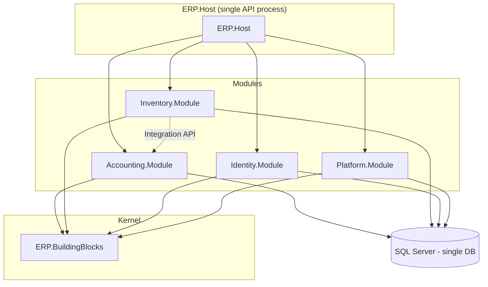
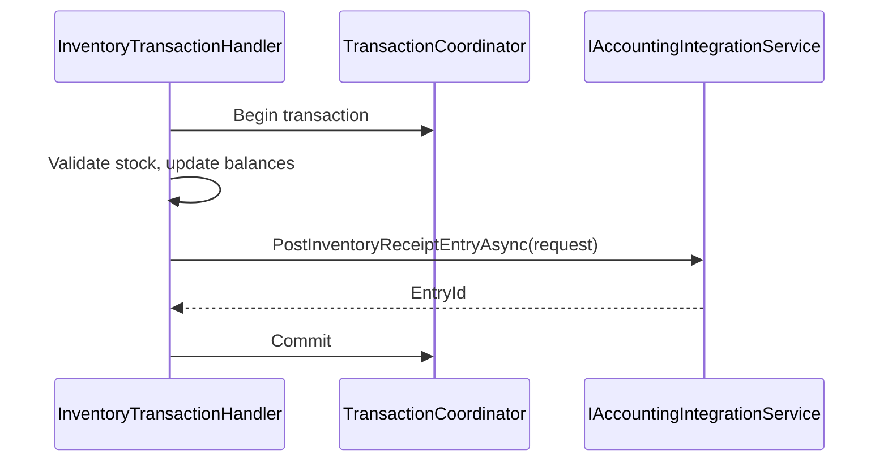
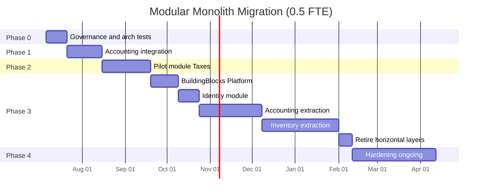

# Modular Monolith Architecture Plan — AAA.ERP

> **Status:** In progress — **Phase 4 hardening** (post-M3); Waves 3A–3E **complete**  
> **Last updated:** July 2026 — **M0–M3 done**; Phase 4.1.x + 4.2.4–4.2.5 + production logging runbook complete (uncommitted on `Refactor`)  
> **Audience:** Developers, solution architects, tech leads

---

## Table of contents

1. [Executive summary](#1-executive-summary)
2. [Context and business drivers](#2-context-and-business-drivers)
3. [Current architecture assessment](#3-current-architecture-assessment)
4. [Target architecture](#4-target-architecture)
5. [Module definitions](#5-module-definitions)
6. [Data architecture](#6-data-architecture)
7. [Application layer standardization](#7-application-layer-standardization)
8. [Integration patterns](#8-integration-patterns)
9. [API and frontend stability](#9-api-and-frontend-stability)
10. [Migration roadmap](#10-migration-roadmap)
    - [10.0 Planning assumptions](#100-planning-assumptions)
    - [10.1 Master timeline](#101-master-timeline)
    - [10.2 Phase 0 — Foundation](#102-phase-0--foundation-and-governance)
    - [10.3 Phase 1 — Integration facade](#103-phase-1--accounting-integration-facade)
    - [10.4 Phase 2 — Pilot module](#104-phase-2--vertical-slice-pilot)
    - [10.5 Phase 3 — Module extraction](#105-phase-3--module-extraction)
    - [10.6 Phase 4 — Hardening](#106-phase-4--hardening)
    - [10.7 Milestones and checkpoints](#107-milestones-and-checkpoints)
11. [Testing strategy](#11-testing-strategy)
12. [Team and process](#12-team-and-process)
13. [Decision matrix](#13-decision-matrix)
14. [What we are NOT doing](#14-what-we-are-not-doing)
15. [Success metrics](#15-success-metrics)
16. [Immediate action list](#16-immediate-action-list)
17. [Glossary](#17-glossary)
18. [Architecture decision records](#18-architecture-decision-records)

---

## 1. Executive summary

**Recommendation:** Evolve the current layered monolith into a **modular monolith**. Do **not** split into microservices at this stage.

AAA.ERP is an accounting + inventory ERP where business transactions routinely span both domains (e.g. inventory receipt posts a GL entry). The codebase already reflects business areas in folder structure (`Account/`, `Inventory/`), but boundaries are not enforced at compile time. The main symptoms are a God `IUnitOfWork` (50+ repositories), direct cross-module entity access, and dual write paths (Services + MediatR).

A modular monolith preserves ERP strengths:

- **ACID transactions** across inventory and general ledger (one database, one deployment)
- **Simple operations** (one API process, one connection string)
- **Clear module ownership** with enforced dependency rules
- **Credible extraction path** if a module ever needs independent scaling

---

## 2. Context and business drivers

### 2.1 What AAA.ERP is today

AAA.ERP is a **.NET 8** backend for an ERP system with:

| Area | Capabilities |
|------|--------------|
| **Accounting** | Chart of accounts, GL entries (journal, payment, receipt, opening, combined), financial periods, currencies, cost centers, sub-ledgers |
| **Inventory** | Products/variants, stock balances, import/export transactions, transfers, attributes, thresholds, expiry levels |
| **Platform** | JWT auth, audit trail, caching, localization (en/ar), global exception handling |
| **Frontend** | Separate SPA consuming REST APIs |

Deployment model: **one API process** → **one SQL Server database**.

### 2.2 Why architecture matters now

Recent development (inventory expansion, product/variant model, stock balances, audit, caching) increased:

- Number of entities and repositories
- Cross-domain workflows (inventory movement → GL posting)
- Team cognitive load (where does new code go? who owns what?)

The project is at the point where a layered monolith begins eroding into tight coupling unless boundaries are made explicit.

### 2.3 Business constraints that drive the decision

| Business fact | Architectural implication |
|---------------|---------------------------|
| Inventory receipt must post GL entry in same operation | Need **ACID** across domains → not microservices yet |
| Branches link to chart-of-account accounts | Cross-module **read** of stable references is OK; **write** must be coordinated |
| Arabic/English UI | Platform module owns localization; modules emit message keys |
| Single company / single deployment (today) | One host, one DB is correct |
| Growing inventory module | Needs isolated ownership without breaking accounting |
| Small-to-medium dev team | Modular monolith > microservices ops burden |

---

## 3. Current architecture assessment

### 3.1 Layered monolith structure

```
ERP.Host            → HTTP, Swagger, migrations, startup
ERP.Application    → IRepository, IService interfaces, validators
ERP.Domain         → Entities, commands, DTOs
ERP.Infrastracture → Implementations (repos, services, handlers, DbContext)
Shared             → Base types, CQRS primitives, exceptions, filters
```

Intended dependency flow:

```
API → Infrastructure → Application → Domain → Shared
```

This is **technically** clean architecture, but **organizationally horizontal**: every feature cuts through all layers. There is no compile-time "Inventory module" — only folders.

### 3.2 Current solution projects

| Project | Role |
|---------|------|
| `ERP.Host` | 42 controllers, startup, EF migrations |
| `ERP.Application` | Repository + service interfaces, validators |
| `ERP.Domain` | Entities, commands, DTOs (~279 files) |
| `ERP.Infrastracture` | Repos, services, handlers, DbContext |
| `Shared` | Base entities, CQRS, exceptions, filters, localization |
| `ERP.UnitTests` | Unit tests |

### 3.3 What already works well

- **MediatR + FluentValidation pipeline** — solid CQRS foundation
- **Base controller hierarchy** — consistent CRUD, pagination, localization
- **EF configuration per entity** — `ApplyConfigurationsFromAssembly` maps to per-module ownership
- **Cross-cutting improvements** — audit fields, global exception handler, pagination, soft delete, filters, audit trail, caching (see `TECHNICAL_DEBT.md`)
- **Domain folders mirror business** — `Account/` and `Inventory/` under Domain

### 3.4 Structural problems

#### Problem A — God `IUnitOfWork`

`IUnitOfWork` exposes 50+ repositories spanning Accounting and Inventory.

**Why this hurts:**

1. No encapsulation — any service can call any repository
2. Constructor explosion in `UnitOfWork`
3. Change amplification — adding one entity touches UoW interface, implementation, and all mocks
4. False sense of transaction boundary — one UoW means "access to everything," not one aggregate

**Fix:** Module-scoped unit of work (`IAccountingUnitOfWork`, `IInventoryUnitOfWork`) + `ITransactionCoordinator` for cross-module operations.

#### Problem B — Cross-module entity coupling

`InventoryTransactionService` and `InventoryTransferService` directly use Accounting entities (`Currency`, `Branch`, `ChartOfAccount`, `FinancialPeriod`), build `CompinedEntryCreateCommand`, and call `_mediator.Send()`.

**Why this hurts:**

1. Inventory depends on Accounting's internal command model
2. Business rules for GL posting are split across modules
3. Inventory cannot be tested in isolation
4. Future service extraction becomes a rewrite

**Fix:** `IAccountingIntegrationService` in `Accounting.Contracts` with request DTOs — Inventory never imports Accounting domain types.

#### Problem C — Dual write paths

| Path | Example |
|------|---------|
| Controller → `ISender.Send(command)` | Create via handler |
| Controller → `IService.ReadAll()` | Reads via service |
| Service → logic + `_mediator.Send` | Inventory transaction |

MediatR is registered in **two assemblies** (`WebBuilderExtensions` and `InfrasctructureExtensions`).

**Fix:** Standardize writes on MediatR handlers; consolidate registration in Host.

#### Problem D — `Shared` project overload

`ERP.Shared` references EF Core, Identity, Swagger, MediatR, AutoMapper, etc. Domain primitives sit next to infrastructure concerns.

**Fix:** Split into `ERP.BuildingBlocks.Domain`, `ERP.BuildingBlocks.Application`, and optional `ERP.BuildingBlocks.Infrastructure`.

#### Problem E — Naming drift

- `Infrastracture` typo
- `Compined` → should be `Combined`
- `ComandValidators` typo
- Namespace inconsistency (`Domain.Account.DBConfiguration` vs `ERP.Domain`)

Modular monolith + architecture tests helps prevent further drift.

---

## 4. Target architecture

### 4.1 Core principle

> **One deployable, one database, many modules** — each module owns its domain; modules communicate through explicit public APIs (contracts), not shared repositories.

### 4.2 Target solution layout

```
AAA.ERP/
├── src/
│   ├── ERP.Host/                              # Composition root (today's ERP.Host)
│   │   ├── Program.cs / startup
│   │   ├── Controllers/
│   │   ├── appsettings.json
│   │   └── Migrations/                        # Until ERP.Persistence exists
│   │
│   ├── BuildingBlocks/
│   │   ├── ERP.BuildingBlocks.Domain/
│   │   ├── ERP.BuildingBlocks.Application/
│   │   └── ERP.BuildingBlocks.Infrastructure/   # Optional early phase
│   │
│   ├── Modules/
│   │   ├── Accounting/
│   │   │   ├── Accounting.Domain/
│   │   │   ├── Accounting.Application/
│   │   │   ├── Accounting.Contracts/          # PUBLIC surface for other modules
│   │   │   └── Accounting.Infrastructure/
│   │   │
│   │   ├── Inventory/
│   │   │   ├── Inventory.Domain/
│   │   │   ├── Inventory.Application/
│   │   │   ├── Inventory.Contracts/
│   │   │   └── Inventory.Infrastructure/
│   │   │
│   │   ├── Identity/
│   │   │   ├── Identity.Domain/
│   │   │   ├── Identity.Application/
│   │   │   └── Identity.Infrastructure/
│   │   │
│   │   └── Platform/
│   │       ├── Platform.Audit/
│   │       ├── Platform.Caching/
│   │       └── Platform.Localization/
│   │
│   └── ERP.Persistence/                       # Phase 3+ optional
│
└── tests/
    ├── Architecture.Tests/
    ├── Accounting.UnitTests/
    ├── Inventory.UnitTests/
    └── IntegrationTests/
```

### 4.3 Dependency rules

```
┌─────────────────────────────────────────────────────────────┐
│  ERP.Host                                                    │
│  References: every *.Infrastructure (composition only)       │
└─────────────────────────────────────────────────────────────┘
         │
         ▼
┌──────────────────┐     ┌──────────────────┐
│ Module.Infra     │────▶│ Module.Application│
└──────────────────┘     └────────┬─────────┘
                                  │
                    ┌─────────────┼─────────────┐
                    ▼             ▼             ▼
            Module.Domain   OtherModule.Contracts   BuildingBlocks
```

| From | May reference | Must NOT reference |
|------|---------------|-------------------|
| `*.Domain` | BuildingBlocks.Domain | EF, MediatR, other modules |
| `*.Application` | Own Domain, BuildingBlocks, other `*.Contracts` | Other modules' Domain/Infrastructure |
| `*.Infrastructure` | Own Application, Domain, EF | Other modules' Domain |
| `*.Contracts` | BuildingBlocks only (DTOs, interfaces) | Domain entities |
| `ERP.Host` | All Infrastructure projects | Domain directly (ideally) |

**Enforcement:** `Architecture.Tests` in CI — PRs that violate rules fail the build.

### 4.4 Architecture diagram



---

## 5. Module definitions

### 5.1 Accounting module

**Purpose:** Own the general ledger and everything required to post financially correct entries.

**Owns:**

- ChartOfAccounts, Entries, FinancialPeriods, Currencies, CostCenters
- SubLedgers (Customer, Supplier, Bank, Branch, Tax, CashInBox, FixedAsset)
- GLSettings, CollectionBooks

**Public contract (`Accounting.Contracts`):**

```csharp
namespace Accounting.Contracts.Integration;

public record InventoryReceiptPostingRequest(
    Guid BranchId,
    Guid PartyAccountId,
    DateTime TransactionDate,
    decimal TotalAmount,
    InventoryTransactionType Direction
);

public record InventoryTransferPostingRequest(
    Guid SourceBranchId,
    Guid DestinationBranchId,
    DateTime TransferDate,
    decimal TotalCost,
    InventoryTransferType TransferType
);

public record FinancialPeriodInfo(Guid Id, DateTime StartDate, DateTime EndDate, bool IsClosed);

public record BranchAccountInfo(Guid BranchId, Guid ChartOfAccountId);

public interface IAccountingIntegrationService
{
    Task<ApiResponse<Guid>> PostInventoryReceiptEntryAsync(
        InventoryReceiptPostingRequest request, CancellationToken ct = default);

    Task<ApiResponse<Guid>> PostInventoryTransferEntryAsync(
        InventoryTransferPostingRequest request, CancellationToken ct = default);

    Task<ApiResponse<FinancialPeriodInfo>> GetOpenPeriodForDateAsync(
        DateTime date, CancellationToken ct = default);

    Task<ApiResponse<BranchAccountInfo>> GetBranchAccountAsync(
        Guid branchId, CancellationToken ct = default);

    Task<ApiResponse<Guid>> ResolvePartyAccountAsync(
        Guid transactionPartyId, CancellationToken ct = default);
}
```

Implementation lives in `Accounting.Infrastructure` and maps requests to internal commands (e.g. `CompinedEntryCreateCommand`). Other modules never import those commands.

### 5.2 Inventory module

**Purpose:** Product catalog, stock levels, inventory movements, transfers.

**Owns:**

- Products, Variants, StockBalances, InventoryTransactions, InventoryTransfers
- Attributes, Thresholds, ExpiryLevels, PackingUnits, SellingPrices

**Critical workflow — receipt with GL posting:**

```
1. Validate command (validator)
2. Begin DB transaction
3. Validate financial period (via IAccountingIntegrationService)
4. Validate stock (for issues)
5. Persist inventory transaction
6. Update stock balances
7. Call IAccountingIntegrationService.PostInventoryReceiptEntryAsync
8. Commit transaction
```

**Public contract (`Inventory.Contracts`) — for reports / future modules:**

```csharp
public interface IInventoryQueryService
{
    Task<ApiResponse<decimal>> GetStockQuantityAsync(
        Guid variantId, Guid branchId, Guid packingUnitId, CancellationToken ct = default);

    Task<ApiResponse<StockValuationDto>> GetBranchValuationAsync(
        Guid branchId, CancellationToken ct = default);
}
```

### 5.3 Identity module

**Purpose:** Authentication and authorization.

**Owns:** `ApplicationUser`, roles, refresh tokens, JWT configuration.

**Exposes:**

```csharp
public interface ICurrentUser
{
    Guid? UserId { get; }
    bool IsAuthenticated { get; }
    IReadOnlyList<string> Roles { get; }
}
```

Other modules use `ICurrentUser` — never reference `ApplicationUser` directly.

### 5.4 Platform module

**Purpose:** Technical capabilities shared by all business modules.

| Sub-area | Current location | Target |
|----------|------------------|--------|
| Audit trail | `AuditService`, `AuditLog` | `Platform.Audit` |
| Caching | `CacheService` | `Platform.Caching` |
| Localization | `Resource.resx`, middleware | `Platform.Localization` |
| API envelope | `ApiResponse<T>` | `BuildingBlocks.Application` |
| Exception handling | `CustomExceptionHandler` | `Platform` or Host |

Platform has **no business rules** about debits/credits or stock quantities.

---

## 6. Data architecture

### 6.1 Single database (recommended)

Keep **one SQL Server database** for the foreseeable future.

**Reasons:**

1. Inventory and GL posting in one transaction
2. Cross-module reports are simple SQL joins
3. One backup, one migration pipeline
4. Matches ERP operational reality

### 6.2 DbContext strategy (phased)

#### Phase 1 — Composed monolithic DbContext

One `ApplicationDbContext`. Each module contributes EF configurations from its Infrastructure assembly:

```csharp
protected override void OnModelCreating(ModelBuilder builder)
{
    builder.ApplyConfigurationsFromAssembly(typeof(AccountingDbContextMarker).Assembly);
    builder.ApplyConfigurationsFromAssembly(typeof(InventoryDbContextMarker).Assembly);
    builder.ApplyConfigurationsFromAssembly(typeof(IdentityDbContextMarker).Assembly);
}
```

#### Phase 2 — Optional SQL schemas

```
accounting.ChartOfAccounts
accounting.Entries
inventory.StockBalances
inventory.Products
```

EF: `builder.Entity<Entry>().ToTable("Entries", "accounting");`

Apply after modules are stable in code — not day one.

#### Phase 3 — Separate databases

Not recommended now. Would require sagas/outbox for inventory + GL.

### 6.3 Migrations

| Phase | Location |
|-------|----------|
| Today | `ERP.Host` |
| Short term | Keep in Host (no ops change) |
| Medium term | `ERP.Persistence` referenced only by Host |

**Rule:** Only one project runs `dotnet ef migrations add`.

### 6.4 Transaction boundaries

| Operation | Transaction scope |
|-----------|-------------------|
| Create Currency | Accounting module only |
| Create Product | Inventory module only |
| Inventory receipt with GL | Cross-module — `ITransactionCoordinator` |
| Read stock balance | Read-only, no transaction |

```csharp
public interface ITransactionCoordinator
{
    Task<ApiResponse<T>> ExecuteAsync<T>(
        Func<CancellationToken, Task<ApiResponse<T>>> action,
        CancellationToken ct);
}
```

Inventory and Accounting share the same scoped `DbContext` within one HTTP request.

---

## 7. Application layer standardization

### 7.1 CQRS convention

| Operation type | Pattern | Location |
|----------------|---------|----------|
| Create / Update / Delete | `IRequest<ApiResponse<T>>` + Handler | Application command + Infrastructure handler |
| Complex reads | Query + Handler | Same |
| Simple paged lists | Query handler (preferred) or read service | Application |
| Cross-module side effect | Integration service | `*.Contracts` interface |

### 7.2 Where business logic lives

| Logic type | Place |
|------------|-------|
| Input validation | FluentValidation in Application |
| Single-aggregate rules | Domain entity / domain service |
| Cross-aggregate within module | Application handler |
| Cross-module rules | Orchestrating handler + integration services |
| Persistence | Infrastructure repositories |

### 7.3 MediatR registration (target)

Single registration in Host:

```csharp
services.AddMediatR(cfg =>
{
    cfg.RegisterServicesFromAssemblies(
        typeof(AccountingApplicationMarker).Assembly,
        typeof(InventoryApplicationMarker).Assembly,
        typeof(IdentityApplicationMarker).Assembly);
    cfg.AddOpenBehavior(typeof(ValidationBehavior<,>));
});

services.AddValidatorsFromAssemblies(same assemblies);
```

Remove duplicate registration from `InfrasctructureExtensions`.

---

## 8. Integration patterns

### 8.1 Pattern comparison

| Pattern | Consistency | Use in AAA.ERP |
|---------|-------------|----------------|
| Direct entity access across modules | Strong | **Remove** |
| Shared God UoW | Strong | **Remove** |
| Module integration service (sync) | Strong | **Primary for GL posting** |
| In-process domain events | Eventual (same process) | Audit, cache invalidation |
| Outbox + worker | Eventual | Future notifications |
| REST/events between services | Eventual | **Not now** |

### 8.2 Inventory → Accounting flow (target)



**Why synchronous, not domain events, for GL posting:**

Inventory + GL must succeed or fail together. Event-driven posting after commit creates stock-without-entry (or vice versa) and reconciliation problems.

### 8.3 In-process domain events (secondary)

Use **after** successful commit for:

- Audit log writes
- Cache invalidation
- Future notifications

### 8.4 Idempotency (future-proofing)

- Add `SourceDocumentId` (inventory transaction id) on GL entries
- Accounting checks for existing entry before creating duplicate

---

## 9. API and frontend stability

### 9.1 External contract unchanged

This is **internal restructuring**. The frontend should see:

- Same routes: `/api/Products`, `/api/StockBalances`, etc.
- Same `ApiResponse<T>` shape
- Same auth and localization headers

### 9.2 Optional Swagger grouping

```csharp
options.SwaggerDoc("accounting", new OpenApiInfo { Title = "Accounting API" });
options.SwaggerDoc("inventory", new OpenApiInfo { Title = "Inventory API" });
```

Documentation benefit only — no breaking changes.

---

## 10. Migration roadmap

### 10.0 Planning assumptions

| Assumption | Value |
|------------|-------|
| Team size | 2–3 backend developers |
| Architecture capacity | **0.5 FTE** (alongside features) or **1 FTE** (dedicated track) |
| Working week | 5 days; estimates in **person-days (pd)** |
| Risk buffer | +15% added to each phase |
| Start date (example) | Week of **6 Jul 2026** |
| Feature freeze during Phase 1 spike | None — integrate with ongoing inventory work |

**Effort legend:** S = 0.5–1 pd · M = 2–3 pd · L = 4–5 pd · XL = 6+ pd

**Two timeline tracks:**

| Track | Phase 0 | Phase 1 | Phase 2 | Phase 3 | Total to modular monolith |
|-------|---------|---------|---------|---------|---------------------------|
| **0.5 FTE** | 3 weeks | 5 weeks | 7 weeks | 24 weeks | **~9 months** |
| **1 FTE** | 2 weeks | 3 weeks | 4 weeks | 14 weeks | **~5 months** |

---

### 10.1 Master timeline

Calendar view (**0.5 FTE** track — recommended for a team shipping features in parallel):



| Phase | Calendar (0.5 FTE) | Calendar (1 FTE) | Person-days | Exit milestone |
|-------|--------------------|------------------|-------------|----------------|
| **0** Foundation | 6 Jul – 24 Jul 2026 | 6 Jul – 17 Jul 2026 | 8–12 pd | M0: Arch tests in CI |
| **1** Integration facade | 27 Jul – 28 Aug 2026 | 20 Jul – 7 Aug 2026 | 15–20 pd | M1: Inventory decoupled |
| **2** Pilot module | 31 Aug – 16 Oct 2026 | 10 Aug – 4 Sep 2026 | 18–25 pd | M2: Module template proven |
| **3** Full extraction | 19 Oct 2026 – 9 Apr 2027 | 7 Sep 2026 – 12 Dec 2026 | 80–120 pd | M3: Horizontal layers gone |
| **4** Hardening | Apr 2027+ (ongoing) | Dec 2026+ (ongoing) | 2–4 pd/sprint | M4: Production-grade ops |

---

### 10.2 Phase 0 — Foundation and governance

**Duration:** 2 weeks (1 FTE) · 3 weeks (0.5 FTE)  
**Goal:** Stop erosion; add guardrails without moving business code.  
**Owner:** Tech lead / architect

#### Week 1 (6–10 Jul 2026)

| ID | Task | Effort | Depends on | Owner | Deliverable |
|----|------|--------|------------|-------|-------------|
| 0.1.1 | Stakeholder kickoff — present plan, assign module owners | S | — | Tech lead | Signed ADR-001 in repo |
| 0.1.2 | Create `Tests/Architecture.Tests` project; add NetArchTest.Rules | S | 0.1.1 | Dev A | Project builds in solution |
| 0.1.3 | Write baseline rule: `Domain` must not reference `Infrastracture` | S | 0.1.2 | Dev A | Passing test |
| 0.1.4 | Write baseline rule: `Application` must not reference `Infrastracture` | S | 0.1.2 | Dev A | Passing test |
| 0.1.5 | Write baseline rule: `API` must not reference `Domain` entities directly | S | 0.1.2 | Dev A | Passing test |
| 0.1.6 | Add ratchet test for Inventory→Account refs (marked `[Fact(Skip = "Phase 1")]`) | S | 0.1.2 | Dev A | Skipped test documented |
| 0.1.7 | Wire `Architecture.Tests` into CI pipeline (fail on violation) | M | 0.1.3–0.1.5 | Dev A | CI green |

#### Week 2 (13–17 Jul 2026)

| ID | Task | Effort | Depends on | Owner | Deliverable |
|----|------|--------|------------|-------|-------------|
| 0.2.1 | Audit MediatR registration — list handlers in both assemblies | S | — | Dev B | Inventory doc in PR |
| 0.2.2 | Move all MediatR + validator registration to `WebBuilderExtensions` only | M | 0.2.1 | Dev B | Single registration point |
| 0.2.3 | Remove `AddMediatR` from `InfrasctructureExtensions` | S | 0.2.2 | Dev B | PR merged |
| 0.2.4 | Smoke test all CRUD endpoints (Swagger / Postman collection) | M | 0.2.3 | Dev B | Test checklist signed |
| 0.2.5 | Remove duplicate DI registrations (`IAttributeDefinitionService`, `IInventoryTransferService`, etc.) | S | — | Dev B | Clean `InfrasctructureExtensions` |
| 0.2.6 | Document freeze rule: no new repos on `IUnitOfWork` (PR template checkbox) | S | 0.1.1 | Tech lead | PR template updated |

#### Week 3 — buffer (20–24 Jul 2026, 0.5 FTE only)

| ID | Task | Effort | Depends on | Owner | Deliverable |
|----|------|--------|------------|-------|-------------|
| 0.3.1 | Create `docs/architecture/CONTRIBUTING.md` — where to put new code | S | 0.1.1 | Tech lead | Contributor guide |
| 0.3.2 | Open tracking issues for rename branches (`Infrastracture`, `Compined`) | S | — | Tech lead | GitHub issues |
| 0.3.3 | Phase 0 retrospective; confirm Phase 1 start date | S | 0.2.4 | Team | Go/no-go for Phase 1 |

**Phase 0 exit criteria (M0):**

- [x] Architecture tests run on every PR (`Tests/ERP.Architecture.Tests`)
- [x] MediatR registered in exactly one place (`WebBuilderExtensions`)
- [x] No duplicate service registrations in `InfrasctructureExtensions`
- [x] ADR-001 to ADR-004 committed under `docs/architecture/adr/`
- [x] Module owners assigned — [MODULE_OWNERS.md](./MODULE_OWNERS.md)
- [x] CI workflow runs build + tests (`.github/workflows/ci.yml`)
- [x] Contributor guide (`docs/architecture/CONTRIBUTING.md`)
- [x] PR template with `IUnitOfWork` freeze rule (`.github/pull_request_template.md`)
- [x] MediatR audit documented (`docs/architecture/MEDIATR_REGISTRATION.md`)
- [x] Smoke tests automated (`Tests/ERP.SmokeTests`)
- [x] Phase 0 retrospective — [PHASE_0_RETROSPECTIVE.md](./PHASE_0_RETROSPECTIVE.md)

**Sample arch tests:**

```csharp
[Fact]
public void Domain_should_not_reference_Infrastructure()
{
    Types.InAssembly(DomainAssembly)
        .Should().NotHaveDependencyOn("ERP.Infrastracture")
        .GetResult().IsSuccessful.Should().BeTrue();
}

[Fact(Skip = "Enable after Phase 1")]
public void Inventory_should_not_reference_Account_Entities()
{
    Types.InAssembly(InventoryServicesAssembly)
        .Should().NotHaveDependencyOn("ERP.Domain.Models.Entities.Account")
        .GetResult().IsSuccessful.Should().BeTrue();
}
```

---

### 10.3 Phase 1 — Accounting integration facade

**Duration:** 3 weeks (1 FTE) · 5 weeks (0.5 FTE)  
**Goal:** Decouple Inventory from Accounting domain internals.  
**Owner:** Inventory module owner + Accounting module owner  
**Status:** **Sprint 4 complete** — M1 sign-off pending review  
**Commit:** `17afc69` + Sprint 4 integration tests on branch `Refactor`

#### Progress summary

| Sprint | Status | Notes |
|--------|--------|-------|
| Sprint 1 — Contracts | **Done** | `Modules/Accounting/Accounting.Contracts/` |
| Sprint 2 — Facade impl | **Done** | Full implementation (skipped stub step 1.1.6) |
| Sprint 3 — Inventory refactor | **Done** | Transaction + transfer + import/export via delegation |
| Sprint 4 — Tests & gate | **Done** | `Tests/ERP.IntegrationTests/` — 6 tests, SQLite in-memory |

#### Sprint 1 — Contracts and facade skeleton (Week 1)

| ID | Task | Status | Deliverable |
|----|------|--------|-------------|
| 1.1.1 | Create `Modules/Accounting/Accounting.Contracts/` project | **Done** | `Accounting.Contracts.csproj` in solution |
| 1.1.2 | Define posting request records | **Done** | `InventoryTransactionPostingRequest`, `InventoryTransferPostingRequest` |
| 1.1.3 | Define `FinancialPeriodInfo`, `BranchAccountInfo` | **Done** | Contract DTOs committed |
| 1.1.4 | Define `IAccountingIntegrationService` | **Done** | Interface in Contracts |
| 1.1.5 | Add `Accounting.Contracts` project reference | **Done** | Referenced from `ERP.Infrastracture` |
| 1.1.6 | Create `AccountingIntegrationService` stub | **Skipped** | Went straight to full implementation in Sprint 2 |

#### Sprint 2 — Implement facade (Week 2)

| ID | Task | Status | Notes |
|----|------|--------|-------|
| 1.2.1 | Implement `GetOpenPeriodForDateAsync` | **Done** | Unit tests **not done** |
| 1.2.2 | Implement `GetBranchAccountAsync` | **Done** | Unit tests **not done** |
| 1.2.3 | Implement `ValidatePartyAccountAsync` | **Done** | Was planned as `ResolvePartyAccountAsync`; unit tests **not done** |
| 1.2.4 | Implement `PostInventoryTransactionEntryAsync` | **Done** | Maps to `CompinedEntryCreateCommand` internally |
| 1.2.5 | Implement `PostInventoryTransferEntryAsync` | **Done** | Replaces `CreateEntryCommand` logic |
| 1.2.6 | Register `IAccountingIntegrationService` in DI | **Done** | `InfrasctructureExtensions.cs` |

#### Sprint 3 — Refactor inventory services (Week 3)

| ID | Task | Status | Notes |
|----|------|--------|-------|
| 1.3.1 | Inject `IAccountingIntegrationService` into `InventoryTransactionService` | **Done** | Constructor updated |
| 1.3.2 | Replace Account entity `DbContext` queries with facade calls | **Done** | Transaction + transfer services |
| 1.3.3 | Replace `_mediator.Send(compinedEntryCommand)` with facade | **Done** | Receipt and issue paths |
| 1.3.4 | Refactor `InventoryTransferService` to use facade | **Done** | Create, approve, reject flows |
| 1.3.5 | Cover import/export transaction services | **Done** | Delegate to `InventoryTransactionService` |
| 1.3.6 | Delete private GL helper methods from inventory services | **Done** | `CreateCompinedEntryCreateCommand`, `CreateEntryCommand` removed |

#### Sprint 4 — Testing and gate (Week 4–5, 0.5 FTE buffer)

| ID | Task | Status | Notes |
|----|------|--------|-------|
| 1.4.1 | Integration test: receipt → stock ↑ + GL entry | **Done** | `InventoryTransactionIntegrationTests.Receipt_increases_stock_and_creates_gl_entry` |
| 1.4.2 | Integration test: receipt failure → rollback | **Done** | `Receipt_gl_failure_rolls_back_stock_and_entry` |
| 1.4.3 | Integration test: export with insufficient stock | **Done** | `Issue_with_insufficient_stock_fails_without_gl_entry` |
| 1.4.4 | Integration test: transfer direct + staged | **Done** | `InventoryTransferIntegrationTests` (2 tests) |
| 1.4.5 | Golden test: GL lines before/after refactor | **Done** | `Receipt_gl_lines_match_expected_branch_and_party_accounts` |
| 1.4.6 | Enable arch test — no Account entity refs in Inventory | **Partial** | `*TransactionService` + `InventoryTransferService` **pass**; Product/Variant catalog services **deferred to Phase 3** |
| 1.4.7 | Code review + merge; update plan status | **Done** | Plan updated; merge to main pending |

**Before / after:**

```
BEFORE: InventoryTransactionService → DbContext.Set<Branch> → CompinedEntryCreateCommand → MediatR
AFTER:  InventoryTransactionService → IAccountingIntegrationService.PostInventoryTransactionEntryAsync
```

**Phase 1 exit criteria (M1):**

- [x] Zero `using ERP.Domain.Models.Entities.Account` in **transaction** inventory services
- [ ] Zero Account entity dependency in **all** inventory services (Product/Variant cost centers/taxes — Phase 3)
- [x] All inventory transaction types use facade for GL posting (create, import, export, transfer)
- [x] Integration tests pass for receipt, export, transfer
- [x] Arch test enabled for transaction services (catalog test skipped until Phase 3)
- [x] No production API contract changes

**Key files (Phase 1):**

| File | Role |
|------|------|
| `Modules/Accounting/Accounting.Contracts/Integration/IAccountingIntegrationService.cs` | Public contract |
| `ERP.Infrastracture/Services/Accounting/AccountingIntegrationService.cs` | Facade implementation |
| `Modules/Inventory/Inventory.Infrastructure/Services/InventoryTransactionService.cs` | Refactored consumer |
| `Modules/Inventory/Inventory.Infrastructure/Services/InventoryTransferService.cs` | Refactored consumer |
| `Tests/ERP.Architecture.Tests/ModuleBoundaryTests.cs` | Boundary gate |
| `Tests/ERP.IntegrationTests/` | Phase 1 Sprint 4 — inventory + GL integration tests |

---

### 10.4 Phase 2 — Vertical slice pilot

**Duration:** 4 weeks (1 FTE) · 7 weeks (0.5 FTE)  
**Goal:** Prove module project structure end-to-end with one feature.  
**Pilot feature:** **Taxes** (Accounting module — small, clear boundary)  
**Owner:** Accounting module owner  
**Status:** **Week 4 complete (M2)** · Taxes pilot signed off · Phase 3 ready

#### Progress summary

| Sprint / week | Status | Notes |
|---------------|--------|-------|
| Week 1 — Scaffold | **Done** | `Accounting.Domain`, `.Application`, `.Infrastructure` |
| Week 2 — Composition | **Done** | `AddAccountingModule()`, MediatR + validators wired |
| Week 3 — EF & migrations | **Done** | Design-time factory, drift check, arch rules |
| Week 4 — Template | **Done** | [MODULE_TEMPLATE.md](./MODULE_TEMPLATE.md), [M2_SIGNOFF.md](./M2_SIGNOFF.md) |

#### Week 1 — Scaffold module projects

| ID | Task | Status | Deliverable |
|----|------|--------|-------------|
| 2.1.1 | Create solution folder `Modules/Accounting/` | **Done** | 4 projects under Accounting solution folder |
| 2.1.2 | Create `Accounting.Domain`; move `Tax` entity | **Done** | `Accounting.Domain/Entities/Tax.cs` |
| 2.1.3 | Create `Accounting.Application`; move commands + validators | **Done** | `Commands/Taxes/`, `Validators/Taxes/` |
| 2.1.4 | Create `Accounting.Infrastructure`; move handler, repo, `TaxDbConfig` | **Done** | Handlers, `TaxService`, `TaxRepository`, `TaxDbConfig` |
| 2.1.5 | `Accounting.Contracts` (from Phase 1) | **Done** | Integration facade contracts |
| 2.1.6 | Arch test: `Accounting.Domain` must not reference `Inventory.*` | **Done** | `ModuleBoundaryTests.Accounting_Domain_should_not_reference_Inventory_entities` |

#### Week 2 — Composition and DI

| ID | Task | Status | Notes |
|----|------|--------|-------|
| 2.2.1 | Implement `AddAccountingModule(IServiceCollection)` | **Done** | `AccountingModuleExtensions.cs` |
| 2.2.2 | Register Tax repo, handler, validator inside module | **Done** | DI + MediatR + FluentValidation assemblies |
| 2.2.3 | Call `AddAccountingModule()` from Host | **Done** | `WebBuilderExtensions.BuildApplication` |
| 2.2.4 | Remove old Tax registrations from `InfrasctructureExtensions` | **Done** | |
| 2.2.5 | Remove old Tax files from horizontal projects | **Done** | Deleted from `ERP.Domain`, `.Application`, `.Infrastracture` |
| 2.2.6 | Verify `TaxesController` still works | **Done** | MediatR integration test creates/reads Tax |

**Key files (Phase 2 Sprint 1):**

| File | Role |
|------|------|
| `Modules/Accounting/Accounting.Domain/Entities/Tax.cs` | Tax aggregate root |
| `Modules/Accounting/Accounting.Application/` | Commands, validators, `ITaxService` / `ITaxRepository` |
| `Modules/Accounting/Accounting.Infrastructure/AccountingModuleExtensions.cs` | `AddAccountingModule()` composition |
| `ERP.Application/Data/ModuleModelConfigurationRegistry.cs` | EF module config hook (avoids circular refs) |
| `ERP.Host/Utilities/WebBuilderExtensions.cs` | Host wires module + second MediatR/validator assembly |

#### Week 3 — EF and migrations

| ID | Task | Status | Deliverable |
|----|------|--------|-------------|
| 2.3.1 | Ensure `TaxDbConfig` picked up via module registry | **Done** | `ModuleModelConfigurationRegistry` + `ApplicationDbContextFactory` |
| 2.3.2 | Run existing migrations — confirm no schema drift | **Done** | Dry-run migration; `Taxes` table retained |
| 2.3.3 | Document pattern: module owns configs, Host owns migrations | **Done** | `CONTRIBUTING.md` + §10.4 |
| 2.3.4 | Add arch test: module dependency rules for Accounting projects | **Done** | 5 rules in `ModuleBoundaryTests` |

#### Week 4 — Template and M2 sign-off

| ID | Task | Status | Deliverable |
|----|------|--------|-------------|
| 2.4.1 | Write `MODULE_TEMPLATE.md` — step-by-step for next aggregate | **Done** | [MODULE_TEMPLATE.md](./MODULE_TEMPLATE.md) |
| 2.4.2 | Optional: migrate **ExpiryLevels** (Inventory) | **Deferred** | Child entity — extract with Product/Variant in Phase 3 |
| 2.4.3 | Team review — validate structure, naming, build time | **Done** | [M2_SIGNOFF.md](./M2_SIGNOFF.md) checklist |
| 2.4.4 | Measure build/test time before vs after | **Done** | ~28 s build (warm), ~14 s test — see M2 sign-off |

#### Weeks 5–7 — buffer (0.5 FTE)

| ID | Task | Effort | Depends on | Owner | Deliverable |
|----|------|--------|------------|-------|-------------|
| 2.5.1 | Fix any circular reference or namespace issues found in pilot | M | 2.4.3 | Dev A | Clean build |
| 2.5.2 | Present module template to full team (30 min walkthrough) | S | 2.4.1 | Tech lead | Team trained |

**Phase 2 exit criteria (M2):**

- [x] Taxes fully lives in `Accounting.*` projects
- [x] `AddAccountingModule()` is the composition pattern for all future Accounting work
- [x] `MODULE_TEMPLATE.md` published
- [x] Arch tests cover Accounting module dependency rules
- [x] No API breaking changes

See [M2_SIGNOFF.md](./M2_SIGNOFF.md) for metrics and review checklist.

---

### 10.5 Phase 3 — Module extraction

**Duration:** 14 weeks (1 FTE) · 24 weeks (0.5 FTE)  
**Goal:** Move all code from horizontal layers into modules; retire `ERP.Application`, `ERP.Domain`, `ERP.Infrastracture`.  
**Strategy:** One aggregate (or aggregate group) per PR; 2–3 migrations per week at steady state.

#### Wave 3A — BuildingBlocks + Platform (Weeks 1–4) — **COMPLETE**

| ID | Task | Effort | Owner | Deliverable | Status |
|----|------|--------|-------|-------------|--------|
| 3A.1 | Create `ERP.BuildingBlocks.Domain` — move `BaseEntity`, tree entities | M | Dev B | Domain primitives | Done |
| 3A.2 | Create `ERP.BuildingBlocks.Application` — `PaginatedResult`, `BaseFilterDto`, behaviors | M | Dev B | App primitives | Done |
| 3A.3 | Move `ApiResponse`, `MessageTemplate` to BuildingBlocks.Application | M | Dev B | Response types | Done |
| 3A.4 | Move `CustomExceptionHandler`, `NotFoundException`, etc. | M | Dev B | Exception types | Done |
| 3A.5 | Create `Platform.Audit` — move `AuditService`, `AuditLog` | M | Dev B | Audit module | Done |
| 3A.6 | Create `Platform.Caching` — move `CacheService` | M | Dev B | Cache module | Done |
| 3A.7 | Create `Platform.Localization` — move resources, middleware | L | Dev B | Localization module | Done |
| 3A.8 | Update all project references from `Shared` → BuildingBlocks | L | Dev A+B | Shared project thinned | Done |
| 3A.9 | Delete moved files from `Shared`; remove or deprecate project | M | Dev A | Shared deprecated | Done (thin shim: Identity + filter DTOs) |

**Wave 3A exit:** `Shared` thinned to filter DTOs and `ErrorMessages`; Platform modules registered via `AddPlatformModules()` in `WebBuilderExtensions`.

#### Wave 3B — Identity (Weeks 5–6) — **COMPLETE**

| ID | Task | Effort | Owner | Deliverable | Status |
|----|------|--------|-------|-------------|--------|
| 3B.1 | Create `Identity.Domain` — `ApplicationUser` (namespace `Shared.BaseEntities.Identity` retained) | M | Dev A | Identity domain | Done |
| 3B.2 | Create `Identity.Application` — `IAuthenticationService`, auth DTOs, `ICurrentUser` | M | Dev A | Auth contracts | Done |
| 3B.3 | Create `Identity.Infrastructure` — auth service, JWT helpers | L | Dev A | Auth impl | Done |
| 3B.4 | Introduce `ICurrentUser`; replace direct `IHttpContextAccessor` in audit + DbContext audit fields | M | Dev A | Abstraction | Done |
| 3B.5 | `AddIdentityModule()` + smoke test `AuthController` | S | Dev A | Auth works | Done |

**Wave 3B exit:** Commit `d8a16e3`.

#### Wave 3C — Accounting extraction (Weeks 7–14) — **COMPLETE**

Migrate aggregates in dependency order. **~1–2 pd per simple aggregate; 3–5 pd for Entries cluster.**

| Week | Aggregates to migrate | PRs | Owner | Status |
|------|----------------------|-----|-------|--------|
| 7 | Currencies, GLSettings, AccountGuides | 2–3 | Dev A | Done |
| 8 | FinancialPeriods, CostCenters, CollectionBooks | 2–3 | Dev A | Done |
| 9 | ChartOfAccounts (tree) | 1–2 | Dev A | Done |
| 10 | Sub-ledgers: Banks, CashInBoxes, Branches | 2–3 | Dev A | Done |
| 11 | Sub-ledgers: Customers, Suppliers, Taxes, FixedAssets | 3–4 | Dev A | Done |
| 12 | Roles | 1 | Dev B | Done |
| 13 | Entries — Journal, Payment, Receipt | 2–3 | Dev A | Done |
| 14 | Entries — Opening, Combined, EntryService core | 3–4 | Dev A | Done |

**Wave 3C exit:** All `ERP.Host/Controllers/Account/*` backed by Accounting module projects.

**Per-aggregate checklist (repeat for each):**

| Step | Task | Effort |
|------|------|--------|
| 1 | Move entity → `Accounting.Domain` | S |
| 2 | Move commands + validators → `Accounting.Application` | S–M |
| 3 | Move handler + repository + DbConfig → `Accounting.Infrastructure` | M |
| 4 | Register in `AddAccountingModule()` | S |
| 5 | Delete from horizontal projects | S |
| 6 | Arch tests + smoke test | S |
| **Total per simple aggregate** | | **1–2 pd** |
| **Total per Entries subgroup** | | **3–5 pd** |

#### Wave 3D — Inventory extraction (Weeks 15–22)

| Week | Aggregates to migrate | PRs | Owner |
|------|----------------------|-----|-------|
| 15 | Colors, Sizes, PackingUnits, ManufacturerCompanies | 3–4 | Dev B | **Done** — `Inventory.Application` + `Inventory.Infrastructure` scaffolded |
| 16 | SellingPrices, AttributeDefinitions, AttributeValues | 2–3 | Dev B | **Done** — custom attribute services + `SellingPriceDto` deletability query |
| 17 | Products (+ related: codes, attachments, packing units) | 2–3 | Dev B | **Done** — `ProductService`, junction repos, 12 DbConfigs; `IVariantProductPreparation` for variant coupling |
| 18 | Variants (+ related: suppliers, taxes, cost centers) | 3–4 | Dev B | **Done** — `VariantService`, junction repos, 12 DbConfigs; `IVariantProductPreparation` folded into `IVariantService` |
| 19 | StockBalances, InventoryThresholds, ExpiryLevels | 2–3 | Dev B | **Done** — `StockBalanceService`, threshold/expiry DbConfigs, validation helpers; StockBalance MediatR handlers added |
| 20 | InventoryTransactions (import/export) | 2 | Dev B | **Done** — `InventoryTransactionService`, import/export facades, 6 MediatR handlers, `InventoryTransaction*DbConfig`; `IInventoryTransactionRepository` stays in `ERP.Application` |
| 21 | InventoryTransfers | 2 | Dev B | **Done** — `InventoryTransferService`, 2 MediatR handlers, `InventoryTransfer*DbConfig`; `IInventoryTransferRepository` stays in `ERP.Application` |
| 22 | Legacy Items (if still in use — deprecate or migrate) | 1–2 | Dev B | **Done** — `ItemService`, `ItemRepository` (restored), 2 MediatR handlers, 7 Item DbConfigs; junction repos in module |

**Wave 3D exit:** All `ERP.Host/Controllers/Inventory/*` backed by Inventory module projects.

#### Wave 3E — Retire horizontal layers (Weeks 23–24)

| ID | Task | Effort | Owner | Deliverable |
|----|------|--------|-------|-------------|
| 3E.1 | Verify `ERP.Domain` has no remaining source files | S | Dev A | Empty project |
| 3E.2 | Verify `ERP.Application` has no remaining source files | S | Dev A | Empty project |
| 3E.3 | Verify `ERP.Infrastracture` has no remaining source files | S | Dev A | Empty project |
| 3E.4 | Remove projects from solution; rename `ERP.Host` → `ERP.Host` (optional) | M | Tech lead | Clean solution |
| 3E.5 | Replace God `IUnitOfWork` with module UoWs or remove entirely | L | Dev A | UoW deprecated |
| 3E.6 | Full regression test suite | L | Dev A+B | All green |
| 3E.7 | Update README, solution diagram | S | Tech lead | Docs current |

**Week 23 (complete):** Audit complete; God `IUnitOfWork` slimmed to transaction coordinator (0 repository properties).

**Week 24 (complete):** Horizontal `ERP.Domain`, `ERP.Application`, `ERP.Infrastracture` removed from solution. Persistence kernel extracted; domain split into module projects.

##### Week 23 — horizontal layer audit (post-3D)

| Project | `.cs` files | Still contains (summary) |
|---------|-------------|--------------------------|
| `ERP.Domain` | 164 | All Account + Inventory entities, DTOs, base commands, `SD.cs`, lookups |
| `ERP.Application` | 41 | `IApplicationDbContext`, `ModuleModelConfigurationRegistry`, base service/repo ports, `IUnitOfWork` (transaction-only), inventory repo interfaces, `IFinancialPeriodUsageQueries` |
| `ERP.Infrastracture` | 25 | `ApplicationDbContext`, slim `UnitOfWork`, base services (`BaseService`, `BaseTreeSettingService`, …), `SubLeadgerService`, `BaseQueryService`, `AttachmentRepository`, `FinancialPeriodUsageQueries`, seed utilities, base DbConfig classes |

##### Week 23 — `IUnitOfWork` consumer map (after slimming)

| Consumer | UoW usage |
|----------|-----------|
| `ItemService` | Transactions only (`Begin`/`Commit`/`Rollback`); all repos injected |
| `ProductService` | Transactions only; all repos injected |
| `VariantService` | Transactions only; all repos injected |
| `InventoryTransactionService` | Transactions only; `IInventoryTransactionRepository` injected |
| `InventoryTransferService` | Transactions only; `IStockBalanceRepository` injected |
| `StockBalanceService` | No UoW (repos injected) |
| `AttributeDefinitionService` | Transactions only |
| `AttributeValueService` | `SaveChanges()` only |
| `EntryService` | Transactions, `Set<T>()`, `SaveChanges()`; `IAttachmentRepository` injected |
| `FinancialPeriodService` | `IInventoryTransactionRepository` injected (cross-module date check) |
| `BranchService` | Transactions; `IAttachmentRepository` injected |
| `CostCenterService`, `FixedAssetService`, `TaxService` | Transactions only |
| `SubLeadgerService` + sub-ledger services | Transactions only (repos injected since 3C) |

**Week 23 — 3E.5 deliverable:** `IUnitOfWork` reduced from 43 repository properties to **0** — retains `Set<T>()`, `BeginTransactionAsync`, `CommitAsync`, `RollbackAsync`, `SaveChanges()` only. Repository implementations remain registered in module DI (`InventoryModuleExtensions`, `AccountingModuleExtensions`); horizontal `InfrasctructureExtensions` registers `IAttachmentRepository` and generic `IBaseRepository<>` only.

##### Week 24 — horizontal layer retirement

| Removed from solution | Replacement |
|-----------------------|-------------|
| `ERP.Domain` | `Accounting.Domain` (account entities/DTOs/commands/output) + `Inventory.Domain` (inventory entities/DTOs/lookups) + `ERP.BuildingBlocks.Application` (base commands/DTOs/validators) |
| `ERP.Application` | `ERP.BuildingBlocks.Application` (base repo/service ports, validators) + `ERP.BuildingBlocks.Persistence` (`IApplicationDbContext`, `ModuleModelConfigurationRegistry`, `IUnitOfWork`) + module Application projects (inventory/account repo ports) |
| `ERP.Infrastracture` | `ERP.Persistence` (renamed; `ApplicationDbContext`, `UnitOfWork`, base repos/services, `SubLeadgerService`, seed utilities) |

Namespaces intentionally preserved (`ERP.Domain.*`, `ERP.Application.*`) in moved files to limit churn — physical projects now match module boundaries.

**Phase 3 exit criteria (M3):**

- [x] No horizontal `ERP.Domain` / `ERP.Application` / `ERP.Infrastracture` projects
- [x] Every controller backed by a module
- [x] God `IUnitOfWork` removed or empty *(Week 23: transaction coordinator only)*
- [x] All arch tests green
- [x] Full API smoke suite passes

---

### 10.6 Phase 4 — Hardening

**Duration:** Ongoing from M3; front-loaded **8 weeks**  
**Goal:** Production-grade modular monolith — observability, ops, debt, optional DB schemas.

#### Month 1 after M3

| ID | Task | Effort | Owner | Deliverable |
|----|------|--------|-------|-------------|
| 4.1.1 | Add Serilog enrichers: `Module`, `CommandName`, `CorrelationId` | M | Dev B | Structured logs |
| 4.1.2 | Swagger grouped by module (Accounting, Inventory, Identity) | M | Dev B | Improved docs |
| 4.1.3 | Rename `Infrastracture` → `Infrastructure` (if not done in 3E) | L | Dev A | Tech debt cleared |
| 4.1.4 | Rename `Compined` → `Combined` (19 files) | L | Dev A | Tech debt cleared |
| 4.1.5 | Add `ITransactionCoordinator` for cross-module flows (formalize Phase 1 pattern) | M | Dev A | Coordinator in BuildingBlocks |

#### Month 2 after M3

| ID | Task | Effort | Owner | Deliverable |
|----|------|--------|-------|-------------|
| 4.2.1 | Evaluate SQL schema separation (`accounting.*`, `inventory.*`) | M | Tech lead | ADR decision |
| 4.2.2 | If approved: migration to add schemas + update EF configs | L | Dev A | Schema separated |
| 4.2.3 | Add `SourceDocumentId` on entries for idempotent inventory posting | M | Dev A | No duplicate entries |
| 4.2.4 | Module README per module (`Accounting/README.md`, etc.) | M | Module owners | Onboarding docs |
| 4.2.5 | Performance review: N+1 queries on Products/Variants list endpoints | L | Dev B | Perf fixes |

#### Ongoing (every sprint)

| ID | Task | Cadence | Owner |
|----|------|---------|-------|
| 4.3.1 | Arch test review — no new violations | Per PR | All |
| 4.3.2 | Module owner review on cross-module PRs | Per PR | Module owners |
| 4.3.3 | Dependency graph check (no new cycles) | Monthly | Tech lead |
| 4.3.4 | ADR review — microservices triggers still not met? | Quarterly | Tech lead |

**Phase 4 exit criteria (M4):**

- [x] Structured logging in production — [PRODUCTION_LOGGING.md](../ops/PRODUCTION_LOGGING.md) runbook; `appsettings.Production.json` (Compact JSON + enrichers)
- [x] Naming debt resolved — `Infrastructure` / `Combined` (legacy route + JSON wire preserved)
- [x] Module READMEs complete — `Modules/{Accounting,Inventory,Identity,Platform}/README.md`, `ERP.Persistence/README.md`
- [ ] Optional schemas deployed (if ADR approved) — **deferred** per [ADR-006](./adr/006-sql-schema-separation.md)
- [x] Onboarding doc: new feature in under 1 day — module READMEs + [MODULE_TEMPLATE.md](./MODULE_TEMPLATE.md)

---

### 10.7 Milestones and checkpoints

| Milestone | Target (0.5 FTE) | Target (1 FTE) | Validation |
|-----------|------------------|----------------|------------|
| **M0** Phase 0 complete | 24 Jul 2026 | 17 Jul 2026 | Arch tests in CI; MediatR consolidated |
| **M1** Phase 1 complete | 28 Aug 2026 | 7 Aug 2026 | **Done** — integration tests in CI |
| **M2** Phase 2 complete | 16 Oct 2026 | 4 Sep 2026 | **Done** — Tax pilot; [MODULE_TEMPLATE.md](./MODULE_TEMPLATE.md) |
| **M3** Phase 3 complete | 9 Apr 2027 | 12 Dec 2026 | **Done** — Waves 3A–3E; horizontal layers retired (`1a4242e`) |
| **M4** Phase 4 baseline | 4 Jun 2027 | 6 Feb 2027 | **In progress** — logging runbook, READMEs, perf, coordinator |

**Go/no-go checkpoints:**

| Checkpoint | When | Question | If NO |
|------------|------|----------|-------|
| CP-1 | End Phase 0 | Do arch tests run reliably in CI? | Fix CI before Phase 1 |
| CP-2 | End Phase 1 | Do integration tests prove atomicity? | Do not start module extraction |
| CP-3 | End Phase 2 | Is module template workable for the team? | Revise structure before Wave 3A |
| CP-4 | Mid Phase 3 (Week 14) | Is velocity sustainable (~2 aggregates/week)? | Extend timeline; reduce parallel feature load |
| CP-5 | End Phase 3 | Full regression green? | Delay M3; keep horizontal projects until stable |

---

### 10.8 Risk register and buffers

| Risk | Impact | Likelihood | Mitigation | Buffer |
|------|--------|------------|------------|--------|
| Feature pressure slows migration | High | High | 0.5 FTE dedicated; migrate 1 aggregate per sprint minimum | +4 weeks on Phase 3 |
| GL posting regression | High | Medium | Golden tests in Phase 1; manual QA on receipt/transfer | +1 week Phase 1 |
| Circular project references | Medium | Medium | Arch tests; Contracts projects | +1 week Phase 2 |
| Build time increases | Low | Medium | Measure in Phase 2; split only if over 2 min | Monitor only |
| Team disagreement on boundaries | Medium | Low | ADRs; module owners; checkpoint reviews | Kickoff workshop |

**Recommended contingency:** Add **4 calendar weeks** to the 0.5 FTE track for production releases and unplanned bugs → **~10 months total** to M3.

---

## 11. Testing strategy

### 11.1 Test pyramid

```
        ┌─────────────┐
        │  E2E / API  │  Few — receipt, transfer, journal
        ├─────────────┤
        │ Integration │  Handlers + real EF
        ├─────────────┤
        │   Unit      │  Domain rules, validators, facade mapping
        ├─────────────┤
        │ Architecture│  Dependency rules — every CI build
        └─────────────┘
```

### 11.2 Critical scenarios

| Scenario | Assert |
|----------|--------|
| Inventory receipt | Stock ↑, GL entry created, same transaction |
| Insufficient stock on export | No stock change, no GL entry |
| Closed financial period | Rejected before persistence |
| Inventory transfer | Correct accounts via integration service |
| Missing default currency | Structured error from Accounting facade |

### 11.3 Module isolation

- Inventory unit tests **mock** `IAccountingIntegrationService`
- Accounting posting tests use request DTOs only — no product catalog needed

---

## 12. Team and process

### 12.1 Module ownership

| Module | Review rule |
|--------|-------------|
| Accounting | PRs touching `Accounting.*` need module owner review |
| Inventory | Same |
| Platform | Senior / rotating owner |
| Host | Tech lead — DI, migrations |

### 12.2 Definition of Done (per feature)

- Code in correct module projects
- Validator + handler for writes
- Arch tests pass
- Integration test if cross-module
- No new repositories on global `IUnitOfWork`

---

## 13. Decision matrix

| Criterion | Layered monolith (today) | Modular monolith | Microservices |
|-----------|--------------------------|------------------|---------------|
| Transactional ERP workflows | Medium | **High** | Low |
| Team scalability (2–8 devs) | Medium | **High** | Medium |
| Time to first value | High (built) | Medium (incremental) | Low |
| Operational complexity | **Low** | **Low** | High |
| Future extractability | Low | **High** | High |
| Fits current business | Eroding | **Best fit** | Over-engineered |

---

## 14. What we are NOT doing

| Option | Why not now |
|--------|-------------|
| Microservices | Inventory+GL atomicity; ops cost; no scaling requirement |
| Full event sourcing | Overkill; reporting needs relational model |
| Multiple DbContexts with separate transactions | Race conditions without distributed transactions |
| Big bang rewrite | ERP downtime risk; frontend coupled to current API |
| Keeping God UnitOfWork | Continues erosion as inventory grows |

---

## 15. Success metrics

| Metric | Target (6 months) |
|--------|-------------------|
| Cross-module entity references (Inventory→Account) | 0 |
| Repositories on global `IUnitOfWork` | 0 (deprecated) |
| MediatR registration points | 1 (Host) |
| Arch test violations in CI | 0 |
| Production incidents: inventory without GL | 0 |
| Onboarding: "where to add a feature" | < 1 day |

---

## 16. Phase status

### Phase 0 — **COMPLETE (M0)**

See [PHASE_0_RETROSPECTIVE.md](./PHASE_0_RETROSPECTIVE.md). Commit: `e912130`.

### Phase 1 — **COMPLETE (M1)**

Sprints 1–4 complete. Integration tests in `Tests/ERP.IntegrationTests/`.

| Done | Notes |
|------|-------|
| 1.1.1–1.3.6 Contracts, facade, inventory refactor | Commit `17afc69` |
| 1.4.1–1.4.5 Integration & golden tests | 6 tests, SQLite in-memory host |
| 1.4.7 Plan + test project in solution | |

| Partial / deferred | |
|--------------------|---|
| 1.4.6 Arch test | Transaction services only; catalog → Phase 3 |
| 1.1.6 Stub | Skipped — implemented facade directly |
| Facade unit tests (1.2.x) | Optional; covered by integration tests |

### Phase 2 — **COMPLETE (M2)**

Taxes vertical slice pilot complete. Playbook: [MODULE_TEMPLATE.md](./MODULE_TEMPLATE.md) · Sign-off: [M2_SIGNOFF.md](./M2_SIGNOFF.md)

| Done | Notes |
|------|-------|
| 2.1.1–2.1.6 Accounting module projects + Tax move + arch test | |
| 2.2.1–2.2.6 `AddAccountingModule()`, old Tax code removed, Tax CRUD test | |
| 2.3.1–2.3.4 EF design-time factory, migration drift check, arch rules | |
| 2.4.1, 2.4.3–2.4.4 Template, sign-off, build metrics | 2.4.2 ExpiryLevels deferred |
| `ModuleModelConfigurationRegistry` for EF configs without circular refs | |

**Next:** Phase 3 module extraction — see [§16](#16-phase-status) (M3 complete).

### Phase 3 — **COMPLETE (M3)**

Waves 3A (BuildingBlocks + Platform), 3B (Identity), 3C (Accounting), 3D (Inventory), 3E (retire horizontal layers). Last committed milestone: Wave 3E — `1a4242e`.

### Phase 4 — **IN PROGRESS** (post-M3 hardening)

Month 1 (4.1.x) **complete** — structured logging, Swagger module groups, naming debt (`Infrastructure`, `Combined`), `ITransactionCoordinator`.

| Done | Notes |
|------|-------|
| 4.1.1 | Serilog enrichers (`CorrelationId`, `Module`, `CommandName`); production runbook [PRODUCTION_LOGGING.md](../ops/PRODUCTION_LOGGING.md); `appsettings.Production.json` |
| 4.1.2 | Swagger grouped by module + legacy `v1` combined doc |
| 4.1.3 | `ERP.Infrastracture.*` → `ERP.Infrastructure.*` (project folder `ERP.Persistence`) |
| 4.1.4 | `Compined` → `Combined`; legacy route `/api/CompinedEntries` + JSON `"Compined"` preserved |
| 4.1.5 | `ITransactionCoordinator` in BuildingBlocks; inventory receipt/issue uses it |

Month 2 (4.2.x) — **substantially complete** (uncommitted on `Refactor`):

| Done | Notes |
|------|-------|
| 4.2.1 | [ADR-006: Defer SQL schema separation](./adr/006-sql-schema-separation.md); 4.2.2 not approved |
| 4.2.3 | `SourceDocumentId` / `SourceDocumentType` on `Entry`; idempotent inventory GL posting; transfer phase constants |
| 4.2.4 | Module READMEs per [§10.6](#106-phase-4--hardening) — Accounting, Inventory, Identity, Platform, `ERP.Persistence` |
| 4.2.5 | Products/Variants list N+1 fixes; `CatalogListIntegrationTests` |
| — | `InventoryTransferService` → `ITransactionCoordinator` (`Create`, `ApproveTransfer`, `RejectTransfer`) |

**Next:** Increment 6 — 3E deferred follow-ups (namespace cleanup, `ERP.Host` → `ERP.Host`, solution diagram); ongoing 4.3.x sprint hygiene.

**Deferred / out of scope:** 4.2.2 SQL schemas (ADR-006); microservices split; API route breaking changes.

### Phase 3 Wave 3B — **COMPLETE**

Identity module extracted from horizontal layers. Commit: `d8a16e3`.

| Done | Notes |
|------|-------|
| 3B.1 | `Modules/Identity/Identity.Domain` — `ApplicationUser` |
| 3B.2 | `Identity.Application` — `IAuthenticationService`, `ICurrentUser`, auth DTOs |
| 3B.3 | `Identity.Infrastructure` — `AuthenticationService`, `CurrentUserService`, `AddIdentityModule()` |
| 3B.4 | `ICurrentUser` in `ApplicationDbContext` audit fields + `Platform.Audit` `AuditService` |
| 3B.5 | Host: `AddIdentityModule()` after `AddPlatformModules()`; JWT/`AddIdentity<>` remain in host |
| Arch tests | Identity module dependency rules added |
| `Shared/` | Retains filter DTOs + `ErrorMessages` only |

### Phase 3 Wave 3C — **COMPLETE** (Week 14)

Week 7–14 aggregates extracted into `Modules/Accounting/` (entities remain in `ERP.Domain` where referenced by unmigrated clusters).

| Done | Notes |
|------|-------|
| Currencies | Commands, validators, handlers, repo, service, `CurrencyDbConfig` |
| GLSettings | Update-only slice: command, validators, handler, repo, service, `GLSettingDbConfig` |
| AccountGuides | Commands, validators, handlers, repo, service, `AccountGuideDbConfig` |
| CollectionBooks | Commands, validators, handlers, repo, service, `CollectionBookDbConfig` |
| FinancialPeriods | Commands, input models, validators, handlers, repo, service, `FinancialPeriodDbConfig`; `IFinancialPeriodUsageQueries` port; removed from God `IUnitOfWork` |
| CostCenters | Tree aggregate + `CostCenterChartOfAccount`; validators renamed to `CostCenter*` |
| ChartOfAccounts | Tree aggregate; custom code generation + sub-ledger validation; `ChartOfAccountInputModel` moved; `IChartOfAccountRepository` removed from God `IUnitOfWork` (injected into `SubLeadgerService` + consumers) |
| Banks | Sub-ledger; thin `BankService` extending `SubLeadgerService`; entity stays in `ERP.Domain` |
| CashInBoxes | Sub-ledger; commands renamed from misnamed `BaseSubLeadger*` files; `ICashInBoxRepository` removed from God `IUnitOfWork` |
| Branches | Sub-ledger; custom Create/Update/Delete (attachments, chart-of-account side effects); `BranchRepository` includes; `IBranchRepository` removed from God `IUnitOfWork` |
| Customers | Sub-ledger; thin `CustomerService`; entity stays in `ERP.Domain` |
| Suppliers | Sub-ledger; `ISupplierRepository` remains on God `IUnitOfWork` (inventory catalog consumers via `_unitOfWork.SupplierRepository`) |
| FixedAssets | Sub-ledger; custom Create/Update/Delete + depreciation COA side effects; `GetNextFixedAsset`; `IFixedAssetRepository.GetAsNoTracking` |
| Roles | `BaseSettingService` / `BaseSettingController`; `Commission` field; entity stays in `ERP.Domain` (`Job.cs`) |
| Journal entries | Thin façade over horizontal `IEntryService`; commands, validators, handlers, service in Accounting |
| Payment entries | Thin façade over horizontal `IComplexEntryService`; `EntryCostCenterValidator` still horizontal |
| Receipt entries | Thin façade over `IComplexEntryService` |
| Opening entries | Thin façade over `IEntryService` |
| Combined entries | Thin façade over `IComplexEntryService`; `AccountingIntegrationService` moved to Accounting.Infrastructure |
| Entry core | `EntryService`, `ComplexEntryService`, `IEntryRepository`; entry DbConfigs; God `IUnitOfWork` entry repos removed |

### Phase 3 Wave 3D — **COMPLETE** (Week 22)

Inventory module scaffolded (`Inventory.Application`, `Inventory.Infrastructure`); entities remain in `ERP.Domain`.

| Done | Notes |
|------|-------|
| Week 15–18 | Colors through Variants clusters |
| Week 19 | StockBalances — commands, validators, handlers (new), `StockBalanceService`, `StockBalanceRepository`, `StockBalanceDbConfig` |
| Week 19 | InventoryThresholds — `InventoryThresholdDbConfig`, `IBaseRepository<InventoryThreshold>` in module; `InventoryThresholdValidationHelper` in `Inventory.Infrastructure.Validation` |
| Week 19 | ExpiryLevels — `ExpiryLevelDbConfig`, `IBaseRepository<ExpiryLevel>` in module; `ExpiryLevelValidationHelper` in module |
| Week 20 | InventoryTransactions — commands, validators, 6 handlers, `InventoryTransactionService`, import/export facades, `InventoryTransactionRepository`, `InventoryTransaction*DbConfig`; accounting via `Accounting.Contracts` only |
| Week 21 | InventoryTransfers — commands, 2 handlers, `InventoryTransferService`, `InventoryTransferRepository`, `InventoryTransfer*DbConfig`; approve/reject flows; accounting via `Accounting.Contracts` only |
| Week 22 | Legacy Items — commands, validators, 2 handlers, `ItemService`, `ItemRepository`, 7 Item DbConfigs, junction `IBaseRepository<>` registrations; `IItemRepository` stays in `ERP.Application` |
| God `IUnitOfWork` | Item/transaction/transfer/stock repos remain on UoW *(slimmed Week 23 — see Wave 3E)* |

### Phase 3 Wave 3E — **COMPLETE** (Weeks 23–24)

God `IUnitOfWork` slimmed to transaction coordinator; horizontal projects removed from solution.

| Done | Notes |
|------|-------|
| Week 23 — 3E.5 | Removed all 43 repository properties from `IUnitOfWork`; consumers inject `I*Repository` directly |
| Week 24 — 3E.1–3E.4 | `ERP.Domain` / `ERP.Application` / `ERP.Infrastracture` deleted; `ERP.Persistence` + `ERP.BuildingBlocks.Persistence` + `Inventory.Domain` added |
| Domain split | Account cluster → `Accounting.Domain`; inventory cluster → `Inventory.Domain` (namespaces preserved) |
| Persistence kernel | `ApplicationDbContext`, `UnitOfWork`, base infra → `ERP.Persistence`; abstractions → `ERP.BuildingBlocks.Persistence` |
| Verification | Build + 62 tests green; EF DbContext info OK |

### Phase 3 Wave 3A — **COMPLETE**

BuildingBlocks + Platform kernel split from `Shared/`. Namespaces kept as `Shared.*` in BuildingBlocks to limit churn; Platform uses `AddPlatformModules()`.

| Done | Notes |
|------|-------|
| 3A.1–3A.4 | `BuildingBlocks/ERP.BuildingBlocks.{Domain,Application}` — base entities, DTOs, CQRS, responses, exceptions |
| 3A.5 | `Modules/Platform/Platform.Audit.*` — `IAuditService`, `AuditService`, `AuditLogDbConfig` via `ModuleModelConfigurationRegistry` |
| 3A.6 | `Modules/Platform/Platform.Caching.*` — `ICacheService`, `CacheService`, `CachedQueryService` |
| 3A.7 | `Modules/Platform/Platform.Localization` — `Resource.resx`, `LocalizationResponseMiddleware` |
| 3A.8–3A.9 | Project refs updated; `Shared/` thinned (`ApplicationUser`, filter DTOs, `ErrorMessages` for Wave 3B) |
| Arch tests | `BuildingBlocks_*` dependency rules added |
| Host | `AddPlatformModules()` after `AddAccountingModule()` in `WebBuilderExtensions` |

```bash
dotnet test AAA.ERP.sln
```

| Suite | Project |
|-------|---------|
| Architecture | `Tests/ERP.Architecture.Tests` |
| Smoke | `Tests/ERP.SmokeTests` |
| Integration | `Tests/ERP.IntegrationTests` |
| Unit | `Tests/ERP.UnitTests` |

---

## 17. Glossary

| Term | Meaning |
|------|---------|
| **Modular monolith** | One deployable app with explicit module boundaries |
| **Bounded context** | Business area with its own model (Accounting, Inventory) |
| **Aggregate** | Cluster of entities changed together (Entry, StockBalance) |
| **Contracts project** | Public API of a module for other modules |
| **Integration service** | Facade implementing cross-module use cases |
| **Strangler fig** | Gradually replace old structure; avoid big-bang rewrite |
| **BuildingBlocks** | Shared technical kernel (not business Shared) |
| **Transaction coordinator** | Explicit cross-module DB transaction wrapper |

---

## 18. Architecture decision records

| ADR | Title | Decision |
|-----|-------|----------|
| ADR-001 | Adopt modular monolith | Evolve in place; do not microservice |
| ADR-002 | Single database | Composed DbContext; optional schemas later |
| ADR-003 | Synchronous GL integration | Inventory posting via `IAccountingIntegrationService` in same transaction |
| ADR-004 | MediatR as sole write path | Deprecate direct service writes for new features |
| ADR-005 | Microservices trigger criteria | Separate team, independent scale, or regulatory isolation required |
| ADR-006 | [Defer SQL schema separation](./adr/006-sql-schema-separation.md) | Defer `accounting.*` / `inventory.*` schemas; single DB until triggers met |

---

## References

- Persistence kernel: `ERP.Persistence/` (`ApplicationDbContext`, `UnitOfWork`, `TransactionCoordinator`)
- Cross-module GL: `Modules/Accounting/Accounting.Infrastructure/Services/AccountingIntegrationService.cs`
- Inventory coordinator: `Modules/Inventory/Inventory.Infrastructure/Services/InventoryTransactionService.cs`, `InventoryTransferService.cs`
- Technical debt tracker: [TECHNICAL_DEBT.md](../../TECHNICAL_DEBT.md)
- Production logging: [PRODUCTION_LOGGING.md](../ops/PRODUCTION_LOGGING.md)
- DI registration: `ERP.Persistence/Utilities/InfrastructureExtensions.cs`, `ERP.Host/Utilities/WebBuilderExtensions.cs`
