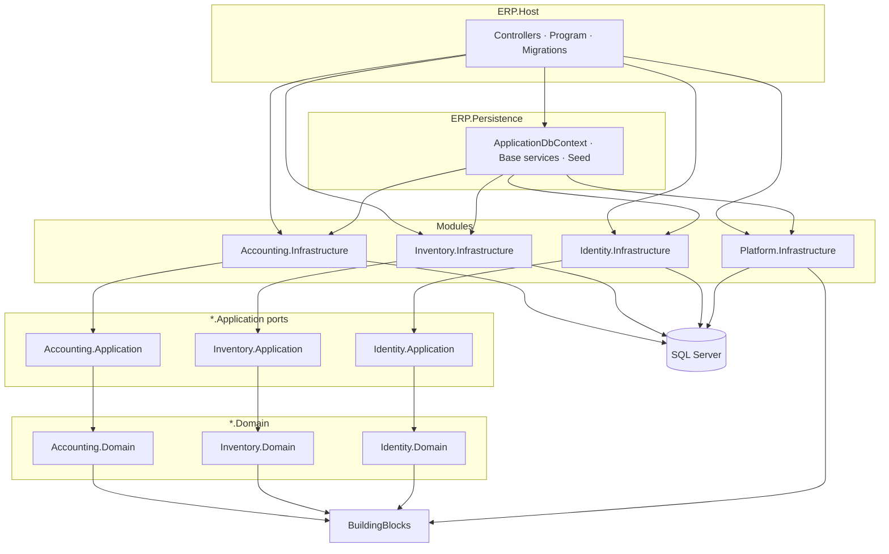
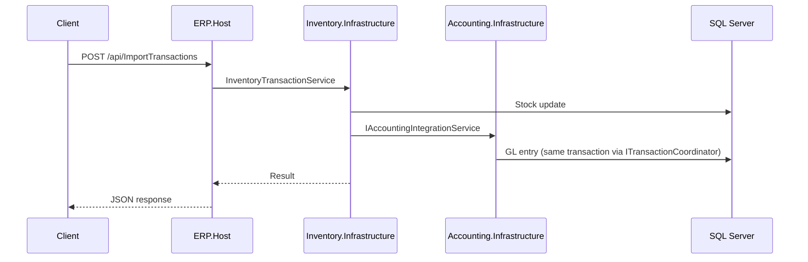

# AAA.ERP — Solution diagram

> **Last updated:** July 2026 — post Increment **6b** (`ERP.Host` rename)  
> **Canonical plan:** [MODULAR_MONOLITH.md](./MODULAR_MONOLITH.md)

## Project layout (actual)

```
AAA.ERP/
├── ERP.Host/                    # Composition root — HTTP, Swagger, EF migrations
├── ERP.Persistence/             # Shared EF kernel (ApplicationDbContext, base services)
├── BuildingBlocks/
│   ├── ERP.BuildingBlocks.Domain/
│   ├── ERP.BuildingBlocks.Application/
│   └── ERP.BuildingBlocks.Persistence/
├── Modules/
│   ├── Accounting/              # Domain · Application · Infrastructure
│   ├── Inventory/
│   ├── Identity/
│   └── Platform/                # Audit · Caching · Localization · Infrastructure
├── Shared/                      # Cross-cutting DTOs, constants, resources
└── Tests/
    ├── ERP.Architecture.Tests/
    ├── ERP.IntegrationTests/
    ├── ERP.SmokeTests/
    └── ERP.UnitTests/
```

## Dependency flow



## Module integration (cross-cutting)



## Enforcement

| Guard | Project |
|-------|---------|
| Layer dependencies | `Tests/ERP.Architecture.Tests/LayerDependencyTests.cs` |
| Module boundaries | `Tests/ERP.Architecture.Tests/ModuleBoundaryTests.cs` |
| Namespace debt | `Tests/ERP.Architecture.Tests/NamespaceDebtTests.cs` |

## EF migrations

Migrations live in **`ERP.Host/Migrations/`**. Design-time and runtime both use `MigrationsAssembly=ERP.Host`.

```bash
dotnet ef migrations add <Name> --project ERP.Host/ERP.Host.csproj --startup-project ERP.Host/ERP.Host.csproj
dotnet ef database update --project ERP.Host/ERP.Host.csproj --startup-project ERP.Host/ERP.Host.csproj
```
