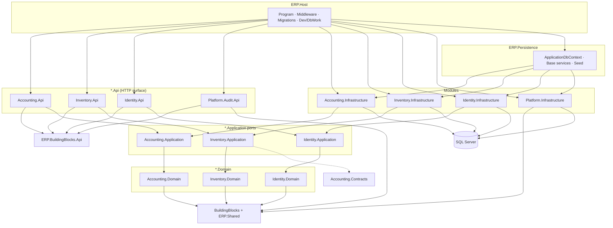
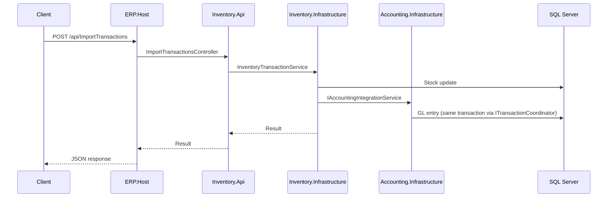

# AAA.ERP — Solution diagram

> **Last updated:** July 2026 — module-owned API migration complete ([PHASE_5_API_MIGRATION_SIGNOFF](./PHASE_5_API_MIGRATION_SIGNOFF.md))  
> **Migration history:** [MODULAR_MONOLITH.md](./MODULAR_MONOLITH.md)  
> **Active plan:** [ARCHITECTURE_ENHANCEMENT_PLAN.md](./ARCHITECTURE_ENHANCEMENT_PLAN.md)

## Project layout (actual)

Solution root is **flat** (no `src/` folder). Retired horizontal layers (`ERP.Application`, `ERP.Domain`, `ERP.Infrastracture`) and `ERP.Host/Controllers/` have been removed.

```
AAA.ERP/
├── ERP.Host/                    # Composition root — startup, Swagger, EF migrations, Dev/DbWork
├── ERP.Persistence/             # Shared EF kernel (ApplicationDbContext, base services)
├── BuildingBlocks/
│   ├── ERP.BuildingBlocks.Domain/
│   ├── ERP.BuildingBlocks.Application/
│   ├── ERP.BuildingBlocks.Api/      # Shared CRUD controller bases
│   ├── ERP.BuildingBlocks.Persistence/
│   └── ERP.Shared/                  # Solution folder; physical path: Shared/
├── Modules/
│   ├── Accounting/              # Domain · Application · Infrastructure · Contracts · Api (21)
│   ├── Inventory/               # Domain · Application · Infrastructure · Api (14)
│   ├── Identity/                # Domain · Application · Infrastructure · Api (Auth)
│   └── Platform/                # Audit.Api · Audit · Caching · Localization · Infrastructure
└── Tests/
    ├── ERP.Architecture.Tests/
    ├── ERP.IntegrationTests/
    ├── ERP.SmokeTests/
    └── ERP.UnitTests/
```

## Dependency flow



## Module integration (cross-cutting)



## Enforcement

| Guard | Project |
|-------|---------|
| Layer dependencies | `Tests/ERP.Architecture.Tests/LayerDependencyTests.cs` |
| Module boundaries | `Tests/ERP.Architecture.Tests/ModuleBoundaryTests.cs` |
| Module API isolation | `Tests/ERP.Architecture.Tests/ModuleApiLayerTests.cs` |
| Namespace debt | `Tests/ERP.Architecture.Tests/NamespaceDebtTests.cs` |

## EF migrations

Migrations live in **`ERP.Host/Migrations/`**. Design-time and runtime both use `MigrationsAssembly=ERP.Host`.

```bash
dotnet ef migrations add <Name> --project ERP.Host/ERP.Host.csproj --startup-project ERP.Host/ERP.Host.csproj
dotnet ef database update --project ERP.Host/ERP.Host.csproj --startup-project ERP.Host/ERP.Host.csproj
```
