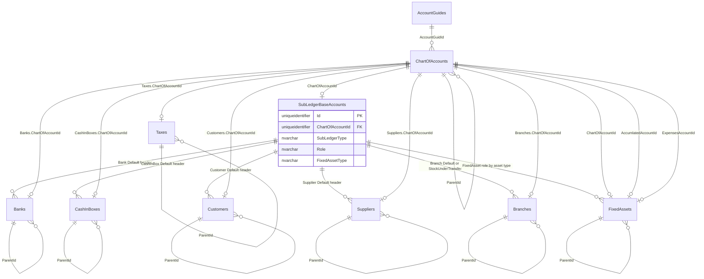
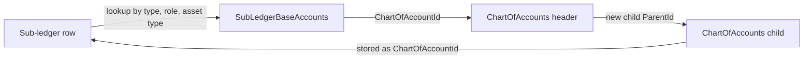

# Sub-ledgers and the chart of accounts

A sub-ledger row is the business party. The chart of accounts is the general-ledger tree those parties post to. They meet in two places: `SubLedgerBaseAccounts`, which names the parent account for a party family, and `ChartOfAccountId` on the party, which points at the child account created for that party.

All of these tables are in the `accounting` schema.

## Diagram

`SubLedgerBaseAccounts` sits between the chart of accounts and the party tables. One row appoints one chart-of-account node as the header for one posting role. Creating a party reads that row, then adds a child account under the header.

How a domain party is saved:

`ParentId` on a bank, customer, or other party is the folder inside that same table. It is not the chart-of-accounts parent. The chart parent is `ChartOfAccounts.ParentId` on the generated child, and that parent is the account named by `SubLedgerBaseAccounts`.

When `NodeType` is Domain (`0`), the server looks up `SubLedgerBaseAccounts`, creates a child row in `ChartOfAccounts`, and stores that child's id in the party's `ChartOfAccountId`. When `NodeType` is Category (`1`), the row is only a folder in the sub-ledger tree and `ChartOfAccountId` stays empty.

Tax does not use `SubLedgerBaseAccounts`. The user chooses the parent account. That parent must exist, be active, not be stopped, and must not itself be an account generated from a sub-ledger.

## Columns shared by the tree tables

`ChartOfAccounts` and every sub-ledger table (`Banks`, `CashInBoxes`, `Customers`, `Suppliers`, `Branches`, `Taxes`, `FixedAssets`) include these.

| Column | Meaning |
|---|---|
| `Id` | Primary key. |
| `Name` | Name, required, unique in that table, max 100. |
| `NameSecondLanguage` | Second-language name, required, unique, max 100. |
| `ParentId` | Parent row in the same table. Empty for a root. |
| `NodeType` | `0` Domain: a real party or account. `1` Category: a grouping folder. |
| `CreatedBy` | User who inserted the row. |
| `CreatedAt` | Insert time. |
| `ModifiedBy` | User who last changed the row. |
| `ModifiedAt` | Last change time. |

## `ChartOfAccounts`

One node in the general ledger. Child accounts created for parties copy nature, flags, and account guide from the parent found in `SubLedgerBaseAccounts`.

| Column | Meaning |
|---|---|
| `Code` | Account number, required, unique, max 100. A new child gets the next code under its parent. |
| `AccountGuidId` | Required foreign key to `AccountGuides`. Classifies the account. Children copy the parent's guide. |
| `AccountNature` | `Debit` or `Credit`. Children copy the parent. |
| `IsDepreciable` | Account participates in depreciation. Copied onto generated children. |
| `IsPostedAccount` | Account accepts journal postings. Copied onto generated children. |
| `IsStopDealing` | Account is blocked from new dealing. A tax parent with this set is rejected. |
| `IsActiveAccount` | Account is active. A tax parent must have this set. |
| `IsCreatedFromSubLeadger` | `true` when this row was generated for a party. Those rows cannot be chosen as a tax parent. |
| `SubLeadgerType` | Optional. Which party family this account belongs to: `Branch`, `Customer`, `Supplier`, `CashInBox`, `Bank`, `FixedAsset`, `Tax`. Set on accounts generated from a party. The column name is spelled `SubLeadger`. |

`AccountGuides` is only `Id`, `Name`, `NameSecondLanguage`, and the four audit columns. It is the classification list behind `AccountGuidId`.

## `SubLedgerBaseAccounts`

This is the configuration table drawn in the center of the diagram. One chart-of-account node is appointed as the header for one posting role. Creating a party reads this table, then adds a child under that header. On insert, `Id` is set to the same value as `ChartOfAccountId`, and `ChartOfAccountId` is unique, so one account can be only one header.

| Column | Meaning |
|---|---|
| `Id` | Primary key. Application code sets it equal to `ChartOfAccountId`. |
| `ChartOfAccountId` | Required, unique foreign key to the header account in `ChartOfAccounts`. |
| `SubLedgerType` | Required. Party family this header serves: `Branch`, `Customer`, `Supplier`, `CashInBox`, `Bank`, `FixedAsset`. Tax is not stored here. |
| `Role` | Required posting role. See the list below. |
| `FixedAssetType` | Required only when `SubLedgerType` is `FixedAsset`. Empty for every other type. Stored as the enum name. |
| Audit columns | `CreatedBy`, `CreatedAt`, `ModifiedBy`, `ModifiedAt`. This table has no name and no `ParentId`. |

`Role` values:

| Role | Used for |
|---|---|
| `Default` | The single header for bank, customer, supplier, cash box, and the normal branch account. |
| `StockUnderTransfer` | Branch header for inventory in transit. Inventory transfers read this. It is not `Branches.ChartOfAccountId`. |
| `Asset` | Fixed-asset cost header for one `FixedAssetType`. |
| `AccumulatedDepreciation` | Accumulated-depreciation header for that asset type. Lands do not have this row. |
| `DepreciationExpense` | Depreciation-expense header for that asset type. Lands do not have this row. |

`FixedAssetType` names: `Lands`, `Buildings`, `Equipment`, `ElectronicDevices`, `OfficeSupplies`, `Furniture`, `VehiclesAndTransportationItems`, `Tools`.

The unique key is `(SubLedgerType, Role)` when `FixedAssetType` is empty, and `(SubLedgerType, Role, FixedAssetType)` when it is set. Startup checks that every required combination exists exactly once.

## Columns shared by every sub-ledger table

| Column | Meaning |
|---|---|
| `ChartOfAccountId` | Optional foreign key to the child account created for this party. Empty on a category folder. |
| `Notes` | Free text, max 1000. |

## `Banks`

Resolved through `SubLedgerBaseAccounts` where `SubLedgerType = Bank` and `Role = Default`.

| Column | Meaning |
|---|---|
| `Phone` | Phone, max 300. |
| `Email` | Email, max 300. |
| `BankAccount` | Bank account number, max 300. |
| `BankAddress` | Address, max 300. |

## `CashInBoxes`

Resolved through `SubLedgerBaseAccounts` where `SubLedgerType = CashInBox` and `Role = Default`.

No columns beyond the shared tree, `ChartOfAccountId`, and `Notes`.

## `Customers` and `Suppliers`

Resolved through `SubLedgerBaseAccounts` where `SubLedgerType` is `Customer` or `Supplier` and `Role = Default`.

Same extra columns on both tables.

| Column | Meaning |
|---|---|
| `CustomerType` | Optional classification, stored as text: `Consumer`, `WholeSale`, `SemiWholesale`, `Distributor`, `Online`. |
| `Phone` | Phone, max 300. |
| `Mobile` | Mobile, max 300. |
| `Email` | Email, max 300. |
| `TaxNumber` | Tax registration number, max 300. |
| `Address` | Address, unlimited text. |

## `Branches`

The branch's own ledger account comes from `SubLedgerType = Branch` and `Role = Default`. Inventory in transit uses a second binding on the same table: `SubLedgerType = Branch` and `Role = StockUnderTransfer`. That second account is not stored on the branch row.

| Column | Meaning |
|---|---|
| `Phone` | Phone, unlimited text. |
| `Address` | Address, unlimited text. |
| `AttachmentId` | Optional foreign key to `Attachments`. Clearing the link sets it to null. This is the branch file, usually the logo. |

## `Taxes`

| Column | Meaning |
|---|---|
| `Percent` | Tax rate, `decimal(18,4)`. |

The parent account is chosen by the user at create time. There is no `SubLedgerBaseAccounts` row for tax. The generated child still lands in `ChartOfAccountId`, with `IsCreatedFromSubLeadger = true` and `SubLeadgerType = Tax`.

## `FixedAssets`

Each asset type has its headers in `SubLedgerBaseAccounts` (`SubLedgerType = FixedAsset`, `FixedAssetType` set, `Role` one of `Asset`, `AccumulatedDepreciation`, `DepreciationExpense`). A depreciable asset gets three chart-of-account children. Lands get only the asset account.

| Column | Meaning |
|---|---|
| `ChartOfAccountId` | Child under the `Asset` header for this asset's type. |
| `AccumlatedAccountId` | Child under the `AccumulatedDepreciation` header. Column spelling is `Accumlated`. Empty for lands and for category folders. |
| `ExpensesAccountId` | Child under the `DepreciationExpense` header. Empty for lands and for category folders. |
| `FixedAssetType` | Optional integer: `0` Lands, `1` Buildings, `2` Equipment, `3` ElectronicDevices, `4` OfficeSupplies, `5` Furniture, `6` VehiclesAndTransportationItems, `7` Tools. |
| `Serial` | Serial number, max 300. |
| `Model` | Model, max 300. |
| `Version` | Version, max 300. |
| `ManufactureCompany` | Manufacturer, max 300. |
| `IsDepreciable` | Whether this asset depreciates. |
| `AssetLifeSpanByYears` | Useful life in years. Stored as `0` when the asset is not depreciable. |
| `DepreciationRate` | Depreciation rate. Stored as `0` when the asset is not depreciable. |

The two extra accounts are named from the header's parent name plus the asset name, and they copy that header's nature, flags, and account guide.

## Related

- [ADR-007 — Sub-ledger COA parent resolution](adr/007-subledger-coa-parent-resolution.md)
